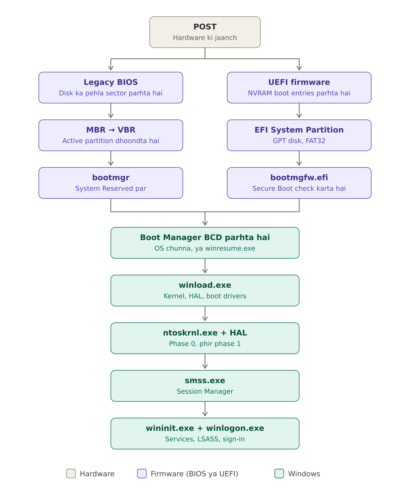

# Bari tasveer (Big picture)

Boot process ke chaar stages hain. Har stage agle stage ko dhoondti hai, usay check karti hai aur control us ke hawale kar deti hai:

1. **Hardware**: POST (Power-On Self-Test)
2. **Firmware**: BIOS ya UEFI Windows boot loader ko dhoondta hai
3. **Windows loader**: Boot Manager → BCD → winload.exe
4. **Windows kernel aur sign-in**: ntoskrnl.exe + HAL → smss.exe → wininit / winlogon → LSASS

**Yaad rakhne ka tareeqa:** *Power → Firmware → Manager → Loader → Kernel → Sessions → Logon.*

**Poora sequence ek nazar mein:**

- POST → **Legacy BIOS** → MBR → Volume Boot Record → `bootmgr`
- POST → **UEFI** → EFI System Partition → `bootmgfw.efi` (Secure Boot is ko check karta hai)
- Dono raaste → Boot Manager **BCD** parhta hai → `winresume.exe` (agar hibernation se wapas aa rahe hon) *ya* `winload.exe`
- `winload.exe` → `ntoskrnl.exe` + `hal.dll` → `smss.exe` → `wininit.exe` + `winlogon.exe` → `lsass.exe` → desktop

# Boot flowchart

# Stage 1: POST (Power-On Self-Test)

Jab aap power button dabate hain to power supply motherboard ke zariye power bhejti hai. Phir firmware buniyadi hardware check karta hai: CPU, RAM, storage controllers aur video.

- Agar koi check fail ho jaye to machine **beep codes, LEDs ya screen par messages** ke zariye batati hai. Yeh patterns har vendor ke mukhtalif hote hain, is liye unhein samajhne ke liye vendor ki documentation dekhein.
- Enterprise servers par **out-of-band management console** istemal karein: HPE par **iLO** aur Dell PowerEdge par **iDRAC**. Yeh hardware health aur fault logs dikhata hai, chahe OS start na bhi ho raha ho.
- Agar hardware par **vendor support contract** hai to screenshots aur logs jama karein aur support case open karein. Vendor fault diagnose kar sakta hai, parts bhej sakta hai, aur contract ke mutabiq data center mein engineer bhi bhej sakta hai.

**Class ka sabaq:** Instructor ke case mein alarm RAM ki taraf ishara kar raha tha. Memory badli gayi, lekin wahi error dobara aaya. Asal kharabi **motherboard** mein thi. POST alarms batate hain ke investigation kahan se shuru karni hai, lekin zaroori nahin ke woh hamesha kharab part ka sahi naam batayein.

# Stage 2: Firmware (BIOS ya UEFI)

Jab POST pass ho jata hai to firmware apni settings ki madad se faisla karta hai ke kya boot karna hai. Aap ke instructor ne isay "mini OS" kaha tha, jo samajhne ka acha tareeqa hai. Is ki settings mein yeh shamil hain:

- **Boot order**: machine pehle USB, network (PXE) ya andar wali disk mein se kis ko try karegi. Bootable USB tabhi chalegi jab boot order is ki ijazat de.
- **Date aur time** (real-time clock)
- **CPU aur memory options**, jin mein **hardware virtualization** (Intel VT-x / AMD-V) bhi shamil hai. Hyper-V aur VMware ko is ki zaroorat hoti hai.
- **Firmware password aur Secure Boot**: yeh do alag features hain. Corrections wala section dekhein.

**CMOS / RTC battery:** Yeh ek coin cell hai, ghari ki battery jaisa. Machine band hone par yeh clock ko chalata rehta hai. Purani machines mein yeh un settings wali memory ko bhi power deta tha. Agar yeh kharab ho jaye to date aur time reset ho jate hain aur settings bhi zaya ho sakti hain.

## Raasta A: Legacy BIOS + MBR disk

1. BIOS boot disk ka pehla sector, yani **Master Boot Record (MBR)**, memory mein address `0000:7C00` par load karta hai.
2. MBR ka code partition table parhta hai aur **active** partition dhoondta hai.
3. Woh us partition ka **Volume Boot Record** (NT boot sector, taqreeban 8 KB code) load karta hai, jo NTFS aur FAT32 parh sakta hai.
4. Boot sector **System Reserved** partition ke root se **`bootmgr`** load karta hai.

## Raasta B: UEFI + GPT disk (aaj kal ka default)

1. UEFI apni **boot entries** parhta hai, jo firmware memory (NVRAM) mein save hoti hain.
2. Woh **EFI System Partition (ESP)** kholta hai, jo **GPT** disk par ek chhota FAT32 partition hai.
3. Agar **Secure Boot** on hai to woh check karta hai ke boot loader par ek qabil-e-aitmaad (trusted) digital signature hai.
4. Woh **`\EFI\Microsoft\Boot\bootmgfw.efi`** (Windows Boot Manager) ko seedha chalata hai. Is mein na MBR boot code hota hai na "active partition".

**Aham usool:** Firmware mode aur disk style match hone chahiye. **BIOS ke saath MBR, aur UEFI ke saath GPT.** Isi wajah se **Rufus** jaise tools installation media banate waqt MBR ya GPT poochte hain. Windows install ya repair karte waqt bhi yeh baat aham hai.

**Interview mein kaun sa raasta batayein?** Woh jo machine waqai istemal kar rahi hai. Modern servers UEFI istemal karte hain, is liye UEFI se shuru karein, aur zikr karein ke legacy BIOS MBR wala raasta istemal karta hai.

# Stage 3: Windows Boot Manager → BCD → winload.exe

Yahan se dono raaste ek jaise hain.

1. **Boot Manager BCD (Boot Configuration Data) parhta hai.** BCD ek chhota database hai jis mein installed operating systems ki list hoti hai: woh kahan hain aur un ke options kya hain, jaise safe mode aur debugging. Agar ek se zyada entry ho to boot menu nazar aata hai. Isay dekhne ya badalne ke liye `bcdedit` istemal karein.
2. **Hibernation se wapsi:** Agar hibernation file maujood ho to Boot Manager **`winresume.exe`** chalata hai. Yeh poora start karne ke bajaye saved memory image dobara load karta hai. Isi liye hibernation se wapas aana cold boot se tez hota hai.
3. **Normal start:** Boot Manager **`winload.exe`** chalata hai, jo memory mein yeh cheezein load karta hai:
    - **`ntoskrnl.exe`**, Windows kernel
    - **`hal.dll`**, Hardware Abstraction Layer, jo hardware platforms ke farq ko kernel se chhupata hai
    - **SYSTEM registry hive**
    - **boot-start drivers**, jaise storage aur file-system drivers. In ke baghair kernel disk nahin parh sakta.
4. winload.exe ek structure (*loader parameter block*) banata hai jo memory aur boot options ko bayan karta hai. Phir control kernel ke hawale kar deta hai. 64-bit systems par is handoff ke dauran CPU 64-bit mode mein chala jata hai.

**Tareekh (History):** **NTLDR** Windows XP aur Server 2003 ka boot loader tha. Windows Vista aur Server 2008 se is ka kaam **bootmgr** aur **winload.exe** mein taqseem ho gaya.

**Jab boot files kharab ho jayein:** Windows Recovery Environment (WinRE) ya installation media → *Repair your computer* istemal karein. Tools mein Startup Repair, `bootrec`, `bcdboot` aur `bcdedit` shamil hain.

# Stage 4: Kernel, Session Manager aur sign-in

1. **`ntoskrnl.exe` do phases mein start hota hai.**
    - **Phase 0** kernel ko khud chalu karta hai: buniyadi memory management aur core kernel structures (`KiInitializeKernel`).
    - **Phase 1** baqi system ko chalu karta hai: HAL, object manager, I/O system aur device drivers.
    - Phir kernel pehla user-mode process, smss.exe, start karta hai.
2. **`smss.exe` (Session Manager)**
    - baqi registry load karta hai aur page file aur environment variables set karta hai.
    - Win32 subsystem start karta hai: **`win32k.sys`** (kernel side) aur **`csrss.exe`** (user side).
    - Session 0 mein **`wininit.exe`** aur user session mein **`winlogon.exe`** start karta hai.
3. **`wininit.exe`** yeh start karta hai:
    - **`services.exe`** (Service Control Manager), jo Windows services aur baqi drivers start karta hai.
    - **`lsass.exe`** (Local Security Authority), jo authentication aur security policy sambhalta hai.
4. **`winlogon.exe`** logon screen dikhata hai aur **Ctrl+Alt+Del** sambhalta hai.
5. **Sign-in:** Winlogon aap ki credentials **LSASS** ko deta hai.
    - **Local account** ke liye LSASS unhein **SAM** database (`C:\Windows\System32\config\SAM`) se check karta hai.
    - **Domain account** ke liye woh unhein **domain controller** se check karta hai, aam taur par Kerberos ke zariye. NTLM fallback hai.
6. Aap ka user profile load hota hai aur **`explorer.exe`** desktop start karta hai.

# Course material mein corrections

- **PDF step 2 (bootmgr ki jagah):** bootmgr `system32` mein **nahin** hota. Legacy BIOS par yeh **System Reserved** partition ke root par hota hai. UEFI par yeh **EFI System Partition** par `bootmgfw.efi` hota hai.
- **PDF step 11 (LSASS):** smss.exe LSASS ko seedha start **nahin** karta. Woh **wininit.exe** start karta hai, aur wininit LSASS aur services.exe start karta hai. PDF mein wininit ka zikr hi nahin hai.
- **PDF step 8 (typo):** "KilInitializeKernel" ki jagah **`KiInitializeKernel`** hona chahiye.
- **PDF flowchart:** Is mein sirf **legacy BIOS/MBR** wala raasta hai. UEFI systems MBR aur Volume Boot Record wale steps skip kar dete hain.
- **Class notes ("Secure Boot"):** **BIOS/UEFI password** aur **UEFI Secure Boot** do **alag** features hain. Password ghair mutalliqa afraad ko machine boot karne ya firmware settings badalne se rokta hai. Secure Boot digital signatures check karta hai taake sirf trusted boot loaders aur drivers chalein, jo bootkits se bachata hai.

# 30 second ka interview jawab

> "Jab server on hota hai to firmware POST chala kar hardware check karta hai. Server par faults iLO ya iDRAC mein nazar aate hain. Firmware, jo aaj kal aam taur par UEFI hota hai, phir boot order ke mutabiq EFI System Partition dhoondta hai aur Windows Boot Manager chalata hai, jab Secure Boot us ki signature check kar leta hai. Legacy BIOS par woh MBR aur partition boot sector parhta hai, jo bootmgr load karte hain. Boot Manager BCD parh kar faisla karta hai ke kya boot karna hai, ya winresume ke zariye hibernation se wapas aata hai. winload.exe kernel, HAL, SYSTEM hive aur boot drivers load karta hai. Kernel do phases mein start hota hai aur smss.exe chalata hai. Session Manager wininit start karta hai, jo services aur LSASS start karta hai, aur winlogon start karta hai, jo logon screen dikhata hai. Jab user sign in karta hai to LSASS credentials ko local SAM ya domain controller se check karta hai, aur desktop load ho jata hai."

**Tip:** Aap ke instructor ne kaha tha ke interview ke jawab ko zyada complicated na karein. Pehle stages saaf saaf batayein, phir interviewer poochay to tafseel dein.

# Lab VM mein khud check karein

Yeh cheezein VMware Workstation mein apne Windows Server 2019 / 2022 / 2025 VMs par try karein:

- **`msinfo32`**: *BIOS Mode* (UEFI ya Legacy) aur *Secure Boot State* dekhein.
- **`bcdedit`** (admin command prompt mein): Boot Manager aur boot loader ki entries dikhata hai, `winload` ka path bhi.
- **Disk Management** (`diskmgmt.msc`): **EFI System Partition** (UEFI) ya **System Reserved** partition (BIOS) dhoondein, aur dekhein ke disk MBR hai ya GPT.
- **Task Manager → Performance → CPU**: dekhein ke *Virtualization* Enabled likha hai.
- **Task Manager → Details**: `smss.exe`, `csrss.exe`, `wininit.exe`, `winlogon.exe`, `services.exe` aur `lsass.exe` dhoondein.

# Self-quiz

1. POST ka matlab kya hai aur yeh kya karta hai?
2. Agar HPE server boot na ho raha ho to hardware fault logs kahan dekhenge? Dell mein is ka mutabadil kya hai?
3. CMOS battery kya karti hai, aur is ke kharab hone ki kya nishani hai?
4. Legacy BIOS ke saath kaun sa partition style chalta hai, aur UEFI ke saath kaun sa?
5. UEFI system par Windows Boot Manager ki file ka naam kya hai, aur yeh kis partition par hoti hai?
6. BCD kya hai, aur kaun si command se isay dekh sakte hain?
7. Jab machine hibernation se wapas aati hai to winload.exe ki jagah kaun si file chalti hai?
8. winload.exe memory mein jo cheezein load karta hai, un mein se chaar ke naam batayein.
9. HAL kya karta hai?
10. Pehla user-mode process kaun sa hai, aur woh kya start karta hai?
11. LSASS ko kaun sa process start karta hai?
12. Local SAM database kahan save hota hai, aur domain user ka password kaun check karta hai?
13. Firmware password aur Secure Boot mein kya farq hai?
14. NTLDR ki jagah kis ne li, aur kaun se Windows versions se?

## Jawabat (Answers)

1. **Power-On Self-Test.** Firmware boot se pehle buniyadi hardware (CPU, RAM, storage, video) check karta hai aur faults ko beep codes, LEDs ya messages ke zariye batata hai.
2. HPE par **iLO** (Integrated Lights-Out); Dell PowerEdge par **iDRAC**.
3. Yeh power band hone par real-time clock ko chalata rehta hai. Purane systems mein yeh firmware settings bhi mehfooz rakhta tha. Kharab hone par **date aur time reset** ho jate hain aur settings zaya ho sakti hain.
4. **BIOS ke saath MBR; UEFI ke saath GPT.**
5. **`bootmgfw.efi`**, **EFI System Partition** (FAT32) par, `\EFI\Microsoft\Boot\` mein.
6. **Boot Configuration Data**: boot entries aur un ke options ka database. **`bcdedit`** se dekhein.
7. **`winresume.exe`**.
8. In mein se koi chaar: **`ntoskrnl.exe`**, **`hal.dll`**, **SYSTEM registry hive**, **boot-start drivers**.
9. Yeh **hardware platforms ke farq ko kernel se chhupata hai**, taake kernel ko har qism ke motherboard ya chipset ke liye alag code na chahiye ho.
10. **`smss.exe`** (Session Manager). Yeh Win32 subsystem (`csrss.exe` / `win32k.sys`), **`wininit.exe`** aur **`winlogon.exe`** start karta hai.
11. **`wininit.exe`**.
12. `C:\Windows\System32\config\SAM`. Domain users ko **domain controller** check karta hai, aam taur par Kerberos ke zariye.
13. Firmware password **yeh control karta hai ke kaun machine boot kar sakta hai ya settings badal sakta hai**. Secure Boot **digital signatures check karta hai** taake sirf trusted boot code chale.
14. **bootmgr + winload.exe**, **Windows Vista / Server 2008** se.
