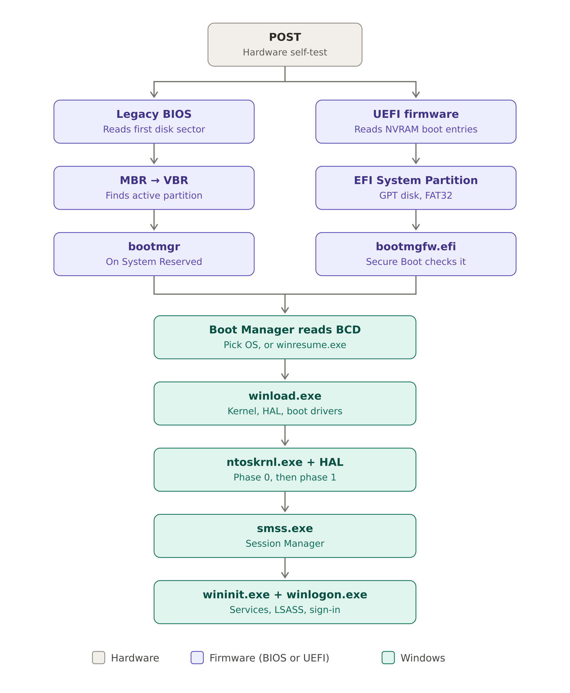

# The big picture

The boot process has four stages. Each stage finds the next one, checks it and hands over control:

1. **Hardware**: POST (Power-On Self-Test)
2. **Firmware**: BIOS or UEFI finds the Windows boot loader
3. **Windows loader**: Boot Manager → BCD → winload.exe
4. **Windows kernel and sign-in**: ntoskrnl.exe + HAL → smss.exe → wininit / winlogon → LSASS

**Memory hook:** *Power → Firmware → Manager → Loader → Kernel → Sessions → Logon.*

**The full sequence at a glance:**

- POST → **Legacy BIOS** → MBR → Volume Boot Record → `bootmgr`
- POST → **UEFI** → EFI System Partition → `bootmgfw.efi` (checked by Secure Boot)
- Both routes → Boot Manager reads **BCD** → `winresume.exe` (when resuming from hibernation) *or* `winload.exe`
- `winload.exe` → `ntoskrnl.exe` + `hal.dll` → `smss.exe` → `wininit.exe` + `winlogon.exe` → `lsass.exe` → desktop

# The boot flowchart

# Stage 1: POST (Power-On Self-Test)

When you press the power button, the power supply sends power through the motherboard. The firmware then checks the basic hardware: CPU, RAM, storage controllers and video.

- When a check fails, the machine reports it with **beep codes, LEDs or messages on the screen**. These patterns differ by vendor, so check the vendor's documentation to read them.
- On enterprise servers, use the **out-of-band management console**: **iLO** on HPE and **iDRAC** on Dell PowerEdge. It shows hardware health and fault logs even when no OS will start.
- When the hardware is covered by a **vendor support contract**, collect screenshots and logs and open a support case. The vendor can diagnose the fault, ship parts and, depending on the contract, send an engineer to the data center.

**Lesson from class:** In the instructor's case, the alarm pointed to RAM. The memory was replaced, but the same error came back. The real fault was the **motherboard**. POST alarms tell you where to start investigating, but they don't always name the failed part.

# Stage 2: Firmware (BIOS or UEFI)

Once POST passes, the firmware uses its settings to decide what to boot. Your instructor called it a "mini OS," which is a useful way to think about it. Its settings include:

- **Boot order**: whether the machine tries USB, network (PXE) or the internal disk first. A bootable USB only works if the boot order allows it.
- **Date and time** (the real-time clock)
- **CPU and memory options**, including **hardware virtualization** (Intel VT-x / AMD-V). Hyper-V and VMware need it.
- **Firmware password and Secure Boot**: these are two different features. See the corrections section.

**CMOS / RTC battery:** This is a coin cell, like a watch battery. It keeps the clock running while the machine is off. On older machines it also powered the memory that held the settings. When it fails, the date and time reset and settings may be lost.

## Route A: Legacy BIOS + MBR disk

1. The BIOS reads the first sector of the boot disk, the **Master Boot Record (MBR)**, into memory at address `0000:7C00`.
2. The MBR code reads the partition table and finds the **active** partition.
3. It loads that partition's **Volume Boot Record** (the NT boot sector, about 8 KB of code), which can read NTFS and FAT32.
4. The boot sector loads **`bootmgr`** from the root of the **System Reserved** partition.

## Route B: UEFI + GPT disk (the modern default)

1. UEFI reads its **boot entries**, which are stored in firmware memory (NVRAM).
2. It opens the **EFI System Partition (ESP)**, a small FAT32 partition on a **GPT** disk.
3. If **Secure Boot** is on, it checks that the boot loader has a trusted digital signature.
4. It runs **`\EFI\Microsoft\Boot\bootmgfw.efi`** (the Windows Boot Manager) directly. There is no MBR boot code and no "active partition."

**Key rule:** The firmware mode and the disk style must match. **BIOS goes with MBR, and UEFI goes with GPT.** This is why tools such as **Rufus** ask for MBR or GPT when you create installation media. It also matters when you install or repair Windows.

**Which route should you describe in an interview?** Describe the one the machine actually uses. Modern servers use UEFI, so lead with that, and mention that legacy BIOS uses the MBR route.

# Stage 3: Windows Boot Manager → BCD → winload.exe

From here, both routes are the same.

1. **Boot Manager reads the BCD (Boot Configuration Data).** The BCD is a small database that lists the installed operating systems, where they are, and their options, such as safe mode and debugging. If there is more than one entry, you see a boot menu. Use `bcdedit` to view or change it.
2. **Resuming from hibernation:** If a hibernation file is present, Boot Manager runs **`winresume.exe`**. It reloads the saved memory image instead of doing a full start, which is why resuming is faster than a cold boot.
3. **Normal start:** Boot Manager runs **`winload.exe`**, which loads into memory:
    - **`ntoskrnl.exe`**, the Windows kernel
    - **`hal.dll`**, the Hardware Abstraction Layer, which hides differences between hardware platforms from the kernel
    - the **SYSTEM registry hive**
    - the **boot-start drivers**, such as storage and file-system drivers. Without them, the kernel couldn't read the disk.
4. winload.exe builds a structure (the *loader parameter block*) that describes memory and the boot options. Then it hands control to the kernel. On 64-bit systems, the CPU switches to 64-bit mode during this handoff.

**History:** **NTLDR** was the boot loader for Windows XP and Server 2003. From Windows Vista and Server 2008 onward, its job was split between **bootmgr** and **winload.exe**.

**When boot files are damaged:** Use the Windows Recovery Environment (WinRE) or the installation media → *Repair your computer*. Tools include Startup Repair, `bootrec`, `bcdboot` and `bcdedit`.

# Stage 4: Kernel, Session Manager and sign-in

1. **`ntoskrnl.exe` starts in two phases.**
    - **Phase 0** gets the kernel itself running: basic memory management and core kernel structures (`KiInitializeKernel`).
    - **Phase 1** brings up the rest of the system: HAL, the object manager, the I/O system and the device drivers.
    - The kernel then starts the first user-mode process, smss.exe.
2. **`smss.exe` (Session Manager)**
    - loads the rest of the registry and sets up the page file and environment variables.
    - starts the Win32 subsystem: **`win32k.sys`** (kernel side) and **`csrss.exe`** (user side).
    - starts **`wininit.exe`** in Session 0 and **`winlogon.exe`** in the user session.
3. **`wininit.exe`** starts:
    - **`services.exe`** (the Service Control Manager), which starts Windows services and the remaining drivers.
    - **`lsass.exe`** (the Local Security Authority), which handles authentication and security policy.
4. **`winlogon.exe`** shows the logon screen and handles **Ctrl+Alt+Del**.
5. **Sign-in:** Winlogon passes your credentials to **LSASS**.
    - For a **local account**, LSASS checks them against the **SAM** database at `C:\Windows\System32\config\SAM`.
    - For a **domain account**, it checks them against a **domain controller**, normally with Kerberos. NTLM is the fallback.
6. Your user profile loads, and **`explorer.exe`** starts the desktop.

# Corrections to the course materials

- **PDF step 2 (bootmgr location):** bootmgr is **not** in `system32`. On legacy BIOS it sits at the root of the **System Reserved** partition. On UEFI it is `bootmgfw.efi` on the **EFI System Partition**.
- **PDF step 11 (LSASS):** smss.exe does **not** start LSASS directly. It starts **wininit.exe**, and wininit starts LSASS and services.exe. The PDF leaves wininit out entirely.
- **PDF step 8 (typo):** "KilInitializeKernel" should read **`KiInitializeKernel`**.
- **PDF flowchart:** It shows only the **legacy BIOS/MBR** route. UEFI systems skip the MBR and Volume Boot Record steps.
- **Class notes ("Secure Boot"):** A **BIOS/UEFI password** and **UEFI Secure Boot** are **different** features. The password stops people from booting the machine or changing firmware settings. Secure Boot checks digital signatures so that only trusted boot loaders and drivers run, which protects against bootkits.

# A 30-second interview answer

> "When a server powers on, the firmware runs POST to check the hardware. On a server, faults show up in iLO or iDRAC. The firmware, which today is usually UEFI, then uses the boot order to find the EFI System Partition and run the Windows Boot Manager, after Secure Boot checks its signature. On legacy BIOS, it reads the MBR and the partition boot sector, which load bootmgr. Boot Manager reads the BCD to decide what to boot, or resumes from hibernation with winresume. winload.exe loads the kernel, the HAL, the SYSTEM hive and the boot drivers. The kernel starts in two phases and launches smss.exe. Session Manager starts wininit, which starts services and LSASS, and winlogon, which shows the logon screen. When the user signs in, LSASS checks the credentials against the local SAM or a domain controller, and the desktop loads."

**Tip:** Your instructor advised against overcomplicating interview answers. Give the stages clearly first, then add detail when the interviewer asks.

# Hands-on checks in your lab VM

Try these on your Windows Server 2019 / 2022 / 2025 VMs in VMware Workstation:

- **`msinfo32`**: look at *BIOS Mode* (UEFI or Legacy) and *Secure Boot State*.
- **`bcdedit`** (in an admin command prompt): shows the Boot Manager and boot loader entries, including the path to `winload`.
- **Disk Management** (`diskmgmt.msc`): find the **EFI System Partition** (UEFI) or the **System Reserved** partition (BIOS), and check whether the disk is MBR or GPT.
- **Task Manager → Performance → CPU**: check that *Virtualization* shows Enabled.
- **Task Manager → Details**: find `smss.exe`, `csrss.exe`, `wininit.exe`, `winlogon.exe`, `services.exe` and `lsass.exe`.

# Self-quiz

1. What does POST stand for, and what does it do?
2. On an HPE server that won't boot, where would you look for hardware fault logs? What is the Dell equivalent?
3. What does the CMOS battery do, and what symptom shows that it has failed?
4. Which disk partition style goes with legacy BIOS, and which goes with UEFI?
5. On a UEFI system, what is the file name of the Windows Boot Manager, and which partition is it on?
6. What is the BCD, and which command lets you view it?
7. Which file runs instead of winload.exe when the machine resumes from hibernation?
8. Name four things that winload.exe loads into memory.
9. What does the HAL do?
10. What is the first user-mode process, and what does it start?
11. Which process starts LSASS?
12. Where is the local SAM database stored, and what checks a domain user's password?
13. What is the difference between a firmware password and Secure Boot?
14. What replaced NTLDR, and starting with which Windows versions?

## Answers

1. **Power-On Self-Test.** The firmware checks the basic hardware (CPU, RAM, storage, video) before booting and reports faults with beep codes, LEDs or messages.
2. **iLO** (Integrated Lights-Out) on HPE; **iDRAC** on Dell PowerEdge.
3. It keeps the real-time clock running while the power is off. On older systems it also kept the firmware settings. When it fails, the **date and time reset** and settings may be lost.
4. **BIOS uses MBR; UEFI uses GPT.**
5. **`bootmgfw.efi`**, on the **EFI System Partition** (FAT32), at `\EFI\Microsoft\Boot\`.
6. **Boot Configuration Data**: a database of boot entries and their options. View it with **`bcdedit`**.
7. **`winresume.exe`**.
8. Any four of: **`ntoskrnl.exe`**, **`hal.dll`**, the **SYSTEM registry hive**, the **boot-start drivers**.
9. It **hides hardware-platform differences** from the kernel, so the kernel doesn't need code for each type of motherboard or chipset.
10. **`smss.exe`** (Session Manager). It starts the Win32 subsystem (`csrss.exe` / `win32k.sys`), **`wininit.exe`** and **`winlogon.exe`**.
11. **`wininit.exe`**.
12. `C:\Windows\System32\config\SAM`. A **domain controller** checks domain users, normally with Kerberos.
13. A firmware password **controls who can boot the machine or change its settings**. Secure Boot **checks digital signatures** so that only trusted boot code runs.
14. **bootmgr + winload.exe**, starting with **Windows Vista / Server 2008**.
