# Install Windows Server 2019 in VMware Workstation Pro (Beginner Lab Guide)

**Language:** English | [Roman Urdu](README.roman-urdu.md)

Part of the [Wintel Lab](../README.md) series.

A step-by-step, screenshot-by-screenshot guide to building a **Windows Server 2019** virtual machine on a **Windows 10** computer using **VMware Workstation Pro 25H2**.

It was written by a student, for students. Every step has a short **"Why?"** so you understand what you are doing, not just which button to click.

## What is in this bundle

| File | What it is for |
|------|----------------|
| [README.md](README.md) / [Roman Urdu](README.roman-urdu.md) | This guide. Follow it from top to bottom. |
| [TROUBLESHOOTING.md](TROUBLESHOOTING.md) / [Roman Urdu](TROUBLESHOOTING.roman-urdu.md) | Problems I hit, why they happened, and how I fixed them. Read this if you get stuck. |
| [INTERVIEW-QA.md](INTERVIEW-QA.md) / [Roman Urdu](INTERVIEW-QA.roman-urdu.md) | 25 beginner interview questions and answers about what you just did. |
| [quiz.html](quiz.html) | A 25-question practice quiz. Download it and open it in any browser. It works offline. |
| [images/](images/) | All the screenshots used in this guide. |

## Contents

1. [Key words explained](#1-key-words-explained)
2. [Before you start (prerequisites checklist)](#2-before-you-start-prerequisites-checklist)
3. [The settings used in this lab](#3-the-settings-used-in-this-lab)
4. [Part A: Check your computer](#part-a-check-your-computer)
5. [Part B: Create the virtual machine](#part-b-create-the-virtual-machine)
6. [Part C: Customize the hardware](#part-c-customize-the-hardware)
7. [Part D: Fix the firmware before first boot](#part-d-fix-the-firmware-before-first-boot)
8. [Part E: Install Windows Server 2019](#part-e-install-windows-server-2019)
9. [Part F: First login and finishing touches](#part-f-first-login-and-finishing-touches)
10. [Handy keyboard shortcuts](#handy-keyboard-shortcuts)
11. [What to do next](#what-to-do-next)
12. [Reusing this bundle for other Windows versions](#reusing-this-bundle-for-other-windows-versions)

---

## 1. Key words explained

Read this once. Every word below appears later in the guide.

| Word | Simple meaning |
|------|----------------|
| **Host** | Your real, physical computer (here: a Windows 10 PC). |
| **Virtual machine (VM)** | A "computer inside your computer". It is really just a few files on your disk, but it behaves like a separate PC. |
| **Guest OS** | The operating system installed *inside* the VM (here: Windows Server 2019). |
| **Hypervisor** | The software that runs VMs. VMware Workstation Pro is a hypervisor. |
| **ISO file** | A single file that is an exact copy of an installation DVD. The VM "reads" it like a disc. |
| **Virtualization (VT-x / AMD-V)** | A CPU feature that lets VMs run fast. It must be **Enabled**. |
| **vCPU / core** | A slice of your real processor that you give to the VM. |
| **RAM / memory** | Short-term working memory. The VM borrows some of yours while it runs. |
| **Virtual disk (.vmdk)** | The file(s) that act as the VM's hard drive. |
| **Firmware (BIOS / UEFI)** | The tiny program that starts a computer before Windows loads. BIOS is the older style, UEFI is the newer one. |
| **Bridged / NAT / Host-only** | Three ways to connect the VM to a network. Explained in [Step 12](#step-12-network-adapter-bridged). |
| **Edition** | A version of Windows Server with a different feature set and price (Standard, Datacenter). |
| **Desktop Experience** | Windows Server *with* the normal Windows desktop. Without it you get **Server Core**: command line only. |
| **Evaluation** | A free, full trial of Windows Server that works for **180 days** without a product key. |
| **VMware Tools** | Drivers you install inside the guest so the VM runs smoothly (better mouse, screen size, clock sync). |

---

## 2. Before you start (prerequisites checklist)

Tick each box before you begin.

- [ ] **A 64-bit computer** with at least **4 CPU cores** and **16 GB RAM** (8 GB is the bare minimum, but it will be slow).
- [ ] **Virtualization is Enabled** (check in Task Manager, see [Step 00b](#step-00b-check-the-cpu-and-virtualization)). If it says *Disabled*, turn on "Intel VT-x" or "AMD-V/SVM" in your PC's BIOS setup.
- [ ] **At least 80 GB of free disk space**, ideally on a drive that is *not* inside OneDrive.
- [ ] **VMware Workstation Pro** installed (this guide uses 25H2, which is free for personal use).
- [ ] **The Windows Server 2019 ISO file** downloaded. The free evaluation is on the Microsoft Evaluation Center (search "Windows Server 2019 Evaluation Center").
- [ ] **A strong password** ready for the Administrator account (at least 8 characters, with upper case, lower case, numbers and symbols). Write it down somewhere safe. **Never put it in GitHub.**
- [ ] About **1 hour** of time.

---

## 3. The settings used in this lab

Use this as your "cheat sheet". If your computer is smaller, see the notes in each step.

| Setting | Value used | Where it is set |
|---------|------------|-----------------|
| Host | Windows 10 Pro, Intel i5-4430 (4 cores), 16 GB RAM | — |
| Hypervisor | VMware Workstation Pro 25H2 | — |
| VM name | `WinSRV-2019` | Step 04 |
| VM location | `D:\VMs\WinSRV-2019` | Step 05 |
| Wizard type | Typical | Step 01 |
| OS install | "I will install the operating system later" | Step 02 |
| Disk | 80 GB, split into multiple files (NVMe type) | Step 07 |
| Memory | 4 GB (4096 MB) | Step 09 |
| Processors | 1 processor x 2 cores | Step 10 |
| CD/DVD | SATA, using the Server 2019 ISO | Step 11 |
| Network | Bridged | Step 12 |
| Firmware | **BIOS** (changed from UEFI) | Step 17 |
| Edition | Datacenter (Desktop Experience) | Step 20 |
| Install type | Custom, on unallocated space | Step 22 |
| Product key | Skipped (180-day evaluation) | Step 24 |
| Network discovery | Yes (private network) | Step 27 |
| VMware Tools | Installed, Complete setup | Steps 28-29 |
| Time zone | Your real local time zone | Step 30 |
| Windows Admin Center pop-up | Closed ("Don't show this message again" ticked) | Step 32 |

---

## Part A: Check your computer

Before building anything, make sure your PC has room for a VM.

### Step 00a: Check free disk space

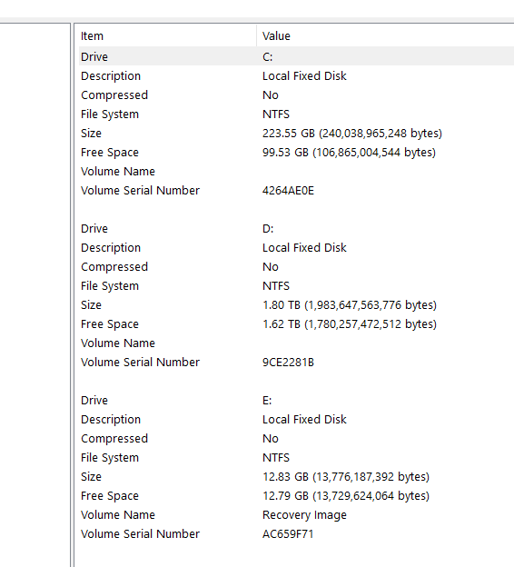

**What I did:** Opened *System Information* (press `Win + R`, type `msinfo32`, press Enter) and went to *Components > Storage > Drives*.

**What I found:** `C:` had about 99 GB free, but `D:` had **1.62 TB** free. So I decided to store my VMs on `D:`.

**Why?** A VM's disk grows as you install things. Putting it on the drive with the most free space stops your main `C:` drive from filling up.

### Step 00b: Check the CPU and virtualization

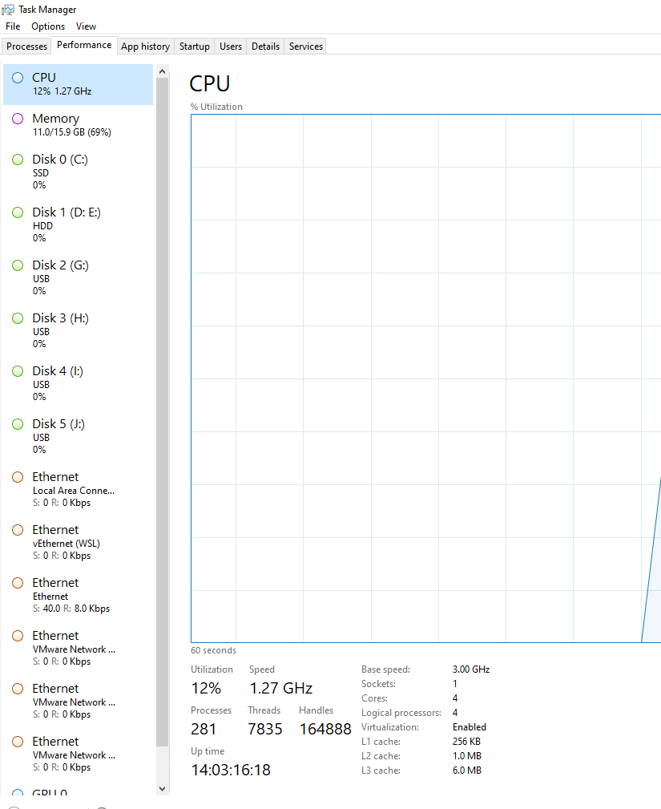

**What I did:** Opened Task Manager (`Ctrl + Shift + Esc`) > **Performance** tab > **CPU**.

**What to look for:**
- **Cores: 4** tells you how many cores you can share with VMs.
- **Virtualization: Enabled**. This is the most important line. If it says *Disabled*, VMs will not start or will be very slow.
- **Memory: 15.9 GB** total.

**Why?** A VM borrows real CPU cores and RAM from your PC. You can't give it more than you have, and you must keep enough for Windows 10 itself.

### Step 00c: Check the VMware version

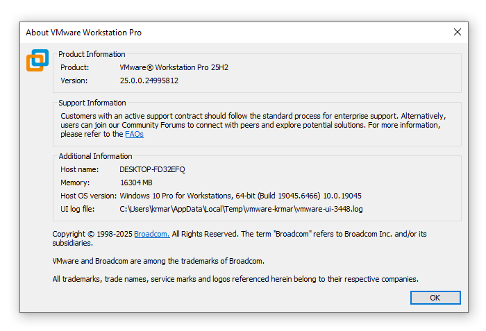

**What I did:** In VMware Workstation, **Help > About VMware Workstation**.

**Why?** Menus and options change between versions. If your screens look different from this guide, check your version first. This guide uses **Workstation Pro 25H2** on **Windows 10 Pro 64-bit**.

---

## Part B: Create the virtual machine

Start the wizard with **File > New Virtual Machine** (or `Ctrl + N`).

### Step 01: Choose Typical

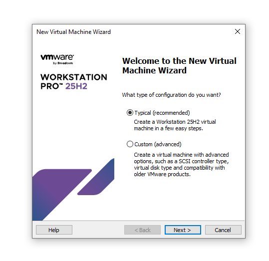

**What to do:** Select **Typical (recommended)** and click **Next**.

**Why?** Typical asks only the important questions and picks sensible defaults for everything else. *Custom* is for advanced choices like the disk controller type, which a beginner doesn't need.

### Step 02: Install the operating system later

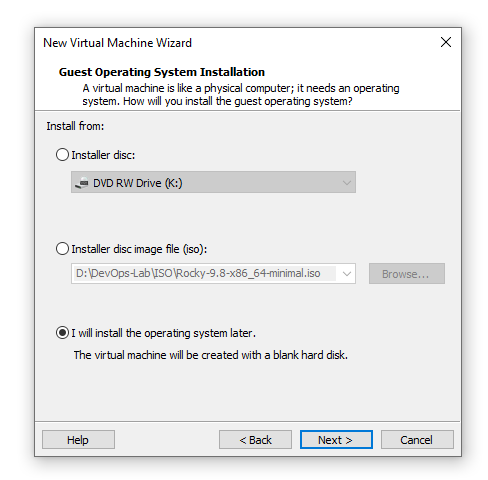

**What to do:** Select **I will install the operating system later** and click **Next**.

**Why?** If you give VMware the ISO here, it may try an *Easy Install*, which answers Windows Setup questions for you. For a lab, you want to **see and learn every Setup screen yourself**. We attach the ISO later in Step 11.

### Step 03: Choose the guest operating system

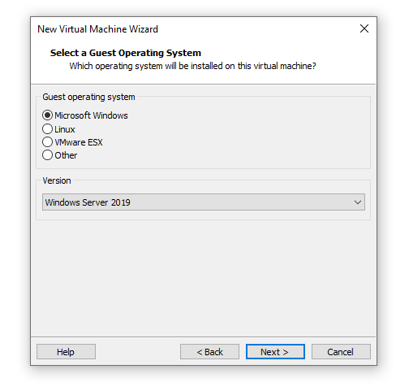

**What to do:** Select **Microsoft Windows**, then in *Version* pick **Windows Server 2019**. Click **Next**.

**Why?** This tells VMware what is going inside, so it picks the right defaults (recommended disk size, memory and drivers) for that system.

### Step 04: Name the VM (notice the default location)

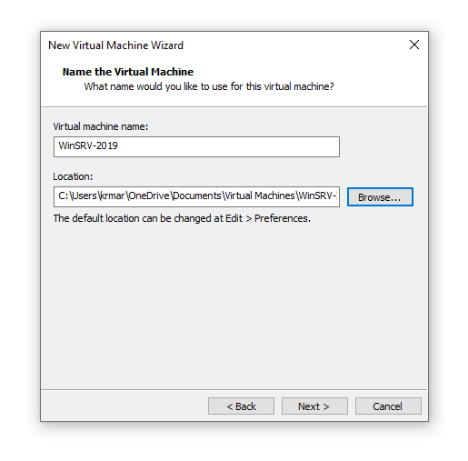

**What to do:** Type the name **`WinSRV-2019`**.

**Watch out:** The default *Location* is `C:\Users\<you>\OneDrive\Documents\Virtual Machines\...`. **Do not leave it there.** See [Issue 1 in TROUBLESHOOTING.md](TROUBLESHOOTING.md#issue-1-vm-saved-inside-onedrive-on-c).

### Step 05: Change the location to the D: drive

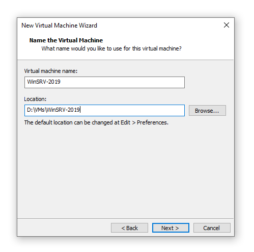

**What to do:** Change *Location* to **`D:\VMs\WinSRV-2019`** (type it, or use **Browse...**). Click **Next**.

**Why?**
- OneDrive tries to upload every change to the cloud. VM files are huge and change all the time, so syncing them is slow and can **corrupt** the VM.
- `D:` has far more free space than `C:`.

**Tip:** Set this once for all future VMs: **Edit > Preferences > Workspace > Default location for virtual machines** = `D:\VMs`.

### Step 06: Disk size (the default is "single file")

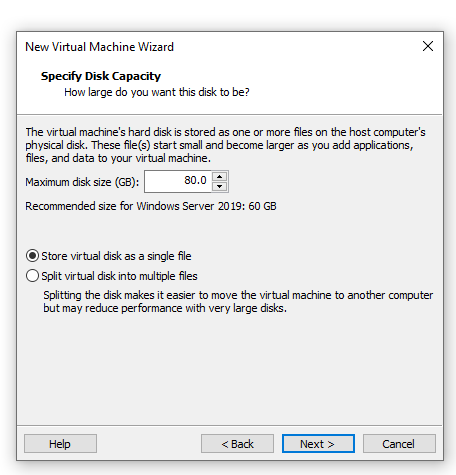

**What you see:** Maximum disk size **80 GB** (VMware recommends 60 GB for Server 2019) and **Store virtual disk as a single file** selected.

**What to do:** Keep **80 GB**, but don't click Next yet. Change the option in the next step.

**Why 80 GB?** Windows Server needs at least 32 GB. 80 GB leaves room for updates and the roles you will add in later labs. The disk is *thin*: it starts small and only grows as data is written, so it does not use 80 GB straight away.

### Step 07: Split the disk into multiple files

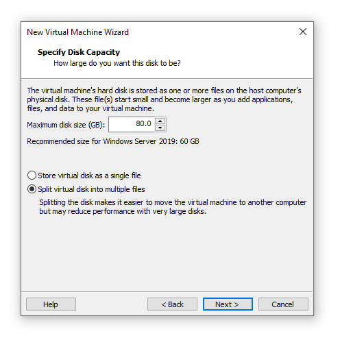

**What to do:** Select **Split virtual disk into multiple files**. Click **Next**.

**Why?** Many smaller files are easier to **copy, move and back up** (for example to a USB stick formatted as FAT32, which can't hold one file bigger than 4 GB). The small speed cost only matters on very large disks. See [Issue 2](TROUBLESHOOTING.md#issue-2-virtual-disk-stored-as-a-single-file).

### Step 08: Review the summary (don't click Finish yet)

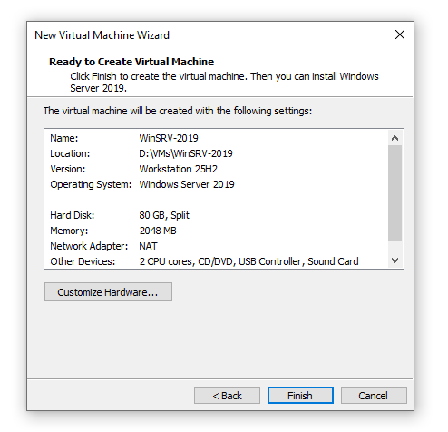

**What you see:** The defaults are **2048 MB memory**, **NAT** network, and **2 CPU cores**.

**What to do:** Click **Customize Hardware...** to change these.

**Why?** 2 GB of RAM is the minimum for a server with a desktop. It works, but it is slow. We also want a Bridged network and the ISO attached.

---

## Part C: Customize the hardware

You are now in the **Hardware** window.

### Step 09: Memory: 4 GB

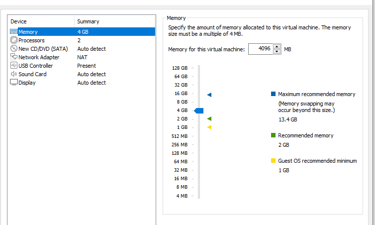

**What to do:** Click **Memory** and set it to **4096 MB** (4 GB).

**Why?** The slider shows three marks: *Guest OS recommended minimum* (1 GB, yellow), *Recommended* (2 GB, green), and *Maximum recommended* (13.4 GB, blue). 4 GB makes Server 2019 with Desktop Experience feel smooth, while still leaving 12 GB for the host.

**Smaller PC?** With 8 GB total RAM, give the VM 2 GB.

### Step 10: Processors: 1 processor x 2 cores

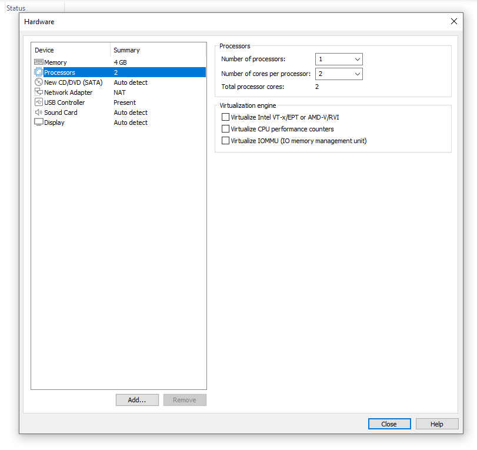

**What to do:** *Number of processors* = **1**, *Number of cores per processor* = **2**. Total = **2 cores**. Leave the *Virtualization engine* boxes unticked.

**Why?**
- The host has 4 cores. Giving the VM 2 leaves 2 for Windows 10.
- "1 processor x 2 cores" copies how a real PC is built (one CPU chip with several cores). Some software licenses count *processors* (sockets), so this is the cleanest choice.
- The *Virtualization engine* boxes are only needed if you want to run VMs **inside** this VM (called *nested virtualization*), for example Hyper-V. Not needed today.

### Step 11: CD/DVD: attach the ISO

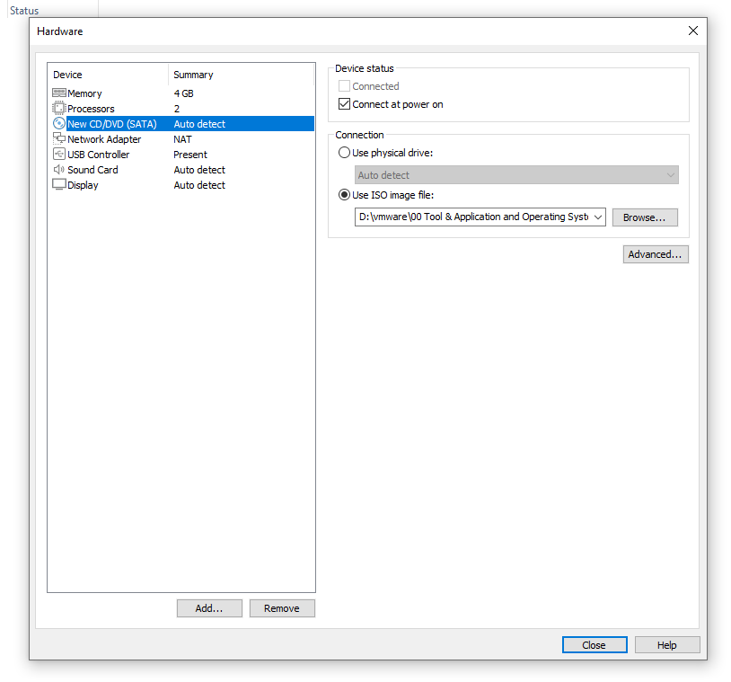

**What to do:** Click **New CD/DVD (SATA)** > select **Use ISO image file** > **Browse...** to your Windows Server 2019 ISO. Make sure **Connect at power on** is ticked.

**Why?** This puts the "installation disc" into the VM's virtual DVD drive. *Connect at power on* means the disc is inserted when the VM starts, so it can boot from it.

### Step 12: Network adapter: Bridged

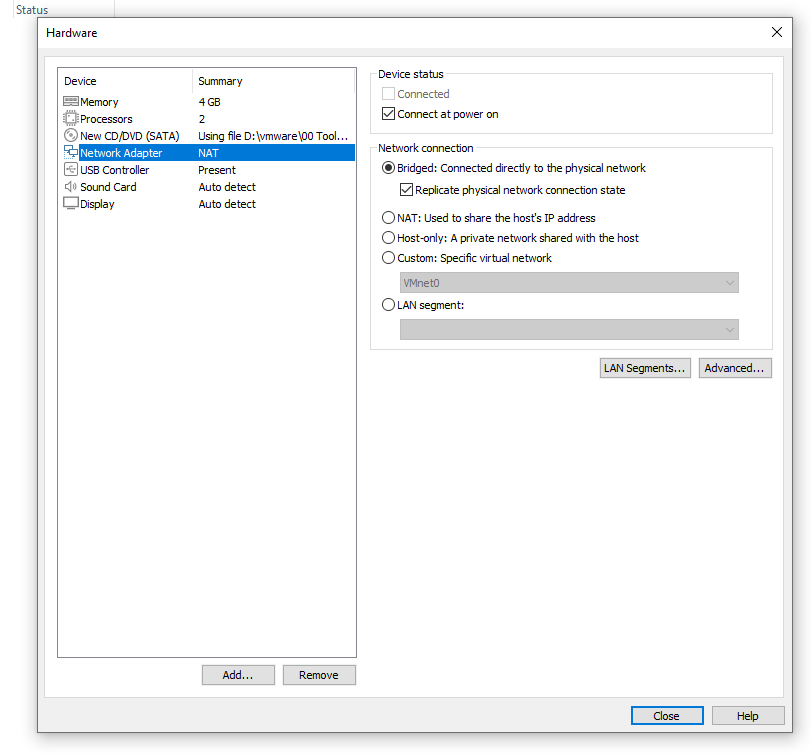

**What to do:** Click **Network Adapter** > select **Bridged: Connected directly to the physical network**. Click **Close**.

**Why?** Here are the three main choices:

| Mode | Simple meaning | Good for |
|------|----------------|----------|
| **Bridged** (used here) | The VM joins your real network like **another real PC**. It gets its own IP address from your home/school router. | When other PCs on the network must reach the server (e.g. a future domain controller or file server). |
| **NAT** (the default) | The VM hides **behind your host's IP address**. It can reach the internet, but other PCs can't easily reach it. | Simple internet access, safest default. |
| **Host-only** | The VM can talk **only to your host** (and other host-only VMs). No internet. | An isolated, private lab. |

**Note:** On some school or work networks, Bridged is blocked. If the VM gets no IP address, switch to NAT.

### Step 13: Final summary, then Finish

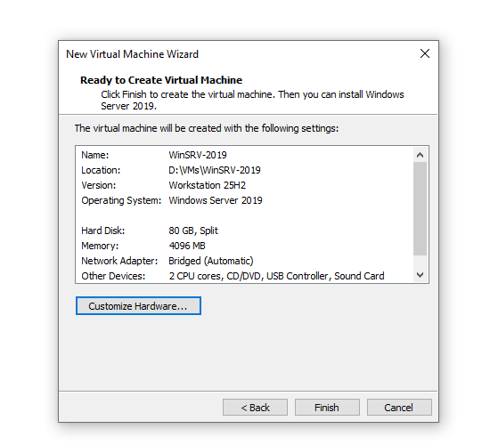

**What to check:** *Hard Disk* **80 GB, Split**, *Memory* **4096 MB**, *Network Adapter* **Bridged (Automatic)**, *Location* **D:\VMs\WinSRV-2019**.

**What to do:** Click **Finish**.

### Step 14: The VM is created

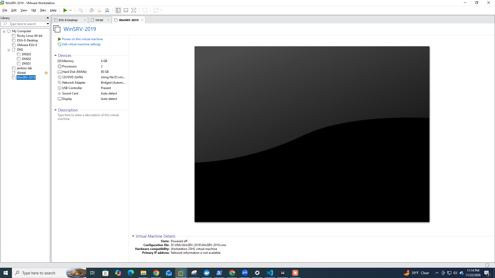

**What you see:** `WinSRV-2019` appears in the **Library** on the left. *Devices* shows Memory 4 GB, Processors 2, **Hard Disk (NVMe)** 80 GB, CD/DVD (SATA) using the ISO, and Network Adapter Bridged. *State: Powered off.*

**Why NVMe?** For Server 2019, VMware chose an **NVMe** virtual disk. NVMe is a fast modern disk type. You did not need to pick this, the Typical wizard did it for you.

**Stop!** Before you power on, do Part D. It will save you the problem I had.

---

## Part D: Fix the firmware before first boot

### Step 15: The problem I hit: UEFI Boot Manager

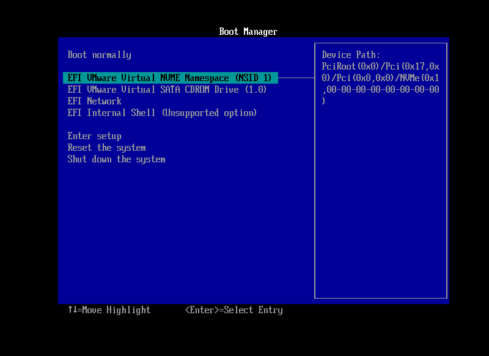

**What happened:** When I powered on the VM, Windows Setup did not start. I landed on this blue **Boot Manager** screen. Choosing *EFI VMware Virtual SATA CDROM Drive* only showed a **blinking cursor**.

**Why?** The VM was using **UEFI** firmware. With UEFI, the Windows ISO shows *"Press any key to boot from CD or DVD..."* for only a few seconds. If you don't click into the VM and press a key in time, it gives up and drops to the Boot Manager. Full details: [Issue 3](TROUBLESHOOTING.md#issue-3-uefi-boot-manager-and-a-blinking-cursor).

**What fixed it for me:** Switching the firmware from UEFI to **BIOS** (next two steps). Power the VM **off** first: **VM > Power > Shut Down Guest** or **Power Off**.

### Step 16: Open VM Settings > Options

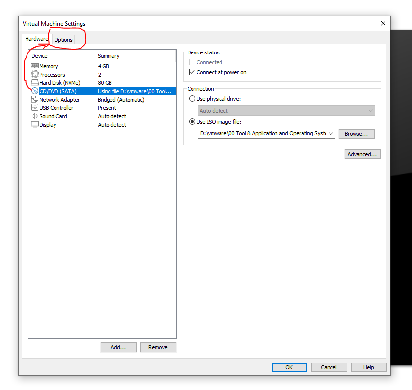

**What to do:** Click **VM > Settings** (or *Edit virtual machine settings*). Click the **Options** tab at the top (circled).

**Why?** The *Hardware* tab is for devices (RAM, disk, network). The *Options* tab is for how the VM behaves, including its **firmware**.

### Step 17: Change Firmware type from UEFI to BIOS

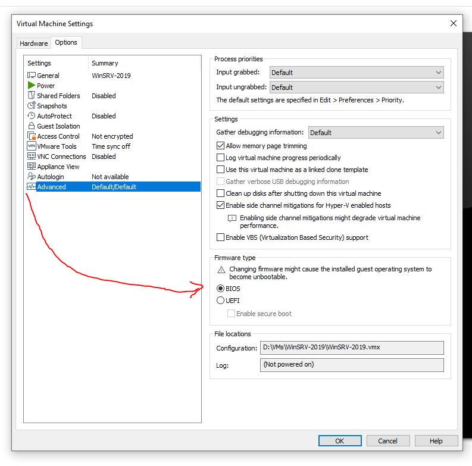

**What to do:** Click **Advanced** (bottom of the list). Under **Firmware type**, select **BIOS**. Click **OK**.

**Why?** BIOS firmware boots straight from the ISO without the short "press any key" timer problem in this lab.

**Important:** Notice the warning: *"Changing firmware might cause the installed guest operating system to become unbootable."* Only change firmware **before** you install the OS. Changing it afterwards can stop Windows from starting.

**Good to know:** UEFI is newer and more secure (it supports Secure Boot and disks bigger than 2 TB). Real servers today usually use UEFI. If you want to keep UEFI, click into the VM window right after you power on and press any key quickly when you see the prompt.

---

## Part E: Install Windows Server 2019

Power on the VM: click **Power on this virtual machine** (green play button). Then **click inside the VM window** so your keyboard and mouse go to the VM.

### Step 18: Language, time and keyboard

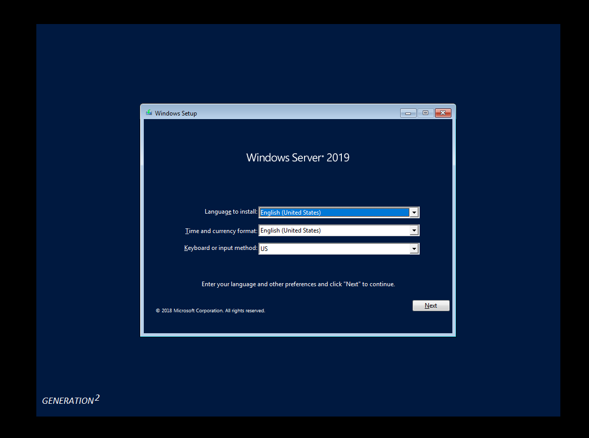

**What to do:** Check *Language to install*, *Time and currency format*, and *Keyboard or input method* (here: English (United States) and US). Click **Next**.

**Why?** These set the language of Windows and your keyboard layout. A wrong keyboard layout means symbols in your password may come out different from what you think you typed.

### Step 19: Install now

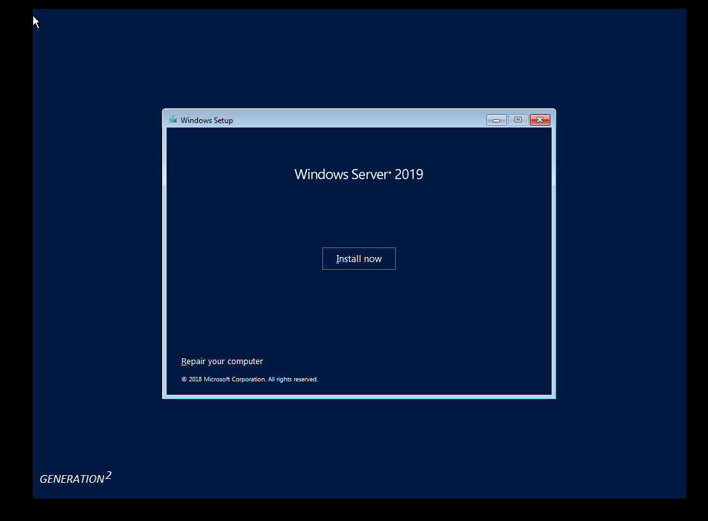

**What to do:** Click **Install now**.

**Why?** *Repair your computer* is only for fixing a broken Windows. We want a new installation.

### Step 20: Choose the edition: Datacenter (Desktop Experience)

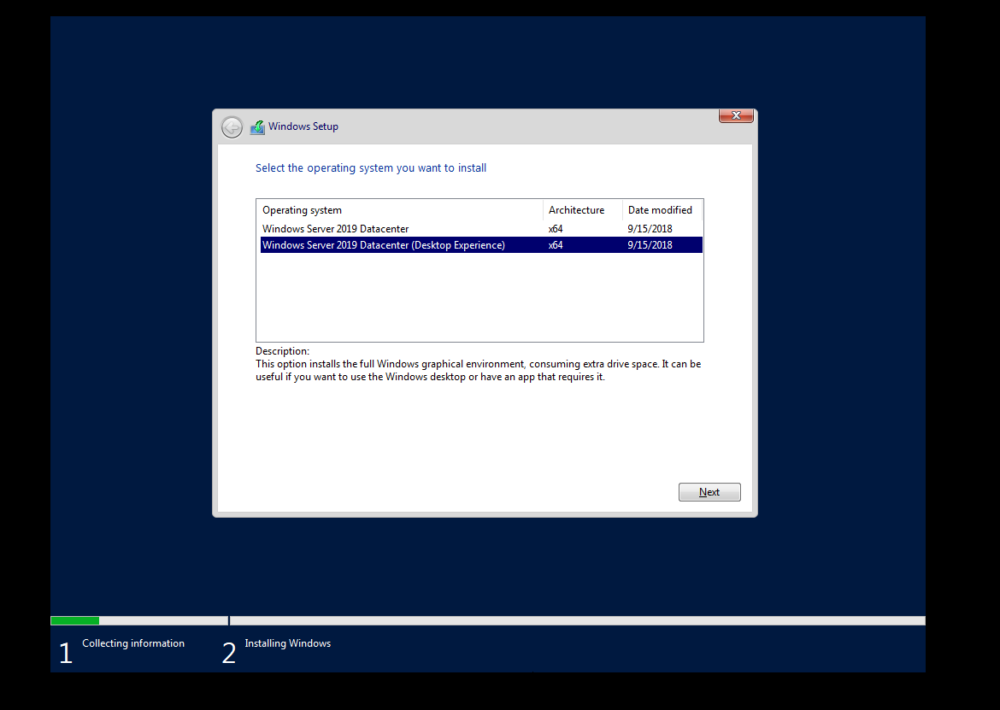

**What to do:** Select **Windows Server 2019 Datacenter (Desktop Experience)**. Click **Next**.

**Why?** There are two choices here, and the difference is very important:

| Option | What you get |
|--------|--------------|
| **Datacenter** (no brackets) | **Server Core**: no desktop, no Start menu, just a command window. Smaller, faster, more secure, but harder for beginners. |
| **Datacenter (Desktop Experience)** | The full Windows desktop with Server Manager, File Explorer and mouse-driven tools. Best for learning. |

**Datacenter vs Standard:** Both have the same core features. Datacenter allows **unlimited** Windows Server VMs on one licensed host and adds extra datacenter features (like Storage Spaces Direct and Shielded VMs). Standard allows 2 VMs. For an evaluation lab, Datacenter lets you try everything.

**Note:** Your ISO may list Standard editions too. Pick the one your class asks for.

### Step 21: Accept the license terms

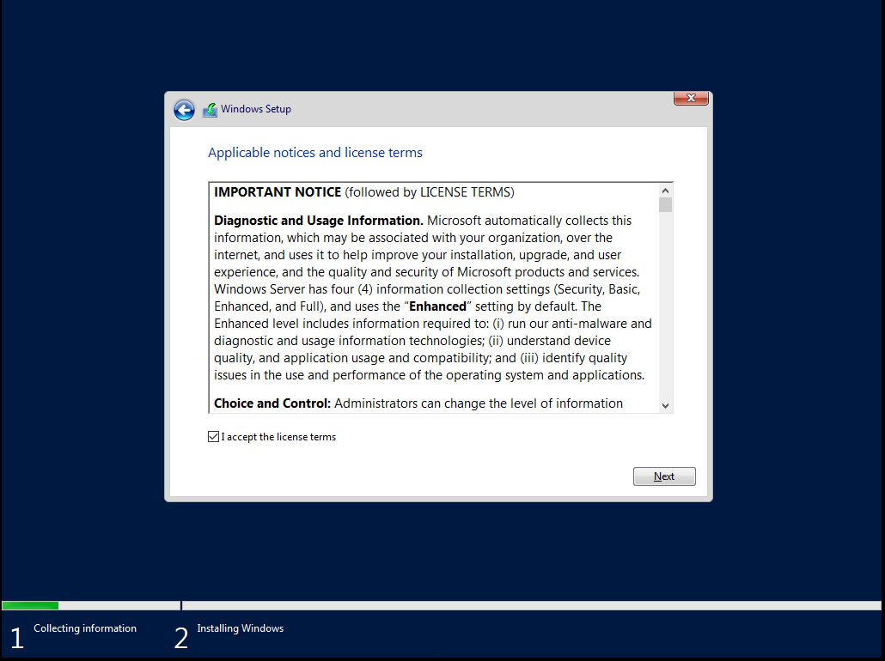

**What to do:** Tick **I accept the license terms**. Click **Next**.

**Why?** Setup will not continue without it. The first part explains what diagnostic data Windows sends to Microsoft.

### Step 22: Choose Custom install and the disk

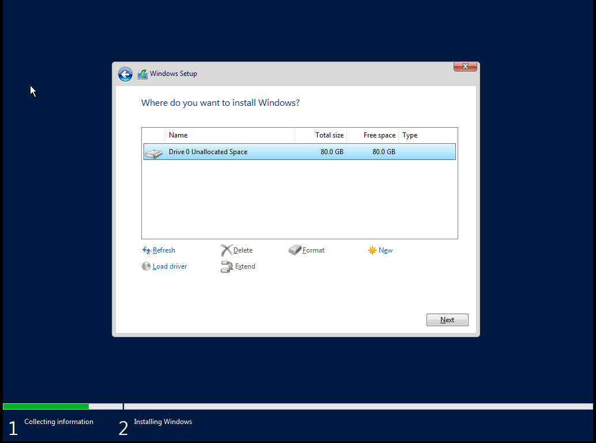

**What to do:** On the previous screen, choose **Custom: Install Windows only (advanced)**. Here, select **Drive 0 Unallocated Space (80.0 GB)** and click **Next**.

**Why?**
- *Upgrade* is only for updating an old Windows that is already installed. Our disk is empty, so we need **Custom**.
- *Unallocated space* means "empty, not yet formatted". Setup will create the partitions it needs by itself. You don't need to click *New* or *Format*.

**Don't see any drive?** See the note in [TROUBLESHOOTING.md](TROUBLESHOOTING.md#issue-9-no-drive-shown-on-where-do-you-want-to-install-windows).

### Step 23: Wait while Windows installs

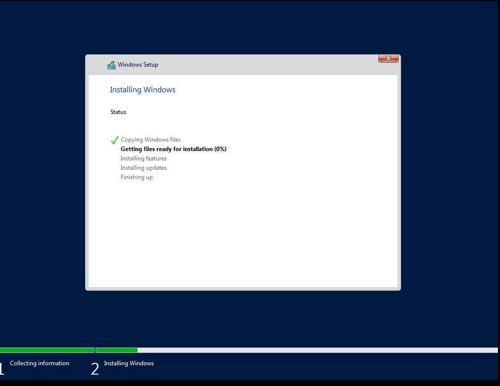

**What to do:** Nothing. Wait. Setup copies files, installs features and updates, then **restarts by itself** one or two times. This usually takes 10 to 20 minutes.

**Why not touch anything?** If you see *"Press any key to boot from CD or DVD"* after a restart, **don't press a key**. That would start Setup again from the beginning.

### Step 24: Product key: skip it

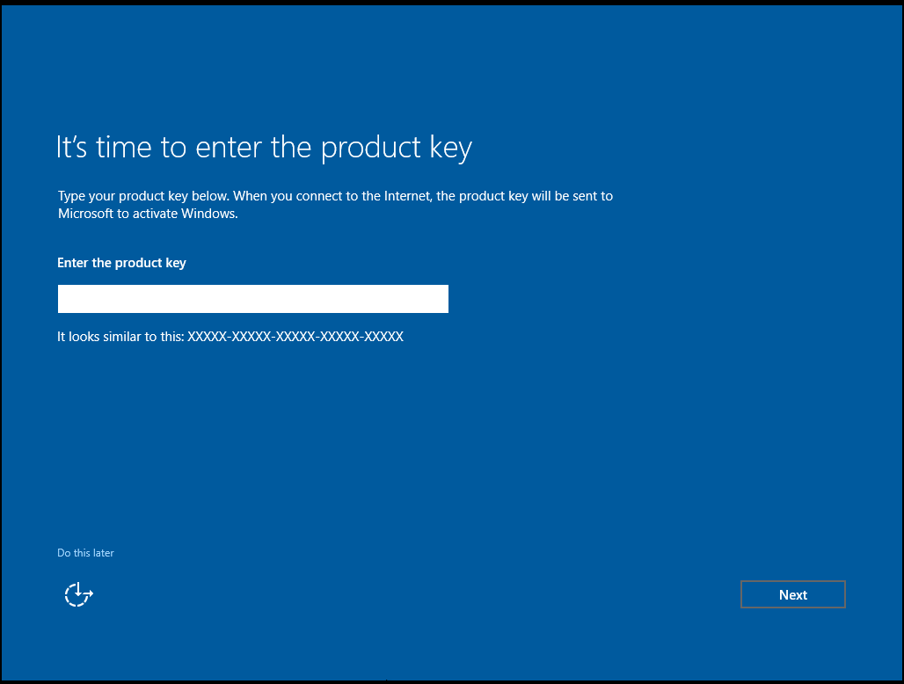

**What to do:** Click **Do this later** (bottom left).

**Why?** Without a key, the evaluation version runs as a full **180-day trial**. That is plenty for a class lab. (Some evaluation ISOs skip this screen.)

### Step 25: Set the Administrator password

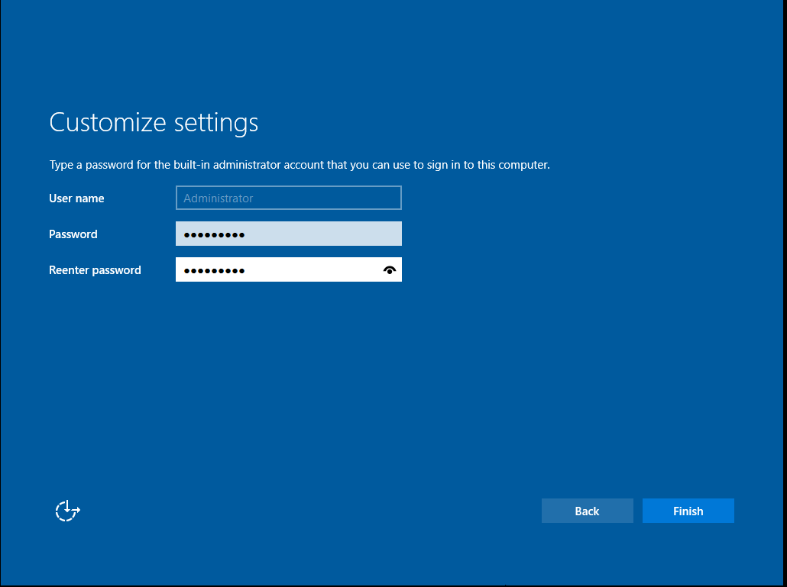

**What to do:** Type a **strong password** twice for the built-in **Administrator** account. Click **Finish**.

**Why?** Administrator has full control of the server, so Windows Server **requires** a complex password: at least 8 characters, using 3 of these 4: upper case, lower case, numbers, symbols.

**Tip:** Click the eye icon to check what you typed. Keep the password in a password manager or your notebook. **Never commit it to GitHub.**

---

## Part F: First login and finishing touches

### Step 26: Log in for the first time

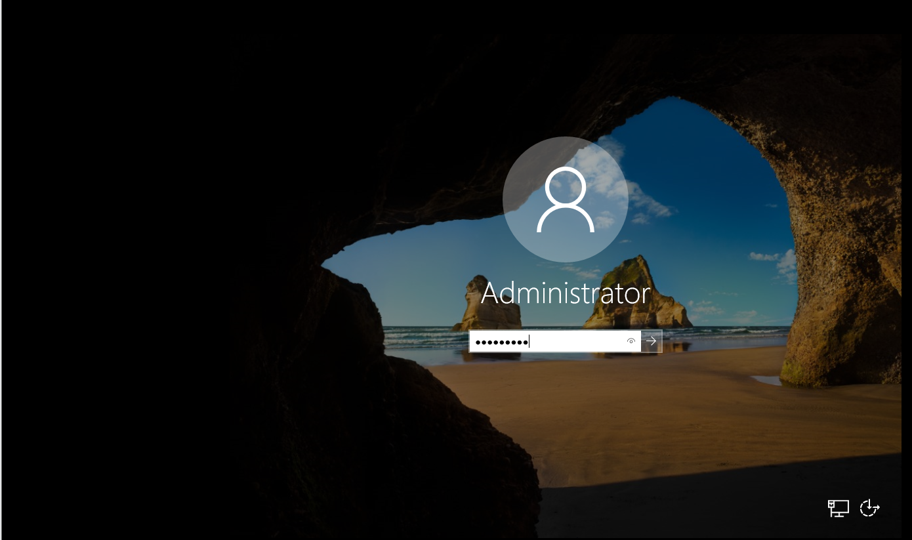

**What to do:** On the lock screen, press **`Ctrl + Alt + Insert`** (not `Ctrl + Alt + Del`). Type your password and press Enter.

**Why Ctrl + Alt + Insert?** If you press `Ctrl + Alt + Del`, your **host** (Windows 10) catches it, not the VM. VMware uses `Ctrl + Alt + Insert` to send it to the VM instead. You can also use **VM > Send Ctrl+Alt+Del**.

### Step 27: Networks: allow discovery?

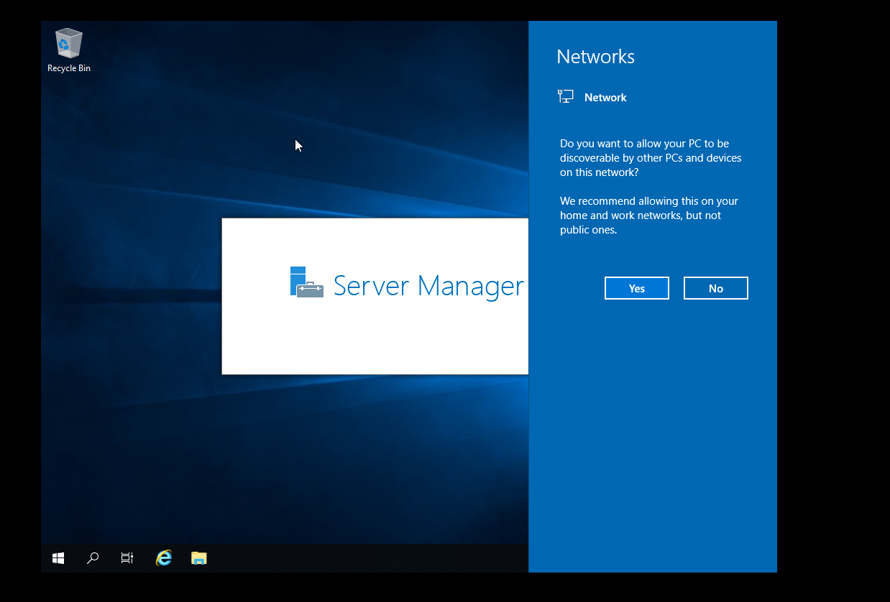

**What to do:** Click **Yes**.

**Why?** *Yes* sets the network to **Private**. That means *network discovery* is on, so other PCs on your lab network can see this server. That is what we want for a server in a home/class lab. On a **public** network (café, airport) you would choose **No**.

**Also:** **Server Manager** opens automatically. It is the main control panel for managing a Windows server.

### Step 28: Install VMware Tools

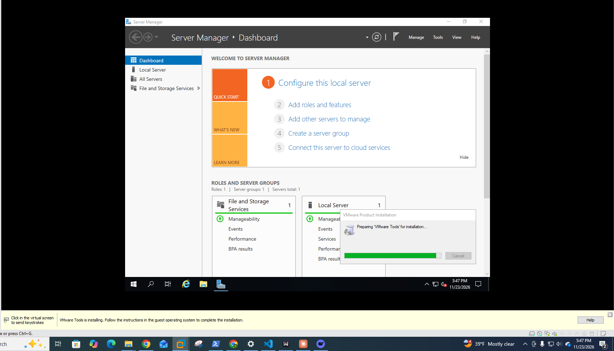

**What to do:** In VMware, click **VM > Install VMware Tools**. A virtual CD is inserted into the VM. If the installer does not start by itself, open **File Explorer > This PC > DVD Drive (D:) VMware Tools** and run **setup64.exe**.

**Why?** VMware Tools are the drivers that make the VM pleasant to use:
- the mouse moves smoothly in and out of the VM window,
- the screen resizes to fit the window,
- copy and paste works between host and VM,
- better network and disk drivers,
- the clock can sync with the host.

**Notice the clock in this screenshot:** the VM shows **3:47 PM** while the host shows **5:47 PM**. We fix this in Step 30.

### Step 29: Choose Complete setup

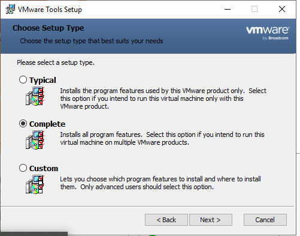

**What to do:** Select **Complete**, click **Next**, then **Install**. **Restart** the VM when asked.

**Why?**
- **Typical**: only the features for *this* VMware product (Workstation).
- **Complete**: all features, in case you later move this VM to another VMware product (like ESXi or Fusion).
- **Custom**: pick features yourself (advanced users).

Either Typical or Complete is fine for this lab. Complete is the safer "everything included" choice.

### Step 30: Set the correct time zone

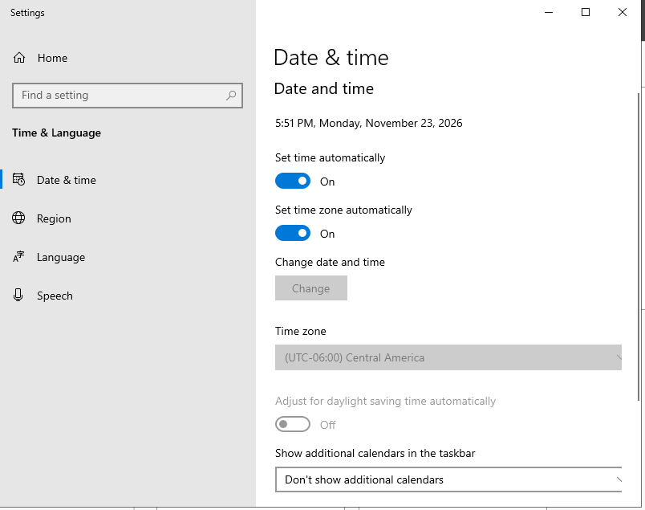

**What to do:** Right-click the clock in the taskbar > **Adjust date/time**. Set **Time zone** to your real zone.

**Why?** Windows Server picks **Pacific Time** by default. My VM was **2 hours behind** my host. Correct time is very important in servers: in **Active Directory**, logins use **Kerberos**, which by default fails if two computers' clocks differ by **more than 5 minutes**.

**Watch out (daylight saving):** In this screenshot the time zone is **(UTC-06:00) Central America**, and *Adjust for daylight saving time* is **Off**. "Central America" (Guatemala, Costa Rica, etc.) does **not** use daylight saving time. If you live in the US or Canada Central zone, choose **(UTC-06:00) Central Time (US & Canada)** instead, or your clock will be 1 hour wrong for half the year. See [Issue 8](TROUBLESHOOTING.md#issue-8-wrong-central-time-zone-no-daylight-saving).

### Step 31: Desktop after VMware Tools and restart

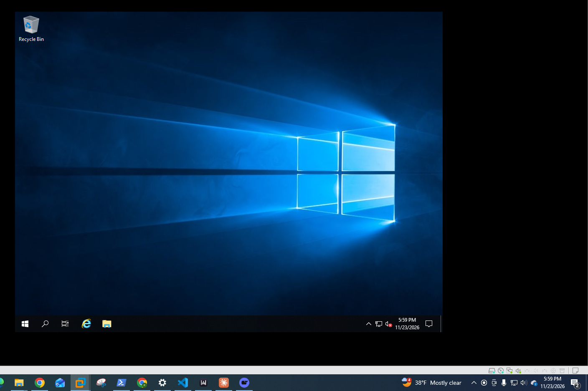

**What you see:** After VMware Tools installs and the VM restarts, you get a clean desktop. The VM clock now shows **5:59 PM**, the **same as the host clock** (bottom right of the host taskbar). The time problem is fixed.

**How to check VMware Tools worked:**
- The mouse moves in and out of the VM window without `Ctrl + Alt`.
- When you resize the VMware window, the VM's screen resizes too.
- The menu item **VM > Install VMware Tools** has changed to **Reinstall VMware Tools**.

### Step 32: Windows Admin Center pop-up

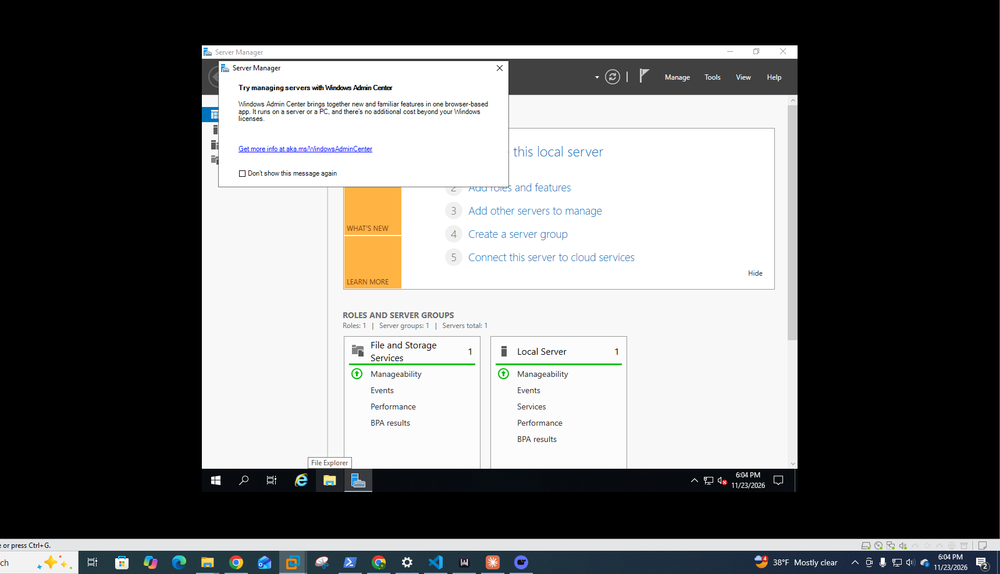

**What you see:** When Server Manager opens, a small box says **"Try managing servers with Windows Admin Center"**.

**What it is:** **Windows Admin Center (WAC)** is a free, **browser-based** tool from Microsoft for managing servers. You install it once (on a server or your PC), then open it in a web browser to manage many servers from one place. It is the modern partner to Server Manager. It is **not** pre-installed; this box is only a suggestion to try it.

**What to do:** Tick **Don't show this message again** and close the box with the **X**. This is completely fine. It only hides the reminder. It does not change or break anything, and you can still install Windows Admin Center later if your class needs it.

**Done!** You now have a working Windows Server 2019 VM.

---

## Handy keyboard shortcuts

| Keys | What it does |
|------|--------------|
| `Ctrl + G` (or click inside the VM) | Send your keyboard and mouse **into** the VM. |
| `Ctrl + Alt` | **Release** the mouse and keyboard back to the host. |
| `Ctrl + Alt + Insert` | Send **Ctrl + Alt + Del** to the VM (to log in or lock). |
| `Ctrl + Alt + Enter` | Full screen on / off. |
| `Ctrl + N` | New virtual machine wizard (on the host, in VMware). |

---

## What to do next

1. **Take a snapshot** called `Clean install`. (**VM > Snapshot > Take Snapshot**.) A snapshot is a "save point". If you break something in a later lab, you can go back in seconds.
2. **Rename the server** to something meaningful, like `SRV2019-DC01` (Server Manager > Local Server > Computer name). It restarts after this.
3. **Give it a static IP address**, so its address never changes. Servers need fixed addresses.
4. **Run Windows Update.**
5. **Next lab idea:** install Active Directory Domain Services and make this server a domain controller.

Check your learning:
- Open [quiz.html](quiz.html) and aim for 20/25 or better.
- Practice answering [INTERVIEW-QA.md](INTERVIEW-QA.md) out loud.

---

## Reusing this bundle for other Windows versions

This folder is a template. To make a bundle for **Server 2022**, **Server 2025** or **Windows 11**:

1. Copy the whole `WS2019/` folder and rename it, for example `WS2022/`.
2. Replace the screenshots in `images/`. Keep the same pattern: `NN-short-description.png` (two-digit step number first, so files sort in order).
3. In `README.md`, update the settings table in section 3 and the steps that change. Things that commonly differ:
   - **Windows 11** requires **UEFI, Secure Boot and TPM 2.0**, so you must **keep UEFI** (do not switch to BIOS) and add a TPM (VM > Settings > Options > Access Control > Encrypt, then Hardware > Add > Trusted Platform Module).
   - **Server 2022 / 2025** work best with **UEFI**. Expect the same "press any key" prompt.
   - Newer versions need more RAM and disk.
4. `TROUBLESHOOTING.md`: keep the same *Symptom / Cause / Fix / Lesson* format and add new issues.
5. `quiz.html`: all questions are in one list called `QUESTIONS` near the top of the `<script>` section. Edit the text there; you don't need to touch the rest of the code.
6. Keep an English and a Roman Urdu copy of every markdown file (`NAME.md` and `NAME.roman-urdu.md`), linked to each other at the top.
7. Add the new bundle to the table in the top-level [Wintel Lab README](../README.md).

Repository layout:

```
wintel-lab/
├── README.md                 (list of all bundles)
├── README.roman-urdu.md
├── WS2019/                   (this bundle)
├── WS2022/                   (coming)
├── WS2025/                   (coming)
└── Win11/                    (coming)
```

---

*Lab environment: Windows 10 Pro host, VMware Workstation Pro 25H2, Windows Server 2019 Datacenter Evaluation. Written as a class lab study guide. No passwords or product keys are included in this repository.*
