# Windows Server 2019 ko VMware Workstation Pro mein Install karna (Beginner Lab Guide)

**Zabaan (Language):** [English](README.md) | Roman Urdu

Yeh [Wintel Lab](../README.roman-urdu.md) series ka hissa hai.

Yeh guide step-by-step aur screenshot ke saath batati hai ke **Windows 10** computer par **VMware Workstation Pro 25H2** ke andar **Windows Server 2019** ki virtual machine kaise banani hai.

Yeh ek student ne students ke liye likhi hai. Har step ke saath ek chhota sa **"Kyun?"** hai, taake aap sirf button na dabayen balke samjhen bhi ke kya ho raha hai.

> **Note:** Button aur menu ke naam English mein hi likhe gaye hain, kyun ke screen par aap ko English mein hi nazar aayenge.

## Is bundle mein kya hai

| File | Kis kaam ki hai |
|------|-----------------|
| [README.roman-urdu.md](README.roman-urdu.md) / [English](README.md) | Yeh guide. Shuru se aakhir tak follow karein. |
| [TROUBLESHOOTING.roman-urdu.md](TROUBLESHOOTING.roman-urdu.md) / [English](TROUBLESHOOTING.md) | Jo masle mujhe aaye, woh kyun aaye, aur maine kaise theek kiye. Agar atak jaayen to yeh parhein. |
| [INTERVIEW-QA.roman-urdu.md](INTERVIEW-QA.roman-urdu.md) / [English](INTERVIEW-QA.md) | 25 beginner interview sawal aur jawab. |
| [quiz.html](quiz.html) | 25 sawalon ka practice quiz (English mein). Download karke kisi bhi browser mein kholein. Internet ke baghair bhi chalta hai. |
| [images/](images/) | Is guide ke saare screenshots. |

## Fehrist (Contents)

1. [Aham alfaaz ki wazahat](#1-aham-alfaaz-ki-wazahat)
2. [Shuru karne se pehle (checklist)](#2-shuru-karne-se-pehle-checklist)
3. [Is lab mein istemal hone wali settings](#3-is-lab-mein-istemal-hone-wali-settings)
4. [Part A: Apna computer check karein](#part-a-apna-computer-check-karein)
5. [Part B: Virtual machine banayen](#part-b-virtual-machine-banayen)
6. [Part C: Hardware customize karein](#part-c-hardware-customize-karein)
7. [Part D: Pehli dafa boot se pehle firmware theek karein](#part-d-pehli-dafa-boot-se-pehle-firmware-theek-karein)
8. [Part E: Windows Server 2019 install karein](#part-e-windows-server-2019-install-karein)
9. [Part F: Pehla login aur aakhri kaam](#part-f-pehla-login-aur-aakhri-kaam)
10. [Kaam ke keyboard shortcuts](#kaam-ke-keyboard-shortcuts)
11. [Aage kya karein](#aage-kya-karein)
12. [Doosre Windows versions ke liye yeh bundle dobara istemal karna](#doosre-windows-versions-ke-liye-yeh-bundle-dobara-istemal-karna)

---

## 1. Aham alfaaz ki wazahat

Isay ek dafa parh lein. Yeh saare alfaaz aage guide mein aayenge.

| Lafz | Aasaan matlab |
|------|---------------|
| **Host** | Aap ka asli computer (yahan: Windows 10 PC). |
| **Virtual machine (VM)** | "Computer ke andar computer". Asal mein yeh disk par chand files hain, lekin bilkul alag PC ki tarah kaam karti hai. |
| **Guest OS** | Woh operating system jo VM ke *andar* install hota hai (yahan: Windows Server 2019). |
| **Hypervisor** | Woh software jo VMs chalata hai. VMware Workstation Pro ek hypervisor hai. |
| **ISO file** | Installation DVD ki hoobahoo copy, ek file ki shakal mein. VM isay disc ki tarah "parhti" hai. |
| **Virtualization (VT-x / AMD-V)** | CPU ka feature jis se VMs tez chalti hain. Isay **Enabled** hona chahiye. |
| **vCPU / core** | Aap ke asli processor ka hissa jo aap VM ko dete hain. |
| **RAM / memory** | Kaam karne wali memory. VM chalte waqt aap ki RAM ka kuch hissa udhaar leti hai. |
| **Virtual disk (.vmdk)** | Woh file(s) jo VM ki hard drive ka kaam karti hain. |
| **Firmware (BIOS / UEFI)** | Chhota program jo Windows se pehle computer ko start karta hai. BIOS purana tareeqa hai, UEFI naya. |
| **Bridged / NAT / Host-only** | VM ko network se jorne ke teen tareeqe. [Step 12](#step-12-network-adapter-bridged) mein samjhaya gaya hai. |
| **Edition** | Windows Server ka ek version jis ke features aur qeemat alag hoti hai (Standard, Datacenter). |
| **Desktop Experience** | Windows Server *ke saath* aam Windows desktop. Is ke baghair **Server Core** milta hai: sirf command line. |
| **Evaluation** | Windows Server ka free aur poora trial jo **180 din** tak product key ke baghair chalta hai. |
| **VMware Tools** | Drivers jo guest ke andar install kiye jaate hain taake VM achhi tarah chale (behtar mouse, screen size, ghari ka sync). |

---

## 2. Shuru karne se pehle (checklist)

Shuru karne se pehle har box tick karein.

- [ ] **64-bit computer** jis mein kam az kam **4 CPU cores** aur **16 GB RAM** ho (8 GB bilkul minimum hai, lekin slow chalega).
- [ ] **Virtualization Enabled ho** (Task Manager mein check karein, [Step 00b](#step-00b-cpu-aur-virtualization-check-karein) dekhein). Agar *Disabled* likha ho to apne PC ki BIOS setup mein "Intel VT-x" ya "AMD-V/SVM" on karein.
- [ ] **Kam az kam 80 GB khali jagah**, behtar hai aisi drive par jo OneDrive ke andar *na* ho.
- [ ] **VMware Workstation Pro** install ho (yeh guide 25H2 istemal karti hai, jo personal use ke liye free hai).
- [ ] **Windows Server 2019 ki ISO file** download ho. Free evaluation Microsoft Evaluation Center par milti hai ("Windows Server 2019 Evaluation Center" search karein).
- [ ] Administrator account ke liye **mazboot password** tayyar ho (kam az kam 8 characters, bare aur chhote huroof, numbers aur symbols ke saath). Kahin mehfooz jagah likh lein. **Isay kabhi GitHub par na daalein.**
- [ ] Taqreeban **1 ghanta** waqt.

---

## 3. Is lab mein istemal hone wali settings

Isay apni "cheat sheet" samjhein. Agar aap ka computer chhota hai to har step mein diye gaye notes dekhein.

| Setting | Jo value use hui | Kahan set hoti hai |
|---------|------------------|-------------------|
| Host | Windows 10 Pro, Intel i5-4430 (4 cores), 16 GB RAM | — |
| Hypervisor | VMware Workstation Pro 25H2 | — |
| VM ka naam | `WinSRV-2019` | Step 04 |
| VM ki location | `D:\VMs\WinSRV-2019` | Step 05 |
| Wizard type | Typical | Step 01 |
| OS install | "I will install the operating system later" | Step 02 |
| Disk | 80 GB, multiple files mein split (NVMe type) | Step 07 |
| Memory | 4 GB (4096 MB) | Step 09 |
| Processors | 1 processor x 2 cores | Step 10 |
| CD/DVD | SATA, Server 2019 ISO ke saath | Step 11 |
| Network | Bridged | Step 12 |
| Firmware | **BIOS** (UEFI se badla) | Step 17 |
| Edition | Datacenter (Desktop Experience) | Step 20 |
| Install type | Custom, unallocated space par | Step 22 |
| Product key | Skip ki (180 din ka evaluation) | Step 24 |
| Network discovery | Yes (private network) | Step 27 |
| VMware Tools | Install kiye, Complete setup | Steps 28-29 |
| Time zone | Aap ka asli local time zone | Step 30 |
| Windows Admin Center pop-up | Band kiya ("Don't show this message again" tick) | Step 32 |

---

## Part A: Apna computer check karein

Kuch banane se pehle yaqeen kar lein ke aap ke PC mein VM ke liye jagah hai.

### Step 00a: Khali disk space check karein

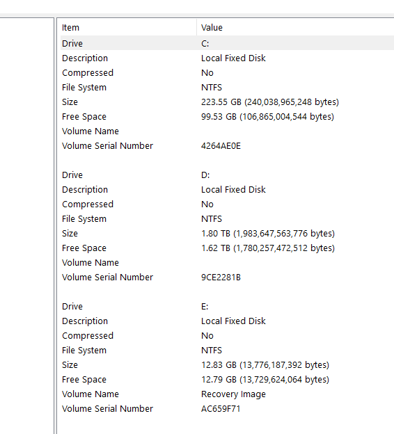

**Maine kya kiya:** *System Information* khola (`Win + R` dabayen, `msinfo32` likhein, Enter dabayen) aur *Components > Storage > Drives* par gaya.

**Kya mila:** `C:` par taqreeban 99 GB khali tha, lekin `D:` par **1.62 TB** khali tha. Is liye maine VMs `D:` par rakhne ka faisla kiya.

**Kyun?** VM ki disk waqt ke saath barhti hai. Usay sab se zyada khali jagah wali drive par rakhne se aap ki main `C:` drive full nahin hoti.

### Step 00b: CPU aur virtualization check karein

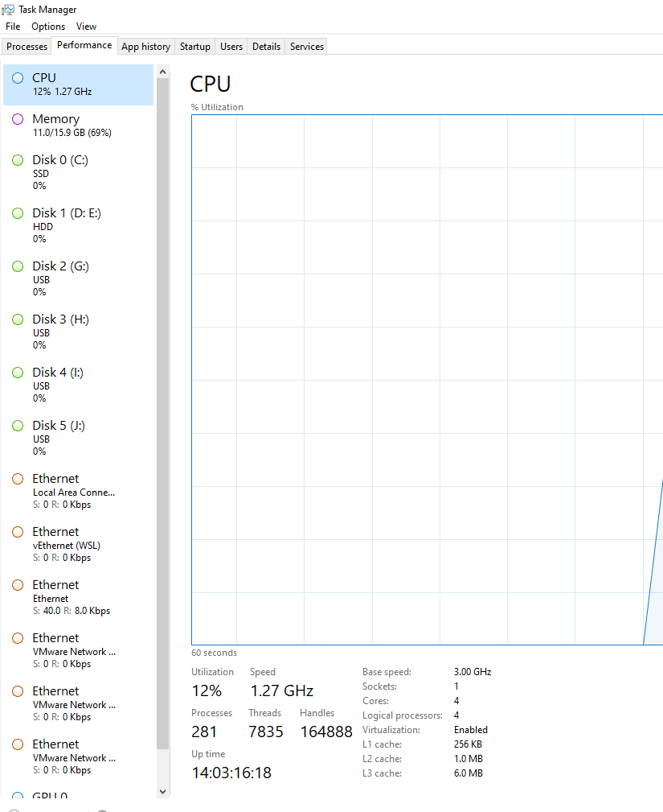

**Maine kya kiya:** Task Manager khola (`Ctrl + Shift + Esc`) > **Performance** tab > **CPU**.

**Kya dekhna hai:**
- **Cores: 4** batata hai ke aap VMs ko kitne cores de sakte hain.
- **Virtualization: Enabled**. Yeh sab se aham line hai. Agar *Disabled* likha ho to VMs start nahin hongi ya bohat slow chalengi.
- **Memory: 15.9 GB** total.

**Kyun?** VM aap ke asli CPU cores aur RAM udhaar leti hai. Aap jitna hai us se zyada nahin de sakte, aur Windows 10 ke liye bhi kaafi chhorna zaroori hai.

### Step 00c: VMware ka version check karein

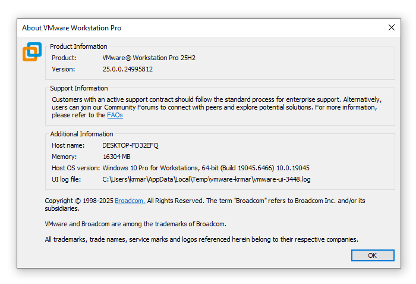

**Maine kya kiya:** VMware Workstation mein **Help > About VMware Workstation**.

**Kyun?** Har version mein menu aur options thore badal jaate hain. Agar aap ki screen is guide se alag lage to pehle version check karein. Yeh guide **Windows 10 Pro 64-bit** par **Workstation Pro 25H2** istemal karti hai.

---

## Part B: Virtual machine banayen

Wizard **File > New Virtual Machine** (ya `Ctrl + N`) se shuru karein.

### Step 01: Typical chunein

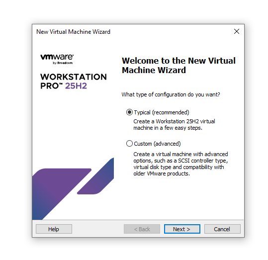

**Kya karna hai:** **Typical (recommended)** select karein aur **Next** dabayen.

**Kyun?** Typical sirf zaroori sawal poochta hai aur baqi sab ke liye munasib default chun leta hai. *Custom* advanced cheezon ke liye hai, jaise disk controller ki type, jo beginner ko nahin chahiye.

### Step 02: Operating system baad mein install karein

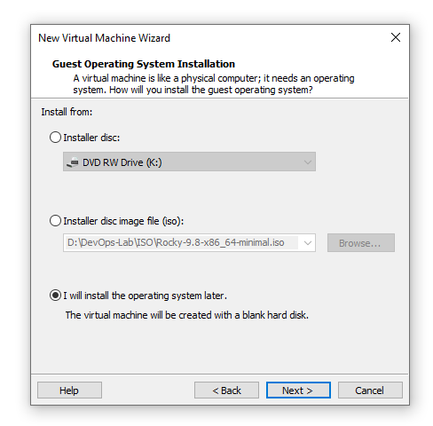

**Kya karna hai:** **I will install the operating system later** select karein aur **Next** dabayen.

**Kyun?** Agar aap yahan ISO de dein to VMware *Easy Install* chala sakta hai, jo Windows Setup ke sawalon ke jawab khud de deta hai. Lab mein aap ko **har Setup screen khud dekhni aur seekhni** hai. ISO hum Step 11 mein lagayenge.

### Step 03: Guest operating system chunein

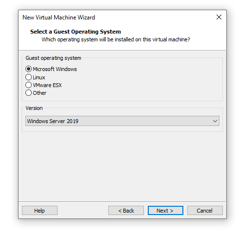

**Kya karna hai:** **Microsoft Windows** select karein, phir *Version* mein **Windows Server 2019** chunein. **Next** dabayen.

**Kyun?** Is se VMware ko pata chalta hai ke andar kya install hoga, taake woh us system ke liye sahi default (disk size, memory, drivers) chune.

### Step 04: VM ka naam rakhein (default location par nazar rakhein)

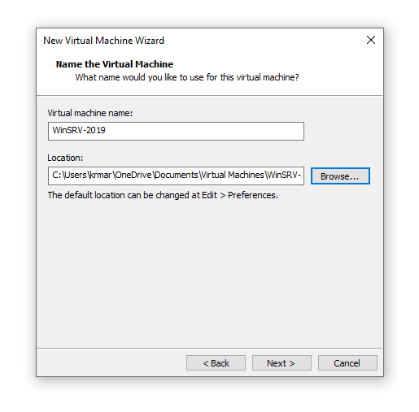

**Kya karna hai:** Naam **`WinSRV-2019`** likhein.

**Khayal rakhein:** Default *Location* `C:\Users\<aap>\OneDrive\Documents\Virtual Machines\...` hai. **Isay wahan mat chhorein.** [TROUBLESHOOTING mein Masla 1](TROUBLESHOOTING.roman-urdu.md#masla-1-vm-c-par-onedrive-ke-andar-save-ho-rahi-thi) dekhein.

### Step 05: Location ko D: drive par badlein

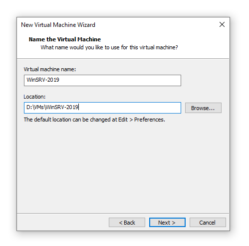

**Kya karna hai:** *Location* ko **`D:\VMs\WinSRV-2019`** kar dein (likh dein ya **Browse...** istemal karein). **Next** dabayen.

**Kyun?**
- OneDrive har tabdeeli ko cloud par upload karne ki koshish karta hai. VM files bohat bari hoti hain aur har waqt badalti rehti hain, is liye unhein sync karna slow hai aur VM **kharab (corrupt)** ho sakti hai.
- `D:` par `C:` se kahin zyada khali jagah hai.

**Tip:** Aainda ki saari VMs ke liye ek dafa set kar dein: **Edit > Preferences > Workspace > Default location for virtual machines** = `D:\VMs`.

### Step 06: Disk size (default "single file" hai)

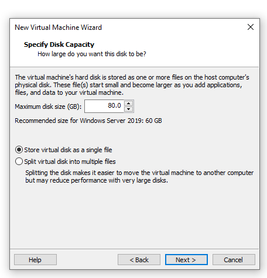

**Kya nazar aata hai:** Maximum disk size **80 GB** (VMware Server 2019 ke liye 60 GB recommend karta hai) aur **Store virtual disk as a single file** selected hai.

**Kya karna hai:** **80 GB** rehne dein, lekin abhi Next mat dabayen. Agle step mein option badlein.

**80 GB kyun?** Windows Server ko kam az kam 32 GB chahiye. 80 GB mein updates aur aglay labs ke roles ke liye jagah bachti hai. Disk *thin* hai: shuru mein chhoti hoti hai aur data likhne ke saath barhti hai, is liye foran 80 GB nahin leti.

### Step 07: Disk ko multiple files mein split karein

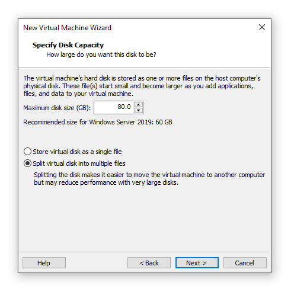

**Kya karna hai:** **Split virtual disk into multiple files** select karein. **Next** dabayen.

**Kyun?** Kai chhoti files ko **copy, move aur backup** karna aasaan hota hai (maslan FAT32 USB par, jo 4 GB se bari ek file nahin rakh sakti). Speed ka thora sa farq sirf bohat bari disks par parta hai. [Masla 2](TROUBLESHOOTING.roman-urdu.md#masla-2-virtual-disk-ek-hi-file-mein-thi) dekhein.

### Step 08: Summary dekhein (abhi Finish mat dabayen)

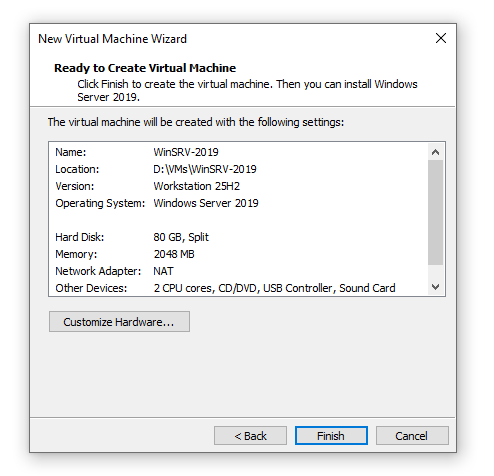

**Kya nazar aata hai:** Default **2048 MB memory**, **NAT** network aur **2 CPU cores** hain.

**Kya karna hai:** In ko badalne ke liye **Customize Hardware...** dabayen.

**Kyun?** Desktop wale server ke liye 2 GB RAM minimum hai. Chal jaata hai lekin slow hai. Hamein Bridged network aur ISO bhi lagani hai.

---

## Part C: Hardware customize karein

Ab aap **Hardware** window mein hain.

### Step 09: Memory: 4 GB

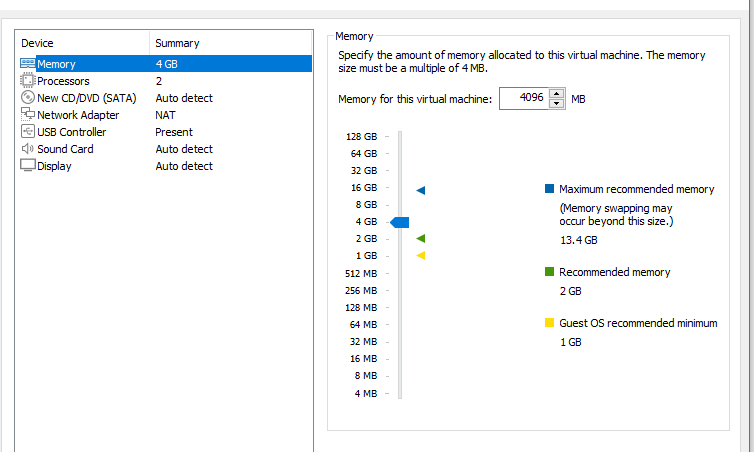

**Kya karna hai:** **Memory** par click karein aur **4096 MB** (4 GB) set karein.

**Kyun?** Slider par teen nishaan hain: *Guest OS recommended minimum* (1 GB, peela), *Recommended* (2 GB, hara), aur *Maximum recommended* (13.4 GB, neela). 4 GB se Server 2019 Desktop Experience smooth chalta hai aur host ke liye 12 GB bach jaati hai.

**PC chhota hai?** Agar total RAM 8 GB hai to VM ko 2 GB dein.

### Step 10: Processors: 1 processor x 2 cores

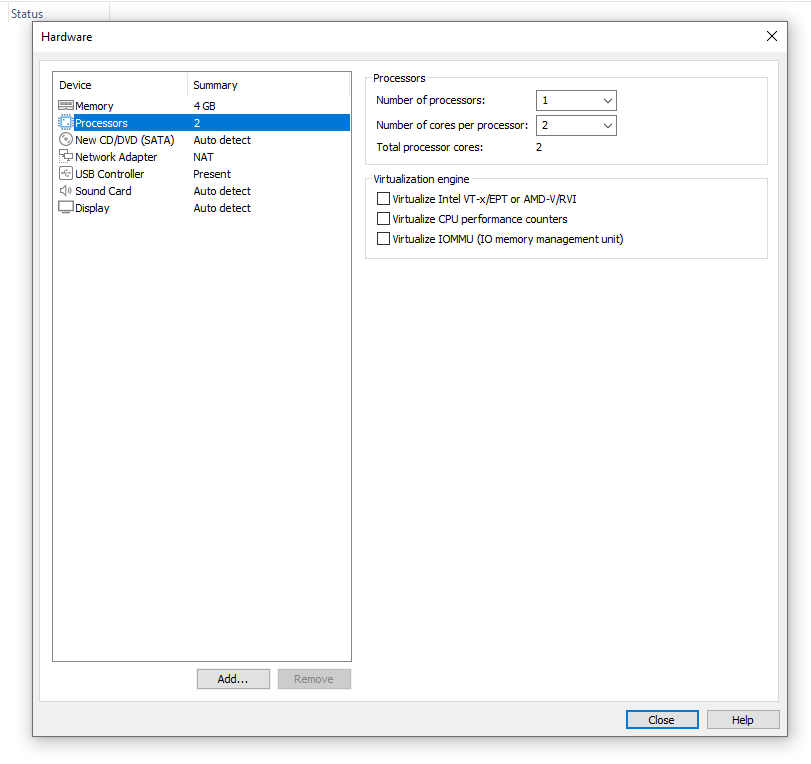

**Kya karna hai:** *Number of processors* = **1**, *Number of cores per processor* = **2**. Total = **2 cores**. *Virtualization engine* wale boxes untick rehne dein.

**Kyun?**
- Host ke paas 4 cores hain. VM ko 2 dene se Windows 10 ke liye 2 bachte hain.
- "1 processor x 2 cores" asli PC jaisa hai (ek CPU chip jis mein kai cores). Kuch software licenses *processors* (sockets) ginte hain, is liye yeh sab se saaf choice hai.
- *Virtualization engine* boxes sirf tab chahiye jab aap is VM ke **andar** VMs chalana chahein (isay *nested virtualization* kehte hain), maslan Hyper-V. Aaj zaroorat nahin.

### Step 11: CD/DVD: ISO lagayen

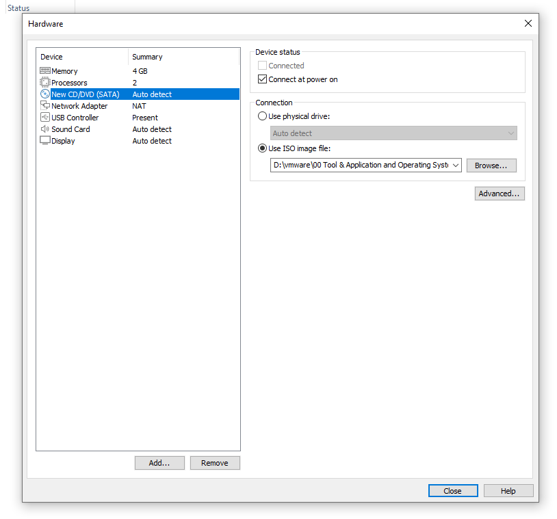

**Kya karna hai:** **New CD/DVD (SATA)** par click > **Use ISO image file** select > **Browse...** se apni Windows Server 2019 ISO chunein. **Connect at power on** tick hona chahiye.

**Kyun?** Is se "installation disc" VM ki virtual DVD drive mein lag jaati hai. *Connect at power on* ka matlab hai VM start hote hi disc andar hogi, taake woh us se boot kar sake.

### Step 12: Network adapter: Bridged

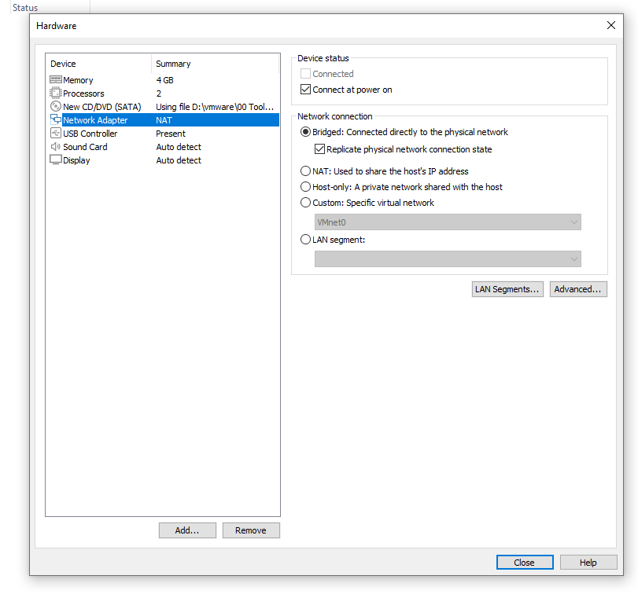

**Kya karna hai:** **Network Adapter** par click > **Bridged: Connected directly to the physical network** select karein. **Close** dabayen.

**Kyun?** Teen main options yeh hain:

| Mode | Aasaan matlab | Kis kaam ke liye |
|------|---------------|------------------|
| **Bridged** (yahan use hua) | VM aap ke asli network mein **ek aur asli PC ki tarah** shamil hoti hai. Ghar/school ke router se apna IP address leti hai. | Jab network ke doosre PCs ko server tak pohanchna ho (maslan aage domain controller ya file server). |
| **NAT** (default) | VM **host ke IP address ke peeche** chhupi hoti hai. Internet chala sakti hai, lekin doosre PCs aasani se us tak nahin pohanch sakte. | Saada internet access, sab se mehfooz default. |
| **Host-only** | VM **sirf host se** (aur doosri host-only VMs se) baat kar sakti hai. Internet nahin. | Alag thalag, private lab. |

**Note:** Kuch school ya office networks par Bridged block hota hai. Agar VM ko IP address na mile to NAT par switch karein.

### Step 13: Aakhri summary, phir Finish

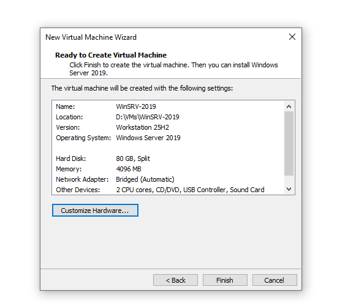

**Kya check karna hai:** *Hard Disk* **80 GB, Split**, *Memory* **4096 MB**, *Network Adapter* **Bridged (Automatic)**, *Location* **D:\VMs\WinSRV-2019**.

**Kya karna hai:** **Finish** dabayen.

### Step 14: VM ban gayi

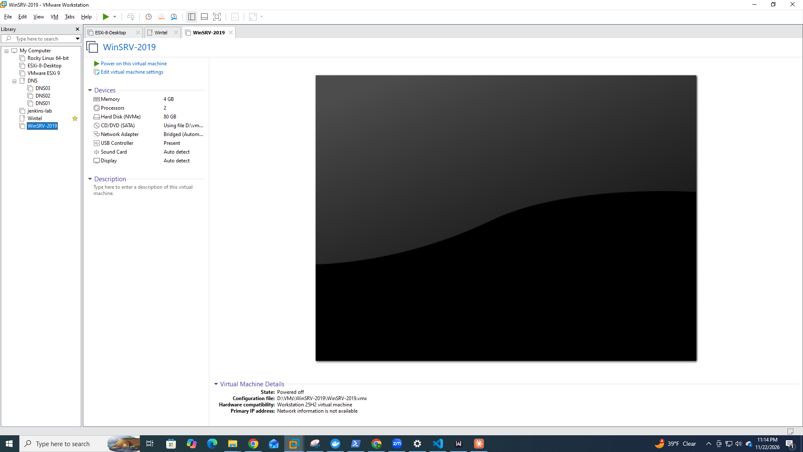

**Kya nazar aata hai:** `WinSRV-2019` baayen taraf **Library** mein aa gayi. *Devices* mein Memory 4 GB, Processors 2, **Hard Disk (NVMe)** 80 GB, CD/DVD (SATA) ISO ke saath, aur Network Adapter Bridged. *State: Powered off.*

**NVMe kyun?** Server 2019 ke liye VMware ne **NVMe** virtual disk chuni. NVMe ek tez, jadeed disk type hai. Yeh aap ko khud nahin chunna para, Typical wizard ne khud kar diya.

**Rukein!** Power on karne se pehle Part D karein. Is se aap woh masla bacha lenge jo mujhe aaya.

---

## Part D: Pehli dafa boot se pehle firmware theek karein

### Step 15: Jo masla mujhe aaya: UEFI Boot Manager

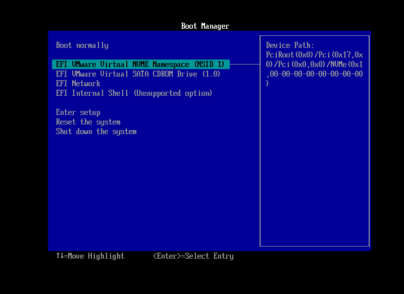

**Kya hua:** VM power on karne par Windows Setup start nahin hua. Mein is neeli **Boot Manager** screen par aa gaya. *EFI VMware Virtual SATA CDROM Drive* chunne par sirf **blinking cursor** aaya.

**Kyun?** VM **UEFI** firmware use kar rahi thi. UEFI mein Windows ISO sirf chand seconds ke liye *"Press any key to boot from CD or DVD..."* dikhati hai. Agar aap waqt par VM ke andar click karke koi key na dabayen to woh chhor deti hai aur Boot Manager par aa jaati hai. Poori tafseel: [Masla 3](TROUBLESHOOTING.roman-urdu.md#masla-3-uefi-boot-manager-aur-blinking-cursor).

**Mere liye kya kaam aaya:** Firmware ko UEFI se **BIOS** par badalna (agle do steps). Pehle VM **band** karein: **VM > Power > Shut Down Guest** ya **Power Off**.

### Step 16: VM Settings > Options kholein

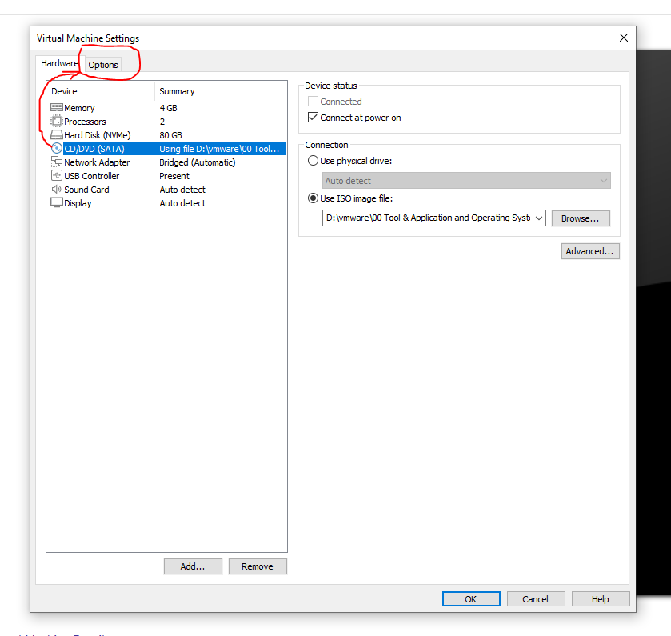

**Kya karna hai:** **VM > Settings** (ya *Edit virtual machine settings*) par click karein. Upar **Options** tab par click karein (laal daaire wala).

**Kyun?** *Hardware* tab devices ke liye hai (RAM, disk, network). *Options* tab VM ke rawaiye ke liye hai, jis mein **firmware** bhi shamil hai.

### Step 17: Firmware type ko UEFI se BIOS karein

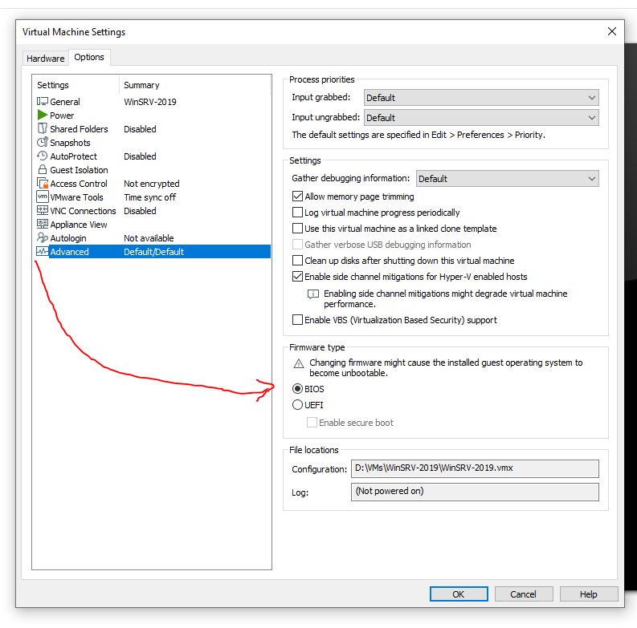

**Kya karna hai:** Neeche **Advanced** par click karein. **Firmware type** mein **BIOS** select karein. **OK** dabayen.

**Kyun?** Is lab mein BIOS firmware ISO se seedha boot karta hai, "press any key" wale chhote timer ka masla nahin hota.

**Aham:** Warning dekhein: *"Changing firmware might cause the installed guest operating system to become unbootable."* Firmware sirf OS install karne se **pehle** badlein. Baad mein badalne se Windows start hona band ho sakta hai.

**Yeh bhi jaan lein:** UEFI naya aur zyada mehfooz hai (Secure Boot aur 2 TB se bari disks support karta hai). Aaj kal asli servers aam tor par UEFI use karte hain. Agar aap UEFI rakhna chahte hain to power on karte hi VM window ke andar click karein aur prompt aate hi foran koi key dabayen.

---

## Part E: Windows Server 2019 install karein

VM power on karein: **Power on this virtual machine** (hara play button) dabayen. Phir **VM window ke andar click karein** taake keyboard aur mouse VM mein chalein.

### Step 18: Zabaan, waqt aur keyboard

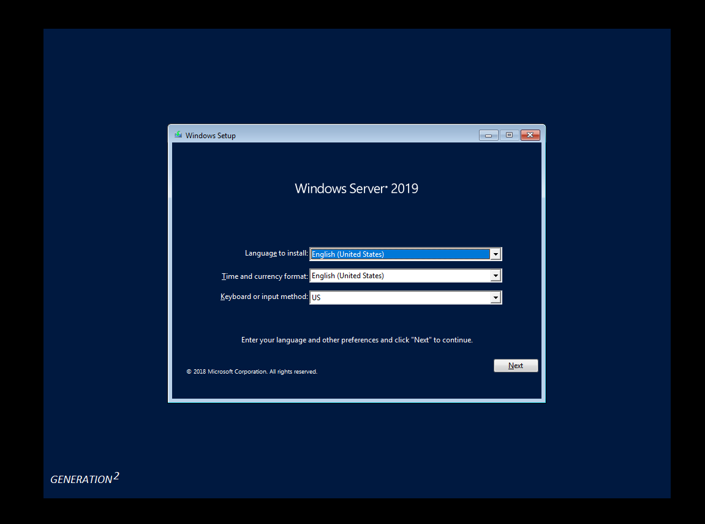

**Kya karna hai:** *Language to install*, *Time and currency format*, aur *Keyboard or input method* check karein (yahan: English (United States) aur US). **Next** dabayen.

**Kyun?** Yeh Windows ki zabaan aur keyboard layout set karte hain. Ghalat keyboard layout ho to password ke symbols woh nahin aayenge jo aap samajh rahe hain.

### Step 19: Install now

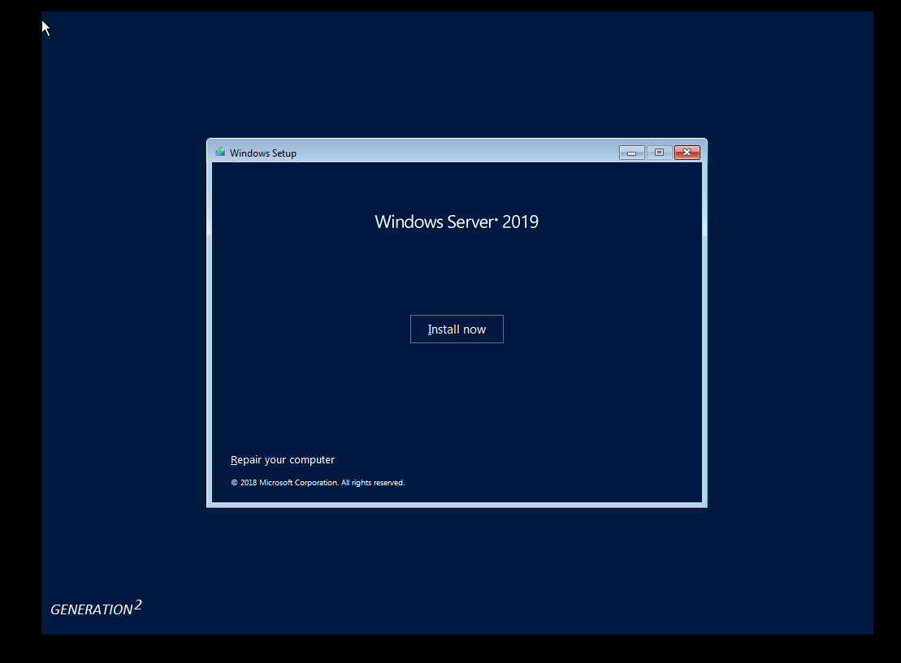

**Kya karna hai:** **Install now** dabayen.

**Kyun?** *Repair your computer* sirf kharab Windows theek karne ke liye hai. Hamein nayi installation chahiye.

### Step 20: Edition chunein: Datacenter (Desktop Experience)

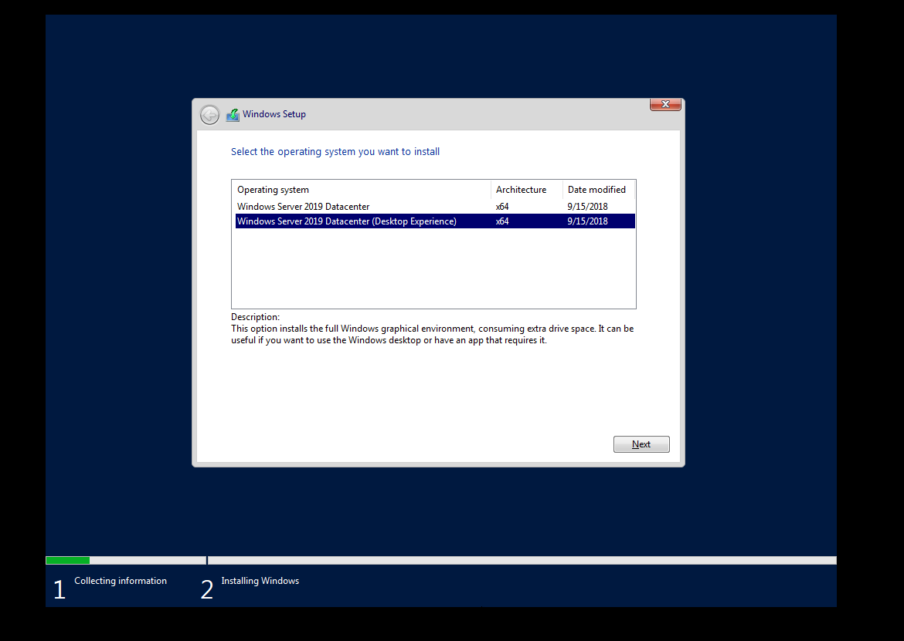

**Kya karna hai:** **Windows Server 2019 Datacenter (Desktop Experience)** select karein. **Next** dabayen.

**Kyun?** Yahan do options hain aur in ka farq bohat aham hai:

| Option | Kya milta hai |
|--------|---------------|
| **Datacenter** (bracket ke baghair) | **Server Core**: na desktop, na Start menu, sirf command window. Chhota, tez, zyada mehfooz, lekin beginners ke liye mushkil. |
| **Datacenter (Desktop Experience)** | Poora Windows desktop, Server Manager, File Explorer aur mouse wale tools. Seekhne ke liye behtareen. |

**Datacenter vs Standard:** Dono ke core features ek jaise hain. Datacenter ek licensed host par **unlimited** Windows Server VMs ki ijazat deta hai aur extra datacenter features (jaise Storage Spaces Direct aur Shielded VMs) deta hai. Standard 2 VMs ki ijazat deta hai. Evaluation lab mein Datacenter se aap sab kuch try kar sakte hain.

**Note:** Aap ki ISO mein Standard editions bhi ho sakti hain. Jo aap ki class kahe woh chunein.

### Step 21: License terms qubool karein

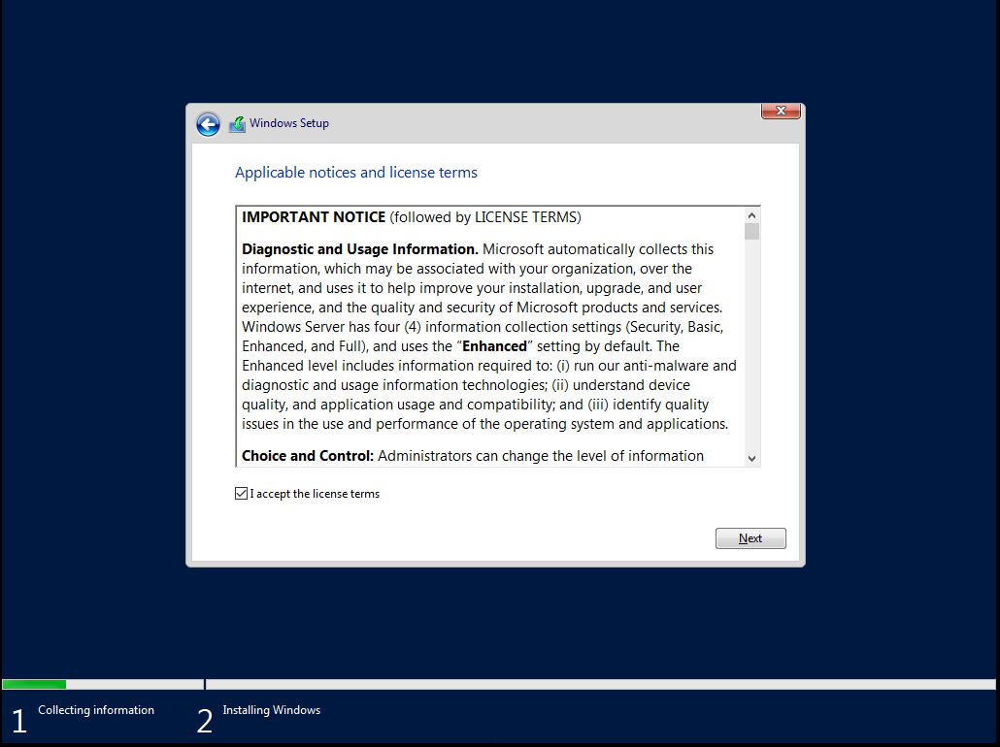

**Kya karna hai:** **I accept the license terms** tick karein. **Next** dabayen.

**Kyun?** Is ke baghair Setup aage nahin barhta. Pehla hissa batata hai ke Windows Microsoft ko kaun sa diagnostic data bhejta hai.

### Step 22: Custom install aur disk chunein

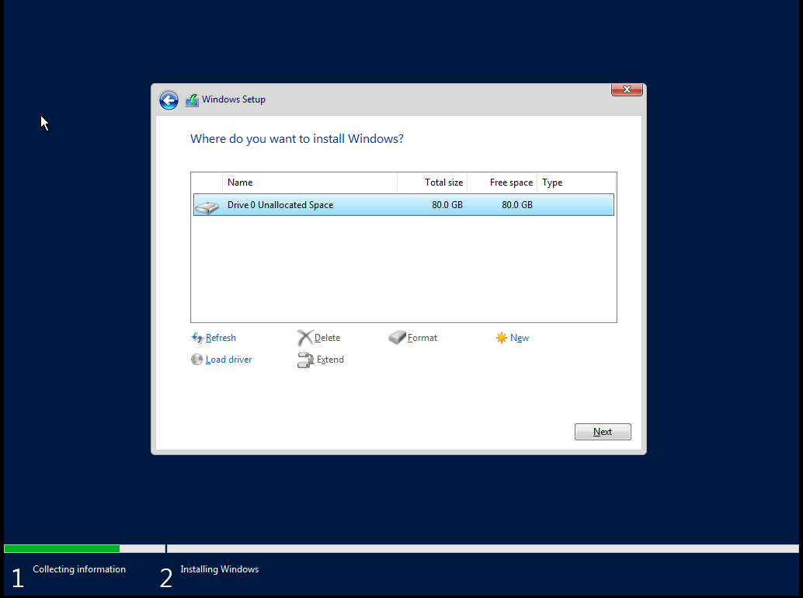

**Kya karna hai:** Pichli screen par **Custom: Install Windows only (advanced)** chunein. Yahan **Drive 0 Unallocated Space (80.0 GB)** select karke **Next** dabayen.

**Kyun?**
- *Upgrade* sirf pehle se installed purani Windows ko update karne ke liye hai. Hamari disk khali hai, is liye **Custom** chahiye.
- *Unallocated space* ka matlab hai "khali, abhi format nahin hui". Setup zaroori partitions khud bana leta hai. *New* ya *Format* dabane ki zaroorat nahin.

**Koi drive nazar nahin aa rahi?** [TROUBLESHOOTING](TROUBLESHOOTING.roman-urdu.md#masla-9-where-do-you-want-to-install-windows-par-koi-drive-nazar-nahin-aati) mein note dekhein.

### Step 23: Windows install hone ka intezar karein

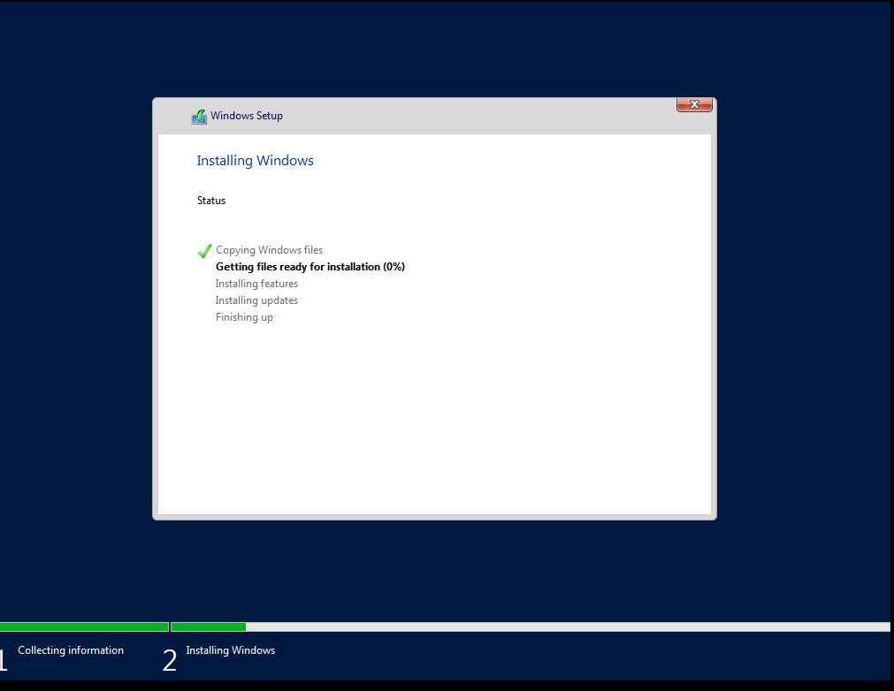

**Kya karna hai:** Kuch nahin. Intezar karein. Setup files copy karta hai, features aur updates install karta hai, phir **khud ek do dafa restart** hota hai. Aam tor par 10 se 20 minute lagte hain.

**Kuch kyun na chhuein?** Restart ke baad agar *"Press any key to boot from CD or DVD"* nazar aaye to **koi key mat dabayen**. Warna Setup dobara shuru se chal parega.

### Step 24: Product key: skip karein

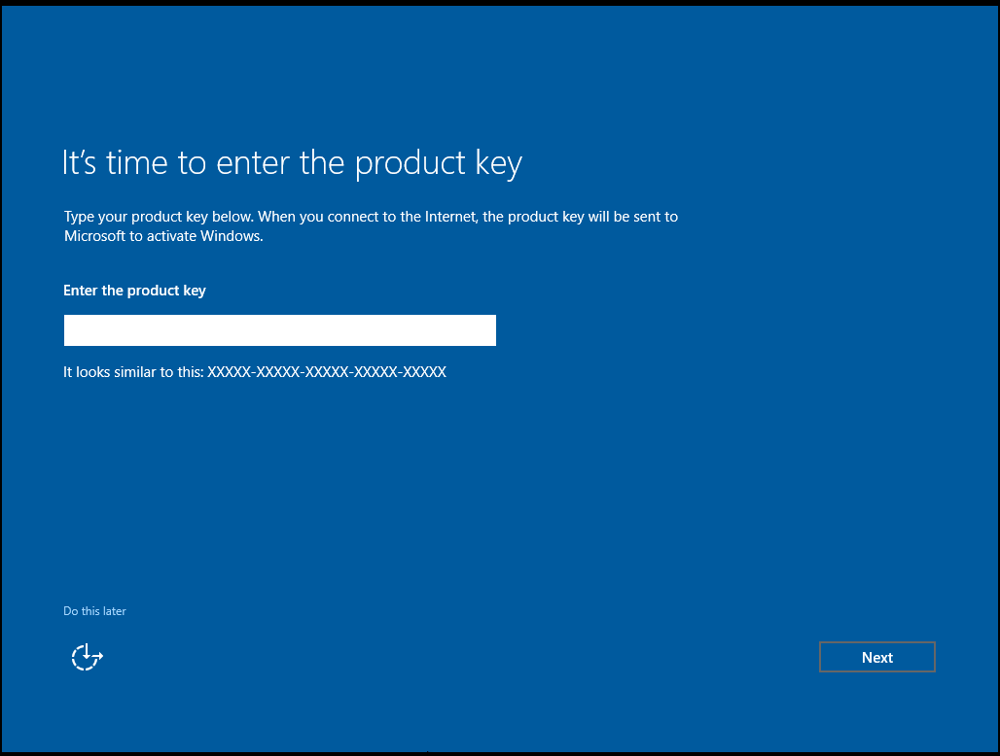

**Kya karna hai:** Neeche baayen taraf **Do this later** dabayen.

**Kyun?** Key ke baghair evaluation version poore **180 din** ka trial chalta hai. Class lab ke liye kaafi hai. (Kuch evaluation ISOs yeh screen dikhati hi nahin.)

### Step 25: Administrator password set karein

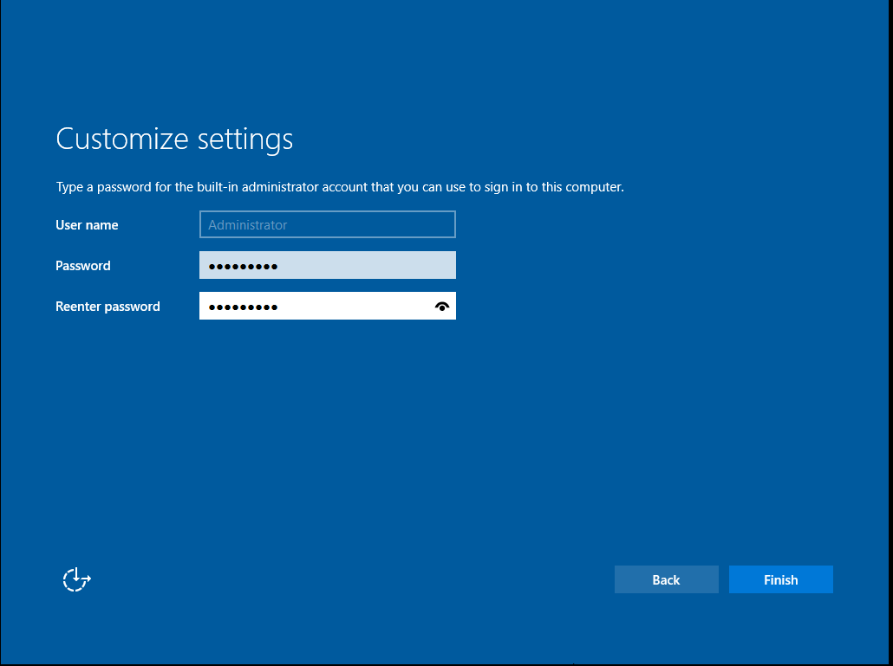

**Kya karna hai:** Built-in **Administrator** account ke liye do dafa **mazboot password** likhein. **Finish** dabayen.

**Kyun?** Administrator ke paas server ka poora control hota hai, is liye Windows Server **complex password zaroori** karta hai: kam az kam 8 characters, aur in chaar mein se 3 qisam: bare huroof, chhote huroof, numbers, symbols.

**Tip:** Jo likha woh dekhne ke liye aankh wale icon par click karein. Password ko password manager ya notebook mein rakhein. **GitHub par kabhi commit na karein.**

---

## Part F: Pehla login aur aakhri kaam

### Step 26: Pehli dafa login karein

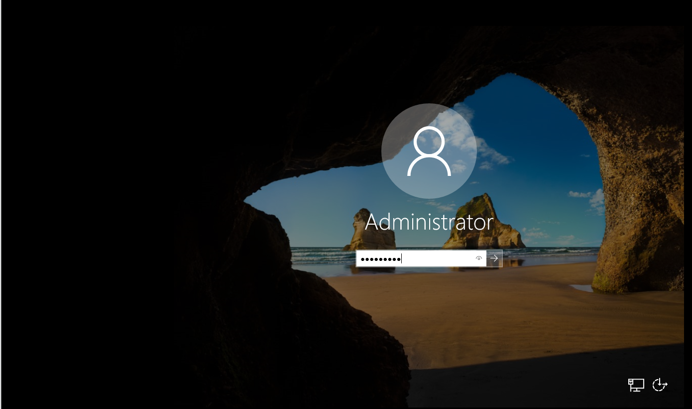

**Kya karna hai:** Lock screen par **`Ctrl + Alt + Insert`** dabayen (`Ctrl + Alt + Del` nahin). Password likhein aur Enter dabayen.

**Ctrl + Alt + Insert kyun?** `Ctrl + Alt + Del` dabane se aap ka **host** (Windows 10) usay pakar leta hai, VM tak nahin pohanchta. VMware is ke liye `Ctrl + Alt + Insert` istemal karta hai. Aap **VM > Send Ctrl+Alt+Del** bhi use kar sakte hain.

### Step 27: Networks: discovery allow karein?

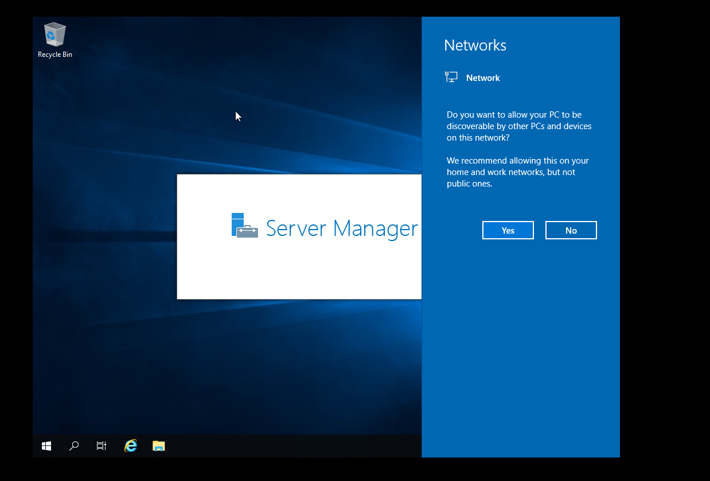

**Kya karna hai:** **Yes** dabayen.

**Kyun?** *Yes* network ko **Private** bana deta hai. Matlab *network discovery* on hai, aur aap ke lab network ke doosre PCs is server ko dekh sakte hain. Ghar/class lab ke server ke liye yahi chahiye. **Public** network (café, airport) par aap **No** chunenge.

**Saath hi:** **Server Manager** khud khul jaata hai. Yeh Windows server manage karne ka main control panel hai.

### Step 28: VMware Tools install karein

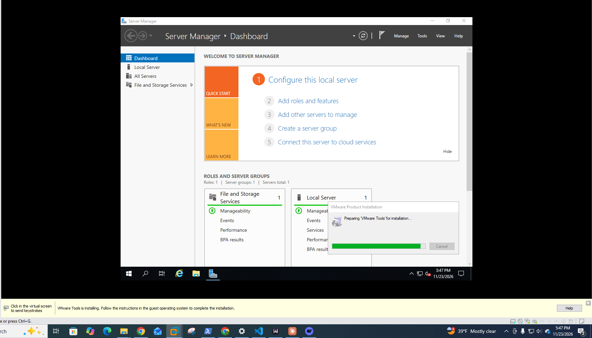

**Kya karna hai:** VMware mein **VM > Install VMware Tools** dabayen. VM mein ek virtual CD lag jaati hai. Agar installer khud start na ho to **File Explorer > This PC > DVD Drive (D:) VMware Tools** kholein aur **setup64.exe** chalayen.

**Kyun?** VMware Tools woh drivers hain jo VM ko istemal mein aasaan banate hain:
- mouse VM window ke andar bahar aasani se chalta hai,
- screen window ke hisaab se resize hoti hai,
- host aur VM ke darmiyan copy paste chalta hai,
- behtar network aur disk drivers,
- ghari host ke saath sync ho sakti hai.

**Is screenshot mein ghari dekhein:** VM **3:47 PM** dikha rahi hai jab ke host **5:47 PM**. Yeh hum Step 30 mein theek karenge.

### Step 29: Complete setup chunein

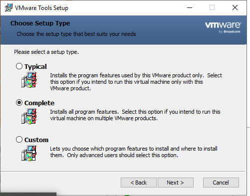

**Kya karna hai:** **Complete** select karein, **Next** phir **Install** dabayen. Poocha jaaye to VM **restart** karein.

**Kyun?**
- **Typical**: sirf *isi* VMware product (Workstation) ke features.
- **Complete**: saare features, agar aap baad mein yeh VM kisi aur VMware product (jaise ESXi ya Fusion) par le jaayen.
- **Custom**: features khud chunein (advanced users).

Is lab ke liye Typical ya Complete dono theek hain. Complete "sab kuch shamil" wala mehfooz option hai.

### Step 30: Sahi time zone set karein

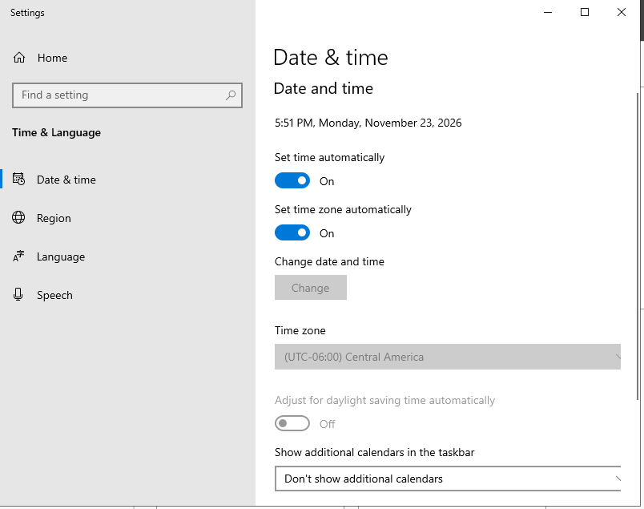

**Kya karna hai:** Taskbar ki ghari par right-click > **Adjust date/time**. **Time zone** ko apne asli zone par set karein.

**Kyun?** Windows Server default mein **Pacific Time** chunta hai. Meri VM host se **2 ghante peeche** thi. Servers mein sahi waqt bohat aham hai: **Active Directory** mein login **Kerberos** se hota hai, jo default mein fail ho jaata hai agar do computers ki ghari mein **5 minute se zyada** farq ho.

**Khayal rakhein (daylight saving):** Is screenshot mein time zone **(UTC-06:00) Central America** hai, aur *Adjust for daylight saving time* **Off** hai. "Central America" (Guatemala, Costa Rica waghera) daylight saving time **use nahin karta**. Agar aap US ya Canada ke Central zone mein rehte hain to **(UTC-06:00) Central Time (US & Canada)** chunein, warna saal ke aadhe hisse mein ghari 1 ghanta ghalat hogi. [Masla 8](TROUBLESHOOTING.roman-urdu.md#masla-8-ghalat-central-time-zone-daylight-saving-nahin) dekhein.

### Step 31: VMware Tools aur restart ke baad desktop

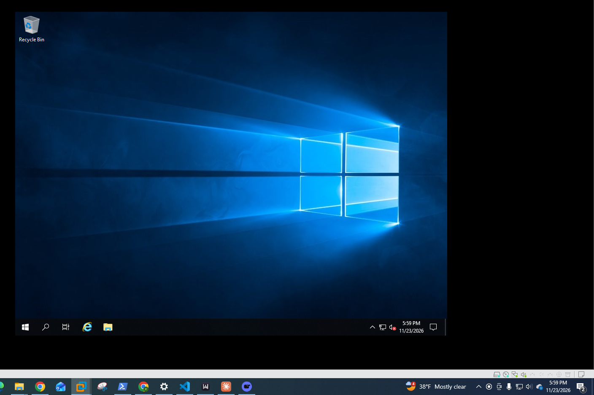

**Kya nazar aata hai:** VMware Tools install hone aur VM restart hone ke baad saaf desktop aata hai. VM ki ghari ab **5:59 PM** dikha rahi hai, **bilkul host ki ghari jaisi** (host taskbar ke neeche daayen). Waqt ka masla hal ho gaya.

**Kaise check karein ke VMware Tools kaam kar rahe hain:**
- Mouse `Ctrl + Alt` ke baghair VM window ke andar bahar chalta hai.
- VMware window ka size badlein to VM ki screen bhi resize hoti hai.
- Menu mein **VM > Install VMware Tools** ab **Reinstall VMware Tools** ban gaya hai.

### Step 32: Windows Admin Center ka pop-up

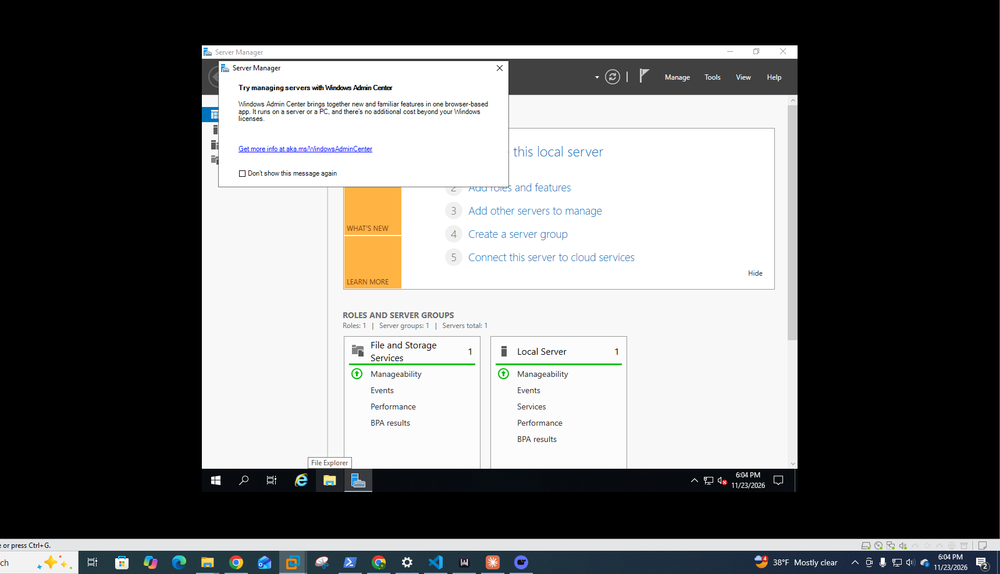

**Kya nazar aata hai:** Server Manager khulne par ek chhota box kehta hai **"Try managing servers with Windows Admin Center"**.

**Yeh kya hai:** **Windows Admin Center (WAC)** Microsoft ka free, **browser-based** tool hai servers manage karne ke liye. Aap isay ek dafa (server ya PC par) install karte hain, phir web browser mein khol kar ek hi jagah se kai servers manage karte hain. Yeh Server Manager ka jadeed saathi hai. Yeh pehle se install **nahin** hota; yeh box sirf isay try karne ka mashwara hai.

**Kya karna hai:** **Don't show this message again** tick karein aur **X** se box band kar dein. Yeh bilkul theek hai. Is se sirf yaad dihani chhup jaati hai. Kuch badalta ya kharab nahin hota, aur agar class mein zaroorat ho to aap baad mein bhi Windows Admin Center install kar sakte hain.

**Mubarak ho!** Ab aap ke paas chalti hui Windows Server 2019 VM hai.

---

## Kaam ke keyboard shortcuts

| Keys | Kya karti hain |
|------|----------------|
| `Ctrl + G` (ya VM ke andar click) | Keyboard aur mouse VM ke **andar** bhejein. |
| `Ctrl + Alt` | Mouse aur keyboard wapas host ko **chhorein**. |
| `Ctrl + Alt + Insert` | VM ko **Ctrl + Alt + Del** bhejein (login ya lock ke liye). |
| `Ctrl + Alt + Enter` | Full screen on / off. |
| `Ctrl + N` | New virtual machine wizard (host par, VMware mein). |

---

## Aage kya karein

1. **Snapshot lein** jis ka naam ho `Clean install`. (**VM > Snapshot > Take Snapshot**.) Snapshot ek "save point" hai. Agar aglay lab mein kuch kharab ho jaaye to seconds mein wapas aa sakte hain.
2. **Server ka naam badlein**, kisi maani-khez naam se, jaise `SRV2019-DC01` (Server Manager > Local Server > Computer name). Is ke baad restart hoga.
3. **Static IP address dein**, taake is ka address kabhi na badle. Servers ko fixed address chahiye.
4. **Windows Update chalayen.**
5. **Aglay lab ka idea:** Active Directory Domain Services install karein aur is server ko domain controller banayen.

Apni seekh check karein:
- [quiz.html](quiz.html) kholein aur 25 mein se 20 ya zyada ka target rakhein.
- [INTERVIEW-QA.roman-urdu.md](INTERVIEW-QA.roman-urdu.md) ke jawab buland awaaz mein practice karein.

---

## Doosre Windows versions ke liye yeh bundle dobara istemal karna

Yeh folder ek template hai. **Server 2022**, **Server 2025** ya **Windows 11** ka bundle banane ke liye:

1. Poora `WS2019/` folder copy karke naam badlein, maslan `WS2022/`.
2. `images/` mein screenshots badlein. Wohi pattern rakhein: `NN-short-description.png` (pehle do hindson wala step number, taake files tarteeb se lagein).
3. `README.md` aur `README.roman-urdu.md` mein section 3 ki settings table aur badalne wale steps update karein. Aam tor par yeh cheezein alag hoti hain:
   - **Windows 11** ko **UEFI, Secure Boot aur TPM 2.0** chahiye, is liye **UEFI hi rakhein** (BIOS par mat badlein) aur TPM add karein (VM > Settings > Options > Access Control > Encrypt, phir Hardware > Add > Trusted Platform Module).
   - **Server 2022 / 2025** UEFI ke saath behtar chalte hain. Wohi "press any key" prompt aayega.
   - Naye versions ko zyada RAM aur disk chahiye.
4. `TROUBLESHOOTING`: wohi *Alaamat / Wajah / Hal / Sabaq* format rakhein aur naye masle shamil karein.
5. `quiz.html`: saare sawal `<script>` section ke upar `QUESTIONS` naam ki list mein hain. Wahin text badlein; baqi code chhoone ki zaroorat nahin.
6. Har markdown file ki English aur Roman Urdu copy rakhein (`NAME.md` aur `NAME.roman-urdu.md`), aur dono ke upar ek doosre ka link dein.
7. Naya bundle upar wali [Wintel Lab README](../README.roman-urdu.md) ki table mein shamil karein.

---

*Lab environment: Windows 10 Pro host, VMware Workstation Pro 25H2, Windows Server 2019 Datacenter Evaluation. Class lab study guide ke tor par likha gaya. Is repository mein koi password ya product key shamil nahin.*
