# Troubleshooting: Windows Server 2019 in VMware Workstation Pro

**Language:** English | [Roman Urdu](TROUBLESHOOTING.roman-urdu.md)  ·  Back to the [guide](README.md)

These are real problems from my lab, written so you can fix them fast. Each one follows the same format:

- **Symptom**: what you see.
- **Cause**: why it happens.
- **Fix**: what to do, step by step.
- **Lesson**: the idea to remember for next time.

Issues 1 to 8 happened during this lab. Issues 9 and 10 are common problems for other students that I didn't hit, but you might.

## Quick index

| # | Problem | Guide step |
|---|---------|-----------|
| 1 | [VM saved inside OneDrive on C:](#issue-1-vm-saved-inside-onedrive-on-c) | 04-05 |
| 2 | [Virtual disk stored as a single file](#issue-2-virtual-disk-stored-as-a-single-file) | 06-07 |
| 3 | [UEFI Boot Manager and a blinking cursor](#issue-3-uefi-boot-manager-and-a-blinking-cursor) | 15-17 |
| 4 | [VM clock is 2 hours behind the host](#issue-4-vm-clock-is-2-hours-behind-the-host) | 28, 30, 31 |
| 5 | [Ctrl + Alt + Del opens the host's menu, not the VM's](#issue-5-ctrl--alt--del-opens-the-hosts-menu-not-the-vms) | 26 |
| 6 | [Mouse is stuck inside the VM](#issue-6-mouse-is-stuck-inside-the-vm) | any |
| 7 | [VMware Tools: Typical or Complete?](#issue-7-vmware-tools-typical-or-complete) | 28-29 |
| 8 | [Wrong Central time zone (no daylight saving)](#issue-8-wrong-central-time-zone-no-daylight-saving) | 30 |
| 9 | [No drive shown on "Where do you want to install Windows?"](#issue-9-no-drive-shown-on-where-do-you-want-to-install-windows) | 22 |
| 10 | [VM won't power on: virtualization error](#issue-10-vm-wont-power-on-virtualization-error) | 00b |

---

## Issue 1: VM saved inside OneDrive on C:

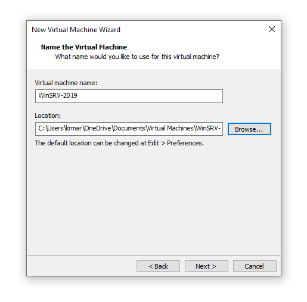

**Symptom**
The *Name the Virtual Machine* screen showed the location `C:\Users\<you>\OneDrive\Documents\Virtual Machines\WinSRV-2019`.

**Cause**
VMware's default folder for new VMs is inside *Documents*. On many Windows 10 PCs, *Documents* is synced by **OneDrive**, so the VM would be saved in a cloud-synced folder on the smaller `C:` drive.

**Fix**
1. In the wizard, change *Location* to `D:\VMs\WinSRV-2019` (Step 05).
2. Optional, so every new VM goes there: **Edit > Preferences > Workspace > Default location for virtual machines** = `D:\VMs`.

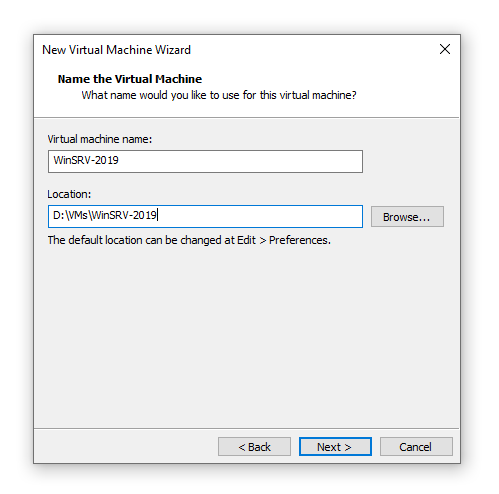

**Lesson**
Keep VMs **out of OneDrive** (or any sync folder like Dropbox or Google Drive). VM files are large and constantly changing. Syncing them wastes internet and disk, and can **corrupt** the VM if a file is synced while it is in use. Store VMs on the drive with the **most free space**.

---

## Issue 2: Virtual disk stored as a single file

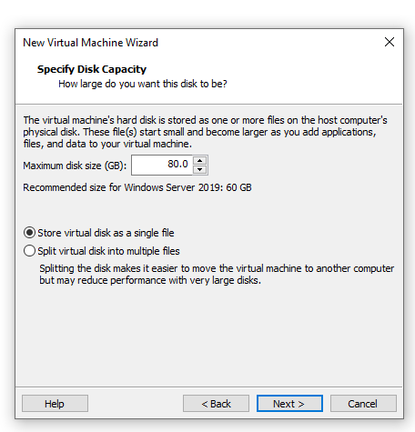

**Symptom**
The *Specify Disk Capacity* screen had **Store virtual disk as a single file** selected.

**Cause**
That is VMware's default for this version.

**Fix**
Select **Split virtual disk into multiple files** (Step 07).

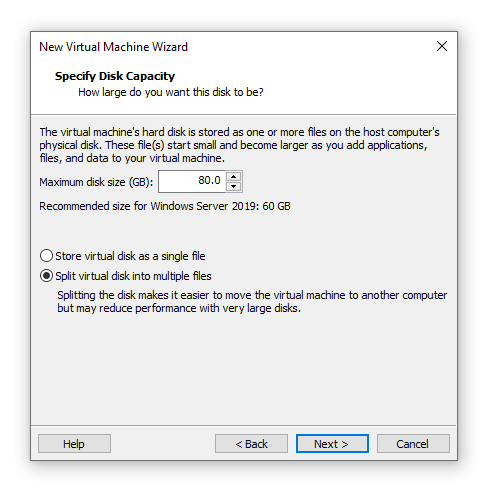

**Lesson**
Split disks are made of many smaller files, which are **easier to copy, move and back up** (for example to a FAT32 USB drive, which can't store any single file bigger than 4 GB). Single-file disks can be a little faster with very large disks. For a lab, **split** is the practical choice.

---

## Issue 3: UEFI Boot Manager and a blinking cursor

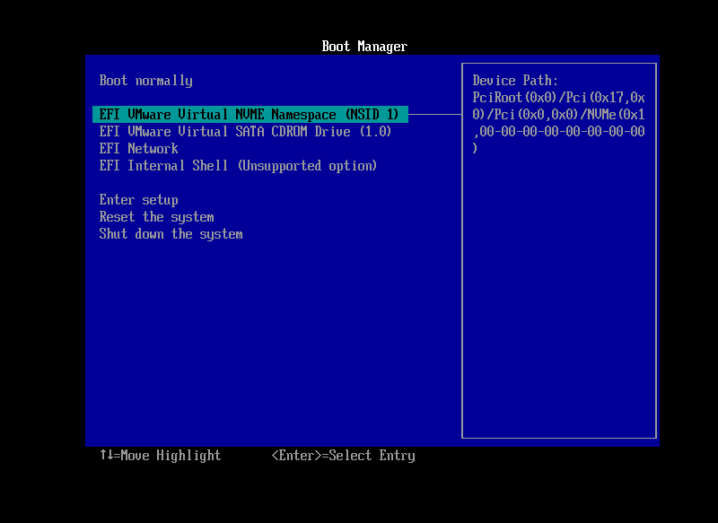

**Symptom**
On first power-on, Windows Setup did not start. Instead, a blue **Boot Manager** screen appeared with options like *EFI VMware Virtual NVME Namespace* and *EFI VMware Virtual SATA CDROM Drive*. Choosing the CDROM only showed a **blinking cursor**.

**Cause**
- The VM used **UEFI** firmware (VMware's default for Server 2019).
- With UEFI, the Windows ISO shows *"Press any key to boot from CD or DVD..."* for only about **5 seconds**.
- I missed it: the keyboard was still on the host because I had not clicked inside the VM. With no key press, the VM skipped the DVD, found an empty disk, and fell back to the Boot Manager.

**Fix I tried first (did not work for me)**
Select the SATA CDROM entry in Boot Manager and tap the **Spacebar** repeatedly. It only blinked.

**Fix that worked**
1. Power off the VM: **VM > Power > Power Off**.
2. Open **VM > Settings**, then the **Options** tab.

   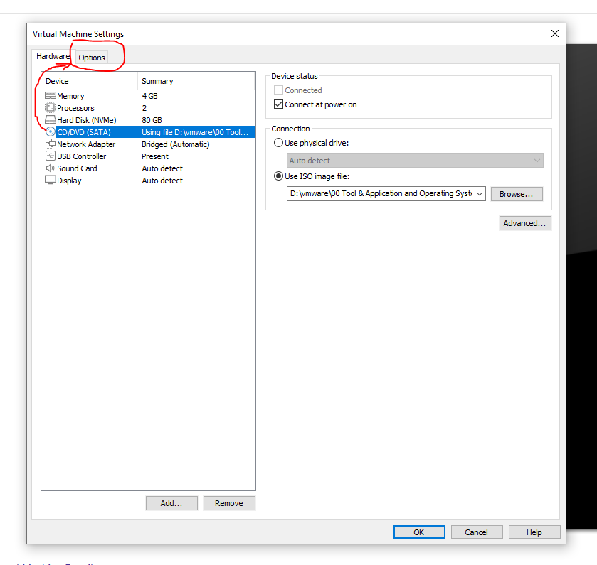

3. Click **Advanced**. Under **Firmware type**, change **UEFI** to **BIOS**. Click **OK**.

   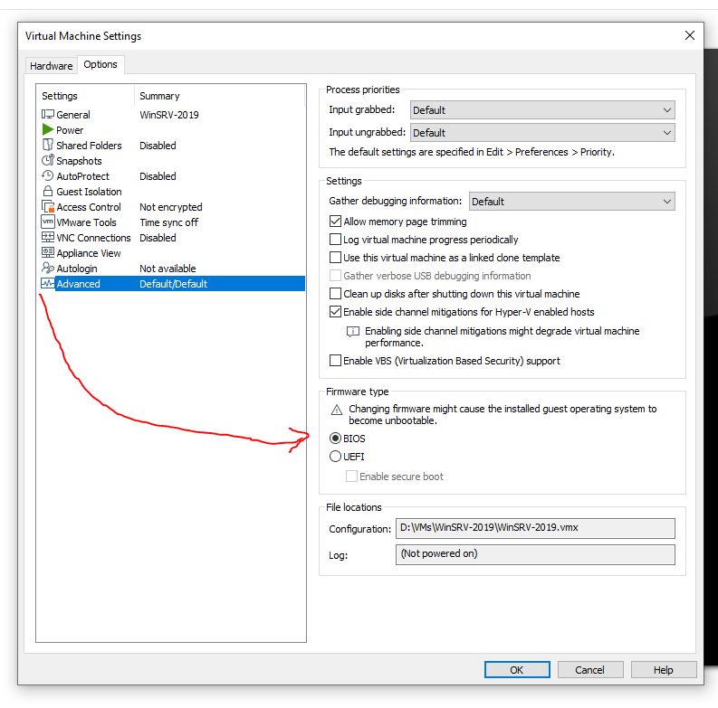

4. Power on the VM again. Windows Setup starts straight away.

**Other fix (if you want to keep UEFI)**
Power on the VM and **immediately click inside the VM window**, then press any key as soon as you see *"Press any key to boot from CD or DVD..."*. You can also use **VM > Power > Power On to Firmware** to open the boot menu on purpose and choose the CD/DVD.

**Lesson**
- **Change firmware type only BEFORE installing the OS.** The warning says it clearly: changing it later can make Windows unbootable, because BIOS and UEFI set up the disk differently (MBR vs GPT).
- **BIOS** is older and simpler. **UEFI** is newer and supports **Secure Boot** and disks larger than 2 TB. Windows 11 *requires* UEFI, so this BIOS fix won't work there.

---

## Issue 4: VM clock is 2 hours behind the host

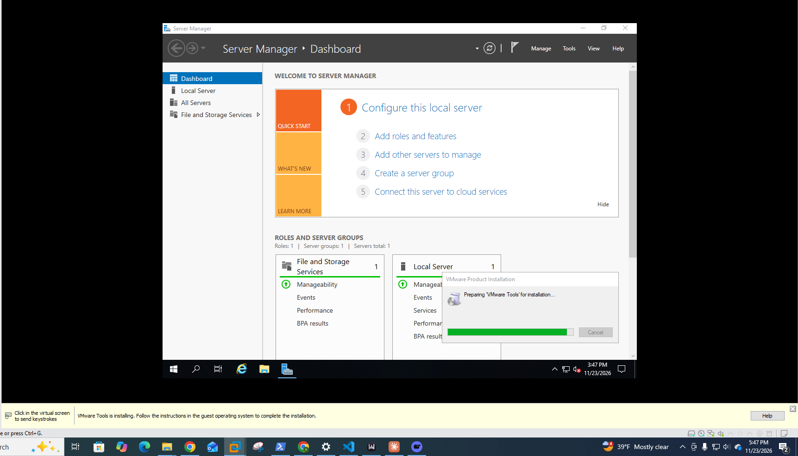

**Symptom**
The VM's clock showed **3:47 PM** while the host's clock showed **5:47 PM**.

**Cause**
Windows Server is installed with the **(UTC-08:00) Pacific Time** zone by default. The time itself is correct, but it is shown in the wrong zone. Pacific is 2 hours behind Central.

**Fix**
1. Inside the VM, right-click the clock in the taskbar > **Adjust date/time**.
2. Under **Time zone**, choose your real zone, for example **(UTC-06:00) Central Time (US & Canada)**.
3. The clock updates immediately. After VMware Tools is installed and the VM restarts, the VM and host clocks match (Step 31):

   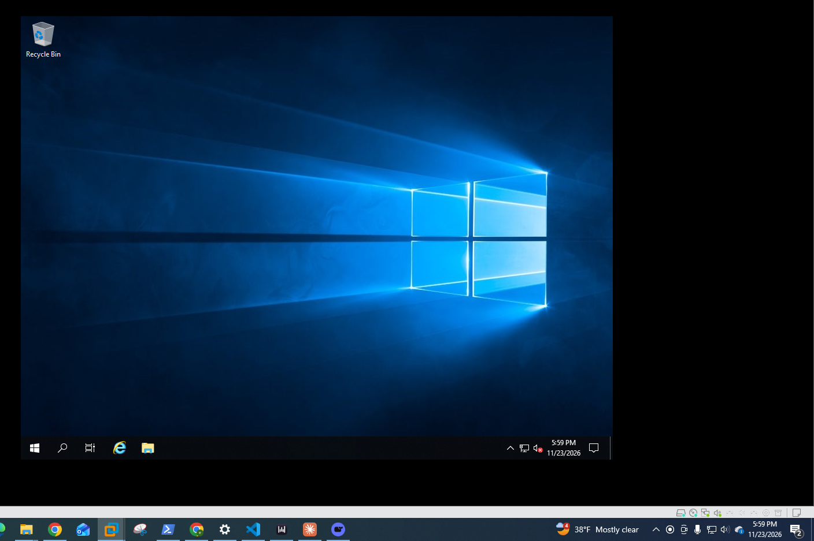

**Lesson**
Correct time is critical on servers. **Active Directory** uses **Kerberos** for logins, and Kerberos by default **rejects logins if two computers' clocks differ by more than 5 minutes**. Always set the time zone right after installing a server.

---

## Issue 5: Ctrl + Alt + Del opens the host's menu, not the VM's

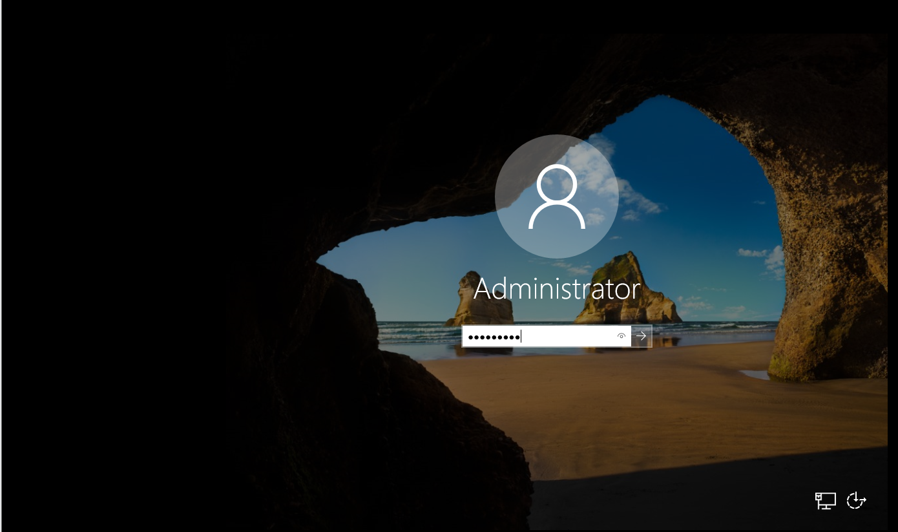

**Symptom**
On the VM lock screen, pressing `Ctrl + Alt + Del` opened the **host's** (Windows 10) security screen instead of the VM's login box.

**Cause**
`Ctrl + Alt + Del` is a special key combination that the host Windows always grabs first. It never reaches the VM.

**Fix**
Use **`Ctrl + Alt + Insert`** inside the VM. Or use the menu: **VM > Send Ctrl+Alt+Del**.

**Lesson**
In VMware Workstation, **`Ctrl + Alt + Insert` = `Ctrl + Alt + Del` for the VM**. (Other hypervisors use different keys. Hyper-V uses `Ctrl + Alt + End`.)

---

## Issue 6: Mouse is stuck inside the VM

**Symptom**
After clicking in the VM, the mouse pointer cannot leave the VM window, and the keyboard only types into the VM.

**Cause**
Before VMware Tools is installed, VMware "grabs" the mouse and keyboard when you click in the VM, so the guest can use them.

**Fix**
Press **`Ctrl + Alt`** together and release. The mouse and keyboard go back to the host. (Press `Ctrl + G` or click in the VM to give them back to the VM.) Installing **VMware Tools** fixes this for good: the mouse then moves in and out freely.

**Lesson**
`Ctrl + Alt` = "let go". The bar at the bottom of the VMware window also reminds you: *"To direct input to this VM, click inside or press Ctrl+G."*

---

## Issue 7: VMware Tools: Typical or Complete?

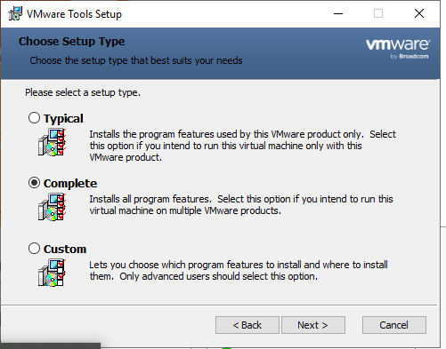

**Symptom**
The VMware Tools installer asks you to pick **Typical**, **Complete** or **Custom**, and it is not obvious which to choose.

**Cause**
The three options install different sets of features.

**Fix**
| Option | Installs | Choose it when |
|--------|----------|----------------|
| **Typical** | Only features for *this* VMware product (Workstation) | The VM will only ever run in Workstation. |
| **Complete** (I chose this) | All features | The VM might later move to another VMware product, like ESXi or Fusion. |
| **Custom** | Only the features you tick | You are an advanced user. |

Pick **Complete** (safe, "everything") or **Typical**, click **Next > Install**, then **restart the VM**.

**Tip:** If the installer does not start after **VM > Install VMware Tools**, open **File Explorer > This PC**, double-click the **DVD Drive (VMware Tools)**, and run **setup64.exe**.

**Lesson**
VMware Tools should **always** be installed in a VMware VM. It adds better graphics, mouse, network and disk drivers, copy/paste, and time sync.

---

## Issue 8: Wrong Central time zone (no daylight saving)

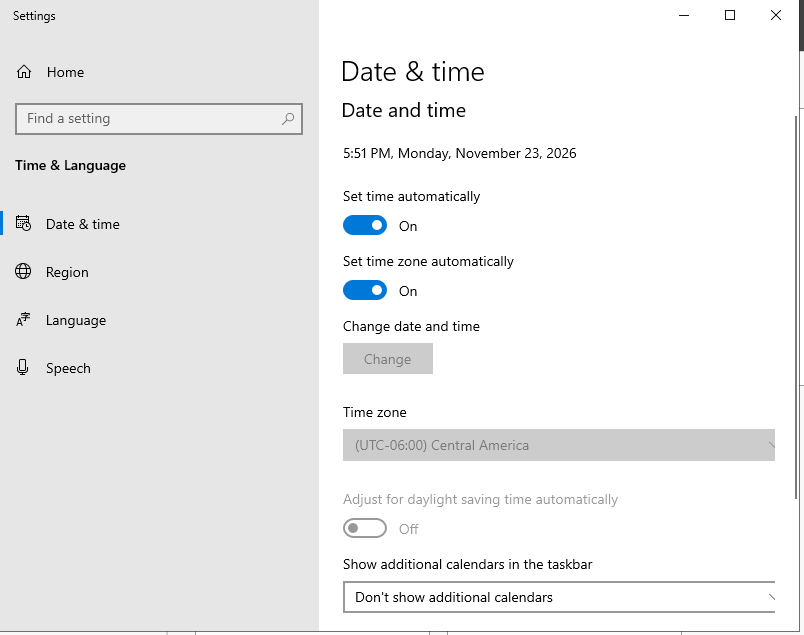

**Symptom**
The time zone was set to **(UTC-06:00) Central America**, and **Adjust for daylight saving time automatically** was greyed out / Off. The clock looked right in November, but would be **1 hour wrong** during US summer time.

**Cause**
There are two different zones with "Central" and UTC-06:00 in the list:

| Time zone | Who uses it | Daylight saving? |
|-----------|-------------|------------------|
| **(UTC-06:00) Central America** | Guatemala, Costa Rica, El Salvador, Honduras, Nicaragua | **No** |
| **(UTC-06:00) Central Time (US & Canada)** | Chicago, Dallas, Winnipeg, etc. | **Yes** (UTC-05:00 in summer) |

They show the same time in winter, so the mistake is easy to miss. *Set time zone automatically* can also pick the wrong one.

**Fix**
1. Right-click the clock > **Adjust date/time**.
2. Turn **Set time zone automatically** **Off**.
3. Choose **(UTC-06:00) Central Time (US & Canada)** (or your real zone).
4. Check that **Adjust for daylight saving time automatically** is **On**.

**Lesson**
Pick the time zone by **location**, not just by the UTC number. Two zones can share an offset but have different daylight saving rules.

---

## Issue 9: No drive shown on "Where do you want to install Windows?"

*(I did not hit this one, but it is common.)*

**Symptom**
The disk list in Setup is empty.

**Cause**
Windows Setup has no driver for the VM's virtual disk controller. This can happen if you used the **Custom** wizard and picked a controller like **VMware Paravirtual SCSI**.

**Fix (easiest)**
Power off, open **VM > Settings > Hardware**, remove the disk and add a new one of type **NVMe** or **SATA** (Windows has these drivers built in). Or start again with the **Typical** wizard as in this guide.

**Lesson**
Setup can only install on disks it has drivers for. The Typical wizard picks a disk type that works out of the box.

---

## Issue 10: VM won't power on: virtualization error

*(I did not hit this one, but it is common.)*

**Symptom**
Powering on shows an error like *"This host supports Intel VT-x, but Intel VT-x is disabled"*.

**Cause**
CPU virtualization is turned off in the host PC's BIOS/UEFI settings. Check Task Manager > Performance > CPU: **Virtualization: Disabled**.

**Fix**
1. Restart the host PC and enter its setup screen (often `F2`, `F10`, `Del` or `Esc` while starting).
2. Find **Intel Virtualization Technology (VT-x)** or **AMD SVM / AMD-V** and set it to **Enabled**.
3. Save and exit. Check Task Manager again: it should say **Enabled**.

**Lesson**
Always check **Virtualization: Enabled** before starting a VM lab (Step 00b).

---

## Still stuck?

1. Read the error message slowly and search the exact text online.
2. Check VMware's log: **VM > Settings > Options > Advanced > File locations > Log** (the `vmware.log` file in the VM's folder).
3. Ask a classmate or your instructor, and share a screenshot of the error (never your password).
