# Troubleshooting: VMware Workstation Pro mein Windows Server 2019

**Zabaan (Language):** [English](TROUBLESHOOTING.md) | Roman Urdu  ·  Wapas [guide](README.roman-urdu.md) par

Yeh mere lab ke asli masle hain, is tarah likhe gaye ke aap jaldi theek kar sakein. Har masla ek hi format mein hai:

- **Alaamat (Symptom)**: aap ko kya nazar aata hai.
- **Wajah (Cause)**: aisa kyun hota hai.
- **Hal (Fix)**: kya karna hai, step by step.
- **Sabaq (Lesson)**: agli dafa ke liye yaad rakhne wali baat.

Masla 1 se 8 is lab mein mujhe aaye. Masla 9 aur 10 doosre students ko aksar aate hain, mujhe nahin aaye, lekin aap ko aa sakte hain.

## Fehrist (Quick index)

| # | Masla | Guide step |
|---|-------|-----------|
| 1 | [VM C: par OneDrive ke andar save ho rahi thi](#masla-1-vm-c-par-onedrive-ke-andar-save-ho-rahi-thi) | 04-05 |
| 2 | [Virtual disk ek hi file mein thi](#masla-2-virtual-disk-ek-hi-file-mein-thi) | 06-07 |
| 3 | [UEFI Boot Manager aur blinking cursor](#masla-3-uefi-boot-manager-aur-blinking-cursor) | 15-17 |
| 4 | [VM ki ghari host se 2 ghante peeche](#masla-4-vm-ki-ghari-host-se-2-ghante-peeche) | 28, 30, 31 |
| 5 | [Ctrl + Alt + Del se host ka menu khulta hai, VM ka nahin](#masla-5-ctrl--alt--del-se-host-ka-menu-khulta-hai-vm-ka-nahin) | 26 |
| 6 | [Mouse VM ke andar phans gaya](#masla-6-mouse-vm-ke-andar-phans-gaya) | koi bhi |
| 7 | [VMware Tools: Typical ya Complete?](#masla-7-vmware-tools-typical-ya-complete) | 28-29 |
| 8 | [Ghalat Central time zone (daylight saving nahin)](#masla-8-ghalat-central-time-zone-daylight-saving-nahin) | 30 |
| 9 | ["Where do you want to install Windows?" par koi drive nazar nahin aati](#masla-9-where-do-you-want-to-install-windows-par-koi-drive-nazar-nahin-aati) | 22 |
| 10 | [VM power on nahin hoti: virtualization error](#masla-10-vm-power-on-nahin-hoti-virtualization-error) | 00b |

---

## Masla 1: VM C: par OneDrive ke andar save ho rahi thi

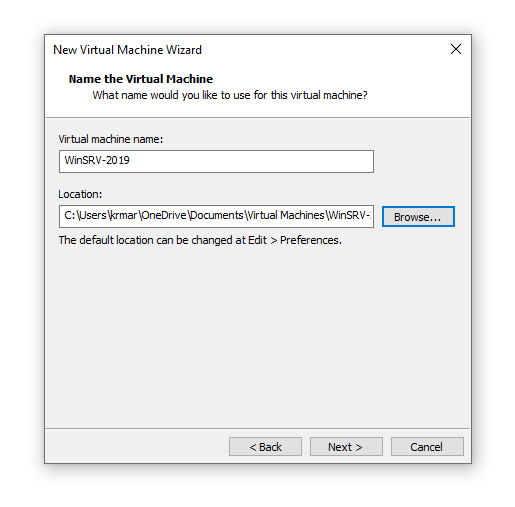

**Alaamat**
*Name the Virtual Machine* screen par location `C:\Users\<aap>\OneDrive\Documents\Virtual Machines\WinSRV-2019` thi.

**Wajah**
VMware nayi VMs ke liye default folder *Documents* ke andar rakhta hai. Bohat se Windows 10 PCs par *Documents* **OneDrive** se sync hota hai, is liye VM chhoti `C:` drive par cloud-sync folder mein save hoti.

**Hal**
1. Wizard mein *Location* ko `D:\VMs\WinSRV-2019` kar dein (Step 05).
2. Optional, taake har nayi VM wahin jaaye: **Edit > Preferences > Workspace > Default location for virtual machines** = `D:\VMs`.

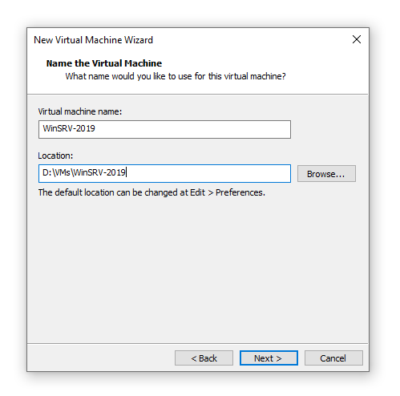

**Sabaq**
VMs ko **OneDrive se bahar** rakhein (ya kisi bhi sync folder jaise Dropbox ya Google Drive se). VM files bari hoti hain aur har waqt badalti hain. Unhein sync karna internet aur disk zaya karta hai, aur agar file use ke dauran sync ho to VM **corrupt** ho sakti hai. VMs ko **sab se zyada khali jagah** wali drive par rakhein.

---

## Masla 2: Virtual disk ek hi file mein thi

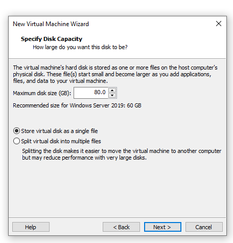

**Alaamat**
*Specify Disk Capacity* screen par **Store virtual disk as a single file** selected tha.

**Wajah**
Is version mein VMware ka default yahi hai.

**Hal**
**Split virtual disk into multiple files** select karein (Step 07).

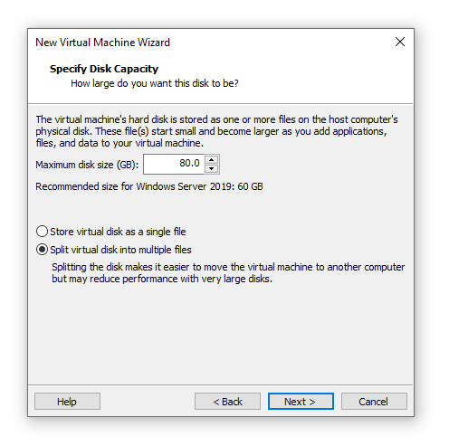

**Sabaq**
Split disk kai chhoti files se banti hai, jinhein **copy, move aur backup karna aasaan** hai (maslan FAT32 USB par, jo 4 GB se bari koi file nahin rakh sakti). Single-file disk bohat bari disks mein thori tez ho sakti hai. Lab ke liye **split** amli choice hai.

---

## Masla 3: UEFI Boot Manager aur blinking cursor

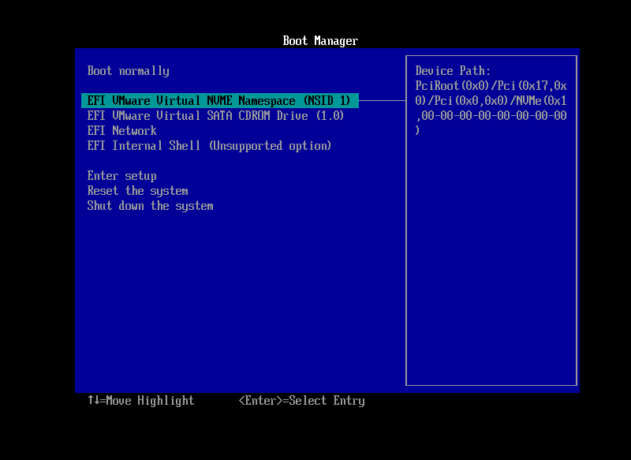

**Alaamat**
Pehli dafa power on karne par Windows Setup start nahin hua. Is ke bajaye neeli **Boot Manager** screen aayi jis mein *EFI VMware Virtual NVME Namespace* aur *EFI VMware Virtual SATA CDROM Drive* jaise options the. CDROM chunne par sirf **blinking cursor** aaya.

**Wajah**
- VM **UEFI** firmware use kar rahi thi (Server 2019 ke liye VMware ka default).
- UEFI mein Windows ISO *"Press any key to boot from CD or DVD..."* sirf taqreeban **5 seconds** dikhati hai.
- Mujh se reh gaya: keyboard abhi host par tha kyun ke maine VM ke andar click nahin kiya tha. Key na dabne par VM ne DVD chhor di, khali disk mili, aur Boot Manager par aa gayi.

**Pehle jo hal try kiya (mere liye kaam nahin aaya)**
Boot Manager mein SATA CDROM chun kar **Spacebar** baar baar dabana. Sirf cursor blink karta raha.

**Jo hal kaam aaya**
1. VM band karein: **VM > Power > Power Off**.
2. **VM > Settings** kholein, phir **Options** tab.

   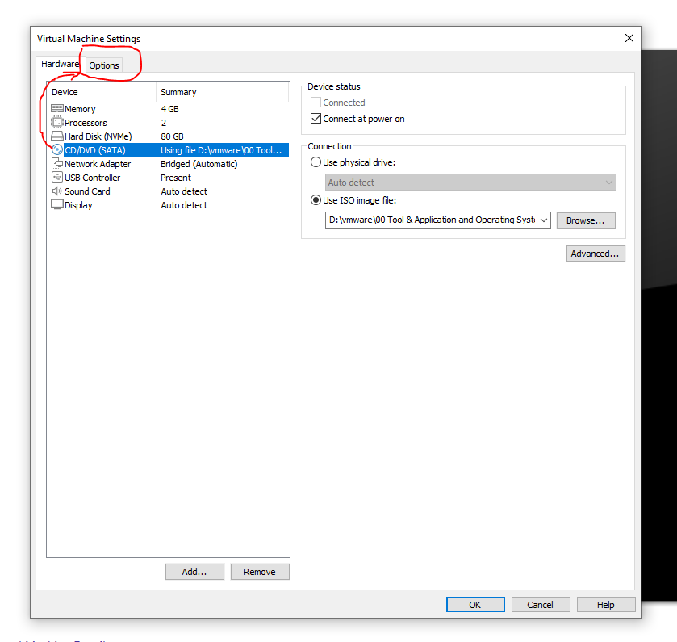

3. **Advanced** par click karein. **Firmware type** mein **UEFI** ko **BIOS** kar dein. **OK** dabayen.

   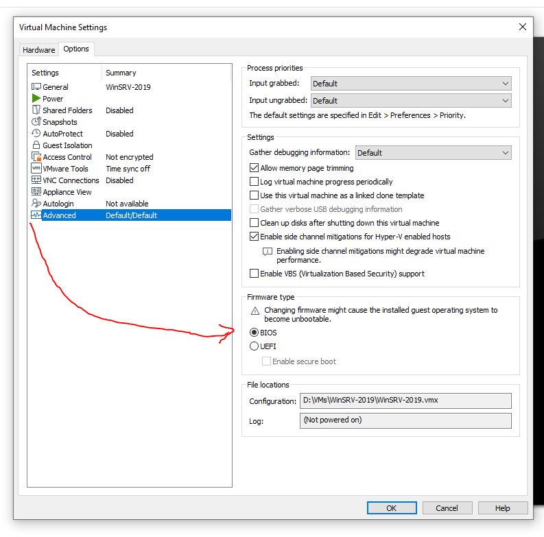

4. VM dobara power on karein. Windows Setup foran start ho jaata hai.

**Doosra hal (agar UEFI hi rakhna ho)**
VM power on karein aur **foran VM window ke andar click karein**, phir *"Press any key to boot from CD or DVD..."* nazar aate hi koi key dabayen. Aap **VM > Power > Power On to Firmware** se jaan boojh kar boot menu khol kar CD/DVD bhi chun sakte hain.

**Sabaq**
- **Firmware type sirf OS install karne se PEHLE badlein.** Warning saaf kehti hai: baad mein badalne se Windows boot nahin hogi, kyun ke BIOS aur UEFI disk ko alag tareeqe se set karte hain (MBR vs GPT).
- **BIOS** purana aur saada hai. **UEFI** naya hai aur **Secure Boot** aur 2 TB se bari disks support karta hai. Windows 11 ko UEFI *zaroori* hai, is liye wahan yeh BIOS wala hal nahin chalega.

---

## Masla 4: VM ki ghari host se 2 ghante peeche

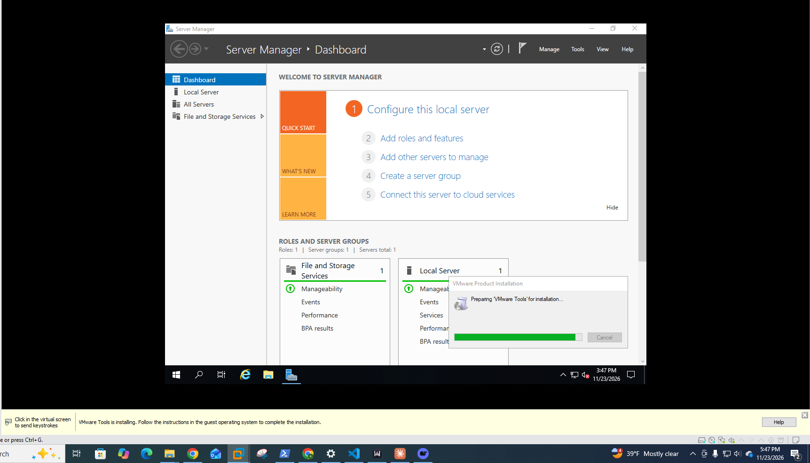

**Alaamat**
VM ki ghari **3:47 PM** dikha rahi thi jab ke host ki ghari **5:47 PM**.

**Wajah**
Windows Server default mein **(UTC-08:00) Pacific Time** zone ke saath install hota hai. Waqt khud sahi hai, lekin ghalat zone mein dikh raha hai. Pacific, Central se 2 ghante peeche hai.

**Hal**
1. VM ke andar taskbar ki ghari par right-click > **Adjust date/time**.
2. **Time zone** mein apna asli zone chunein, maslan **(UTC-06:00) Central Time (US & Canada)**.
3. Ghari foran update ho jaati hai. VMware Tools install hone aur restart ke baad VM aur host ki ghari barabar hain (Step 31):

   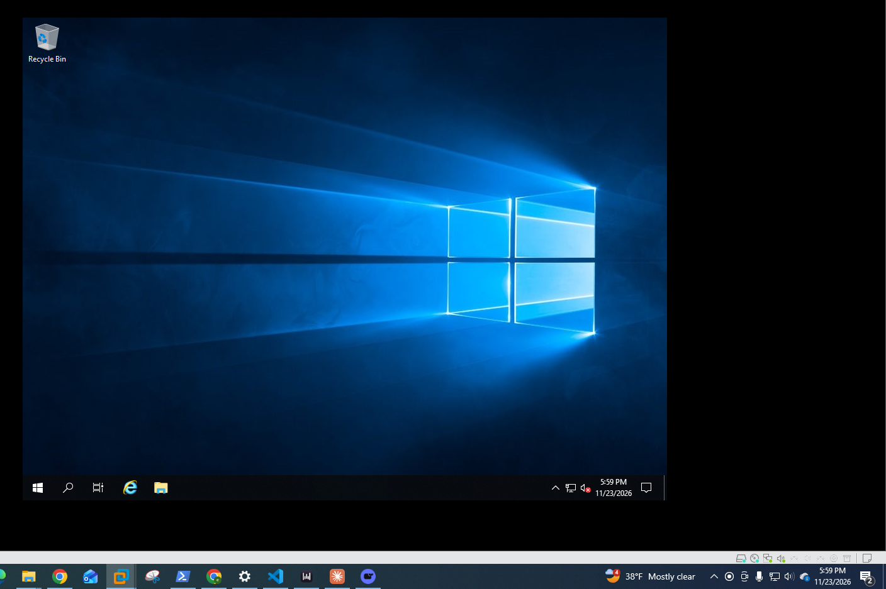

**Sabaq**
Servers par sahi waqt bohat zaroori hai. **Active Directory** login ke liye **Kerberos** use karta hai, aur Kerberos default mein **login rad kar deta hai agar do computers ki ghari mein 5 minute se zyada farq ho**. Server install karte hi time zone set karein.

---

## Masla 5: Ctrl + Alt + Del se host ka menu khulta hai, VM ka nahin

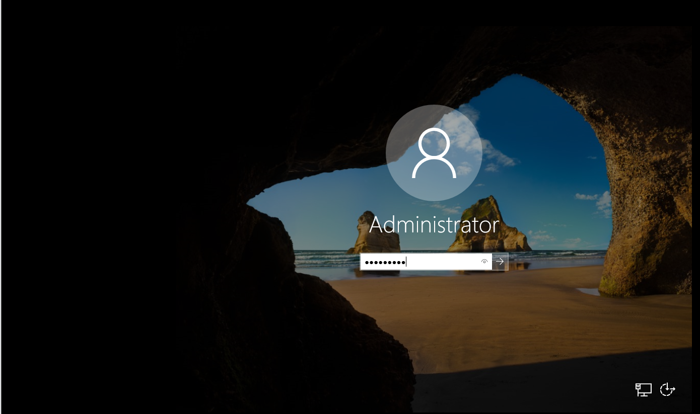

**Alaamat**
VM ki lock screen par `Ctrl + Alt + Del` dabane se VM ka login box nahin, balke **host** (Windows 10) ki security screen khuli.

**Wajah**
`Ctrl + Alt + Del` ek khaas key combination hai jo host Windows hamesha pehle pakar leta hai. Yeh VM tak kabhi nahin pohanchta.

**Hal**
VM ke andar **`Ctrl + Alt + Insert`** dabayen. Ya menu se: **VM > Send Ctrl+Alt+Del**.

**Sabaq**
VMware Workstation mein **`Ctrl + Alt + Insert` = VM ke liye `Ctrl + Alt + Del`**. (Doosre hypervisors alag keys use karte hain. Hyper-V `Ctrl + Alt + End` use karta hai.)

---

## Masla 6: Mouse VM ke andar phans gaya

**Alaamat**
VM mein click karne ke baad mouse pointer VM window se bahar nahin nikalta, aur keyboard sirf VM mein likhta hai.

**Wajah**
VMware Tools install hone se pehle, VM mein click karte hi VMware mouse aur keyboard "pakar" leta hai taake guest unhein use kar sake.

**Hal**
**`Ctrl + Alt`** ek saath dabayen aur chhor dein. Mouse aur keyboard wapas host par aa jaate hain. (`Ctrl + G` ya VM mein click karke wapas VM ko dein.) **VMware Tools** install karne se yeh masla hamesha ke liye khatam ho jaata hai: mouse phir aasani se andar bahar chalta hai.

**Sabaq**
`Ctrl + Alt` = "chhor do". VMware window ke neeche wali patti bhi yaad dilati hai: *"To direct input to this VM, click inside or press Ctrl+G."*

---

## Masla 7: VMware Tools: Typical ya Complete?

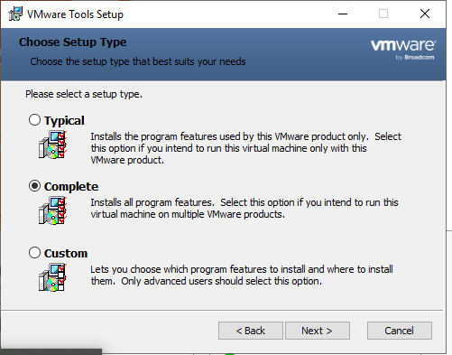

**Alaamat**
VMware Tools installer **Typical**, **Complete** ya **Custom** chunne ko kehta hai, aur samajh nahin aata kaun sa chunein.

**Wajah**
Teeno options features ke alag set install karte hain.

**Hal**
| Option | Kya install karta hai | Kab chunein |
|--------|-----------------------|-------------|
| **Typical** | Sirf *isi* VMware product (Workstation) ke features | Jab VM hamesha sirf Workstation mein chalegi. |
| **Complete** (maine yeh chuna) | Saare features | Jab VM baad mein kisi aur VMware product (jaise ESXi ya Fusion) par ja sakti ho. |
| **Custom** | Sirf woh features jo aap tick karein | Advanced users ke liye. |

**Complete** (mehfooz, "sab kuch") ya **Typical** chunein, **Next > Install** dabayen, phir **VM restart karein**.

**Tip:** Agar **VM > Install VMware Tools** ke baad installer start na ho to **File Explorer > This PC** kholein, **DVD Drive (VMware Tools)** par double-click karein, aur **setup64.exe** chalayen.

**Sabaq**
VMware VM mein VMware Tools **hamesha** install karne chahiyein. Yeh behtar graphics, mouse, network aur disk drivers, copy/paste aur time sync dete hain.

---

## Masla 8: Ghalat Central time zone (daylight saving nahin)

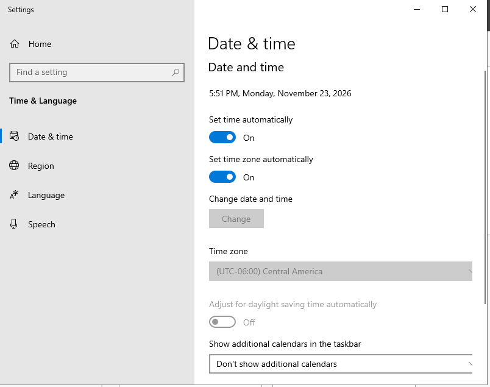

**Alaamat**
Time zone **(UTC-06:00) Central America** par set tha, aur **Adjust for daylight saving time automatically** grey / Off tha. November mein ghari sahi lag rahi thi, lekin US ki garmiyon ke waqt mein **1 ghanta ghalat** hoti.

**Wajah**
List mein "Central" aur UTC-06:00 wale do alag zones hain:

| Time zone | Kaun use karta hai | Daylight saving? |
|-----------|--------------------|------------------|
| **(UTC-06:00) Central America** | Guatemala, Costa Rica, El Salvador, Honduras, Nicaragua | **Nahin** |
| **(UTC-06:00) Central Time (US & Canada)** | Chicago, Dallas, Winnipeg waghera | **Haan** (garmiyon mein UTC-05:00) |

Sardiyon mein dono ek hi waqt dikhate hain, is liye ghalti aasani se nazar nahin aati. *Set time zone automatically* bhi ghalat zone chun sakta hai.

**Hal**
1. Ghari par right-click > **Adjust date/time**.
2. **Set time zone automatically** ko **Off** karein.
3. **(UTC-06:00) Central Time (US & Canada)** chunein (ya apna asli zone).
4. Check karein ke **Adjust for daylight saving time automatically** **On** hai.

**Sabaq**
Time zone **jagah ke hisaab se** chunein, sirf UTC number dekh kar nahin. Do zones ka offset ek jaisa ho sakta hai lekin daylight saving ke qawaid alag.

---

## Masla 9: "Where do you want to install Windows?" par koi drive nazar nahin aati

*(Yeh mujhe nahin aaya, lekin aam hai.)*

**Alaamat**
Setup mein disk ki list khali hai.

**Wajah**
Windows Setup ke paas VM ke virtual disk controller ka driver nahin hai. Aisa tab ho sakta hai jab aap ne **Custom** wizard mein **VMware Paravirtual SCSI** jaisa controller chuna ho.

**Hal (sab se aasaan)**
VM band karein, **VM > Settings > Hardware** kholein, disk remove karke **NVMe** ya **SATA** type ki nayi disk add karein (Windows mein in ke drivers pehle se hote hain). Ya is guide ki tarah **Typical** wizard se dobara shuru karein.

**Sabaq**
Setup sirf un disks par install kar sakta hai jin ke drivers us ke paas hon. Typical wizard aisi disk type chunta hai jo foran kaam kare.

---

## Masla 10: VM power on nahin hoti: virtualization error

*(Yeh mujhe nahin aaya, lekin aam hai.)*

**Alaamat**
Power on karne par error aata hai jaise *"This host supports Intel VT-x, but Intel VT-x is disabled"*.

**Wajah**
Host PC ki BIOS/UEFI settings mein CPU virtualization band hai. Task Manager > Performance > CPU dekhein: **Virtualization: Disabled**.

**Hal**
1. Host PC restart karein aur us ki setup screen mein jaayen (start hote waqt aksar `F2`, `F10`, `Del` ya `Esc`).
2. **Intel Virtualization Technology (VT-x)** ya **AMD SVM / AMD-V** dhoondein aur **Enabled** karein.
3. Save karke exit karein. Task Manager dobara check karein: **Enabled** likha hona chahiye.

**Sabaq**
VM lab shuru karne se pehle hamesha **Virtualization: Enabled** check karein (Step 00b).

---

## Ab bhi atke hue hain?

1. Error message aahista parhein aur exact text online search karein.
2. VMware ka log dekhein: **VM > Settings > Options > Advanced > File locations > Log** (VM ke folder mein `vmware.log` file).
3. Kisi classmate ya instructor se poochein, aur error ka screenshot share karein (password kabhi nahin).
