# Install Windows Server 2022 in VMware Workstation Pro (Beginner Lab Guide)

**Language:** English | [Roman Urdu](README.roman-urdu.md)

Part of the [Wintel Lab](../README.md) series. Second bundle, after [Windows Server 2019](../WS2019/README.md).

A step-by-step, screenshot-by-screenshot guide to building a **Windows Server 2022** virtual machine on a **Windows 10** computer using **VMware Workstation Pro 25H2**.

It was written by a student, for students. Every step has a short **"Why?"** so you understand what you are doing, not just which button to click.

**Did the 2019 lab already?** Great, this one goes faster. All the lessons from 2019 are built in from the start, so this time there was **no Boot Manager problem**. Look for the 🆕 marks: they show what is **different** in 2022.

## What is in this bundle

| File | What it is for |
|------|----------------|
| [README.md](README.md) / [Roman Urdu](README.roman-urdu.md) | This guide. Follow it from top to bottom. |
| [TROUBLESHOOTING.md](TROUBLESHOOTING.md) / [Roman Urdu](TROUBLESHOOTING.roman-urdu.md) | Problems, things that looked strange, and how to fix them. Read this if you get stuck. |
| [INTERVIEW-QA.md](INTERVIEW-QA.md) / [Roman Urdu](INTERVIEW-QA.roman-urdu.md) | 25 beginner interview questions and answers about Server 2022 and this lab. |
| [quiz.html](quiz.html) | A 25-question practice quiz. Download it and open it in any browser. It works offline. |
| [images/](images/) | All the screenshots used in this guide. |

## Contents

1. [Key words explained](#1-key-words-explained)
2. [Before you start (prerequisites checklist)](#2-before-you-start-prerequisites-checklist)
3. [The settings used in this lab](#3-the-settings-used-in-this-lab)
4. [What is different from Server 2019?](#4-what-is-different-from-server-2019)
5. [Part A: Create the virtual machine](#part-a-create-the-virtual-machine)
6. [Part B: Customize the hardware](#part-b-customize-the-hardware)
7. [Part C: Set the firmware to BIOS before first boot](#part-c-set-the-firmware-to-bios-before-first-boot)
8. [Part D: Install Windows Server 2022](#part-d-install-windows-server-2022)
9. [Part E: First login and finishing touches](#part-e-first-login-and-finishing-touches)
10. [Handy keyboard shortcuts](#handy-keyboard-shortcuts)
11. [What to do next](#what-to-do-next)

---

## 1. Key words explained

Read this once. Every word below appears later in the guide. (Same list as 2019, plus three new words at the end.)

| Word | Simple meaning |
|------|----------------|
| **Host** | Your real, physical computer (here: a Windows 10 PC). |
| **Virtual machine (VM)** | A "computer inside your computer". It is really just a few files on your disk, but it behaves like a separate PC. |
| **Guest OS** | The operating system installed *inside* the VM (here: Windows Server 2022). |
| **Hypervisor** | The software that runs VMs. VMware Workstation Pro is a hypervisor. |
| **ISO file** | A single file that is an exact copy of an installation DVD. The VM "reads" it like a disc. |
| **vCPU / core** | A slice of your real processor that you give to the VM. |
| **RAM / memory** | Short-term working memory. The VM borrows some of yours while it runs. |
| **Virtual disk (.vmdk)** | The file(s) that act as the VM's hard drive. |
| **Firmware (BIOS / UEFI)** | The tiny program that starts a computer before Windows loads. BIOS is the older style, UEFI is the newer one. |
| **Bridged / NAT / Host-only** | Three ways to connect the VM to a network. Explained in [Step 07](#step-07-attach-the-iso-and-change-the-network-to-bridged). |
| **Edition** | A version of Windows Server with a different feature set and price (Standard, Datacenter). |
| **Desktop Experience** | Windows Server *with* the normal Windows desktop. Without it you get **Server Core**: command line only. |
| **VMware Tools** | Drivers you install inside the guest so the VM runs smoothly (better mouse, screen size, clock sync). |
| 🆕 **Product key** | A license code that **activates** Windows (proves you paid for it). |
| 🆕 **Evaluation ISO** | The free 180-day trial ISO from Microsoft. Its editions have the word "Evaluation" in the name. |
| 🆕 **NVMe** | A fast, modern type of disk. VMware gives Server 2022 a virtual NVMe disk. |

---

## 2. Before you start (prerequisites checklist)

- [ ] **A 64-bit computer** with at least **4 CPU cores** and **16 GB RAM**, with **virtualization Enabled** (see the [2019 guide, Step 00b](../WS2019/README.md#step-00b-check-the-cpu-and-virtualization)).
- [ ] **At least 80 GB of free disk space** on a drive that is *not* inside OneDrive (here: `D:`).
- [ ] **VMware Workstation Pro** installed (this guide uses 25H2).
- [ ] **The Windows Server 2022 ISO file.** The free trial is on the Microsoft Evaluation Center (search "Windows Server 2022 Evaluation Center"). Choose **ISO, 64-bit, English (United States)**. It is about 5 GB.
- [ ] **A strong password** for the Administrator account. Write it down somewhere safe. **Never put it in GitHub.**
- [ ] About **1 hour** of time (the install itself took about 15 minutes in my lab).

---

## 3. The settings used in this lab

| Setting | Value used | Step |
|---------|------------|------|
| Host | Windows 10 Pro, Intel i5-4430 (4 cores), 16 GB RAM | — |
| Hypervisor | VMware Workstation Pro 25H2 | — |
| Wizard type | Typical | 01 |
| OS install | "I will install the operating system later" | 02 |
| Guest OS | Microsoft Windows > Windows Server 2022 | 03 |
| VM name | `Windows Server 2022` | 04 |
| VM location | `D:\VMs\WinSRV-2022` | 04 |
| Disk | 80 GB, **split into multiple files** (NVMe type) | 05 |
| Memory | 3824 MB (about 3.7 GB). 4096 MB is also fine. | 07-08 |
| Processors | 2 cores | 08 |
| CD/DVD | SATA, using the Server 2022 ISO | 07 |
| Network | **Bridged** (Automatic) | 08 |
| Firmware | **BIOS** (changed from UEFI before first boot) | 09-10 |
| Edition | **Standard (Desktop Experience)** | 14 |
| Install type | Custom, on unallocated space | 16 |
| Product key | No key screen appeared in my lab | — |
| VMware Tools | Installed, **Complete** setup | 21-22 |
| Time zone | (UTC-06:00) Central Time (US & Canada) | 23 |

---

## 4. What is different from Server 2019?

| Topic | Server 2019 lab | 🆕 Server 2022 lab |
|-------|-----------------|--------------------|
| Boot problem | Landed on the UEFI **Boot Manager**, fixed by switching to BIOS **after** the problem | Switched to **BIOS before the first boot**, so Setup started straight away |
| VM location | Had to fix the OneDrive default | Set `D:\VMs\WinSRV-2022` from the start |
| Network | Changed NAT to Bridged | Same |
| Edition picked | Datacenter (Desktop Experience) | **Standard** (Desktop Experience) |
| Edition names | "...Evaluation..." | No "Evaluation" in the name (a non-evaluation ISO). See [Issue 4](TROUBLESHOOTING.md#issue-4-edition-names-do-not-say-evaluation). |
| Setup window title | "Windows Setup" | "Microsoft Server Operating System Setup" |
| Product key screen | Appeared, clicked "Do this later" | **Did not appear**, went straight to the password |
| Clock after first login | 2 hours behind (Pacific) | Already matched the host, but still checked |
| Server Manager | Normal | Showed a red **Services** alert ([Issue 6](TROUBLESHOOTING.md#issue-6-red-services-alert-in-server-manager)) |
| Built-in browser | Internet Explorer | **Microsoft Edge** (you can see it in the taskbar) |

---

## Part A: Create the virtual machine

Start the wizard with **File > New Virtual Machine** (or `Ctrl + N`).

### Step 01: Choose Typical

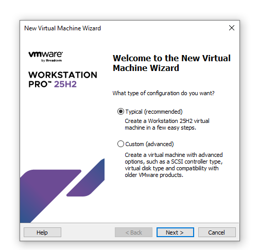

**What to do:** Select **Typical (recommended)** and click **Next**.

**Why?** Typical asks only the important questions and picks sensible defaults for everything else. *Custom* is for advanced choices a beginner doesn't need.

### Step 02: Install the operating system later

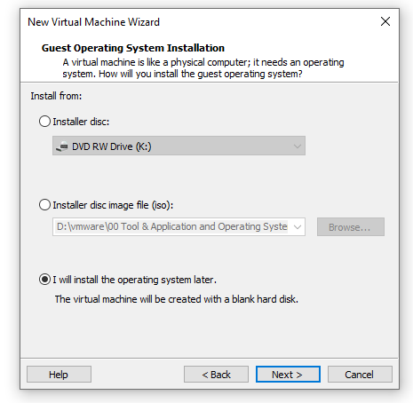

**What to do:** Select **I will install the operating system later** and click **Next**.

**Why?** If you give VMware the ISO here, it may run *Easy Install* and answer the Setup questions for you. In a lab you want to **see and learn every Setup screen yourself**. We attach the ISO in Step 07.

### Step 03: Choose the guest operating system

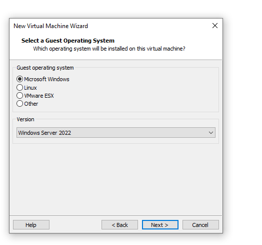

**What to do:** Select **Microsoft Windows**, then in *Version* pick **Windows Server 2022**. Click **Next**.

**Why?** This tells VMware what is going inside, so it picks the right defaults (recommended disk size, memory, disk type) for that system.

### Step 04: Name the VM and store it on D:

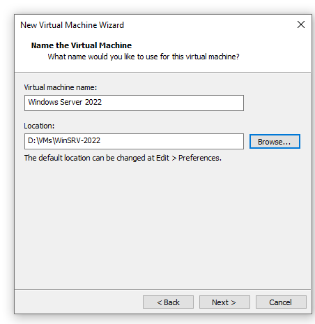

**What to do:** Name: **`Windows Server 2022`**. Location: **`D:\VMs\WinSRV-2022`**. Click **Next**.

**Why?** This is the **lesson from 2019**: VMware's default location is inside **OneDrive** on `C:`. OneDrive tries to upload every change to the cloud, which is slow and can **corrupt** a VM. `D:` also has much more free space. See [Issue 1](TROUBLESHOOTING.md#issue-1-default-vm-location-is-inside-onedrive).

### Step 05: Disk: 80 GB, split into multiple files

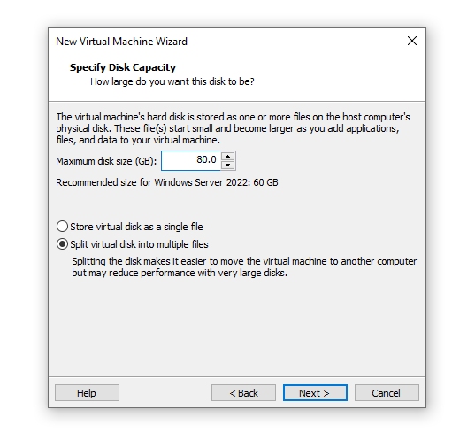

**What to do:** Set *Maximum disk size* to **80 GB** (VMware recommends 60 GB). Select **Split virtual disk into multiple files**. Click **Next**.

**Why?**
- **80 GB** leaves room for updates and the roles you will add later. The disk starts small and grows only as data is written.
- **Split** = many smaller files, which are easier to **copy, move and back up** (another 2019 lesson).

### Step 06: Review the summary (don't click Finish yet)

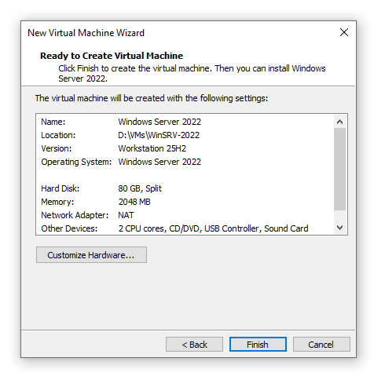

**What you see:** The defaults are **2048 MB memory**, **NAT** network, and **2 CPU cores**.

**What to do:** Click **Customize Hardware...**.

**Why?** 2 GB of RAM is slow for a server with a desktop. We also want a Bridged network and the ISO attached.

---

## Part B: Customize the hardware

### Step 07: Attach the ISO and change the network to Bridged

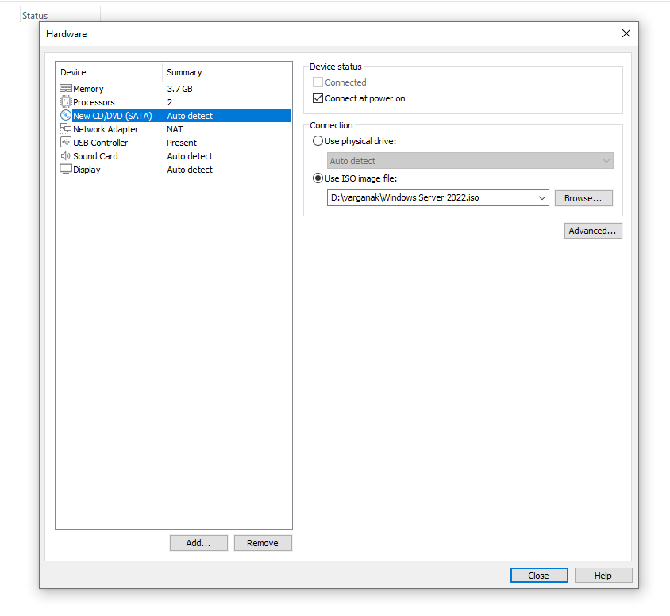

**What to do:**
1. **Memory:** raise it to about **4 GB**. (In my lab it landed on **3824 MB**, about 3.7 GB, which is fine.)
2. **Processors:** keep **2**.
3. **New CD/DVD (SATA):** select **Use ISO image file** > **Browse...** to your Windows Server 2022 ISO. Keep **Connect at power on** ticked.
4. **Network Adapter:** select **Bridged**.
5. Click **Close**.

**Why?**
- **ISO:** this puts the "installation disc" into the VM's DVD drive. *Connect at power on* means it's inserted when the VM starts.
- **Bridged:** the VM joins your real network like **another real PC** and gets its own IP address. A server should be reachable by other computers.

| Mode | Simple meaning |
|------|----------------|
| **Bridged** (used here) | The VM is like another real PC on your network, with its own IP. |
| **NAT** (default) | The VM hides behind your host's IP. It has internet, but others can't reach it easily. |
| **Host-only** | The VM can talk only to your host. No internet. |

### Step 08: Final summary, then Finish

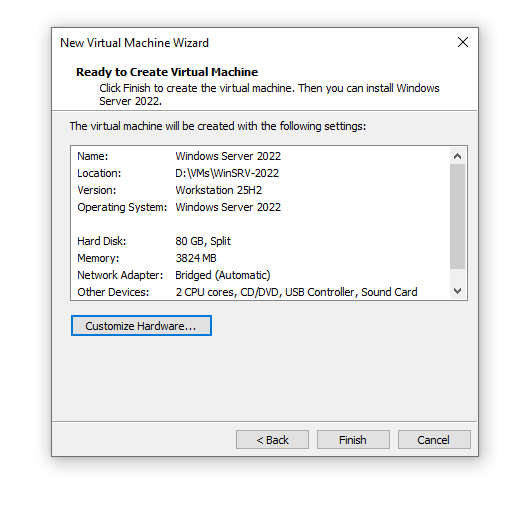

**What to check:** *Location* **D:\VMs\WinSRV-2022**, *Hard Disk* **80 GB, Split**, *Memory* **3824 MB**, *Network Adapter* **Bridged (Automatic)**, *Other Devices* **2 CPU cores**.

**What to do:** Click **Finish**.

---

## Part C: Set the firmware to BIOS before first boot

**Stop! Do not power on yet.** In the 2019 lab, the VM started with UEFI and got stuck at the **Boot Manager**. This time we fix it *before* the first boot.

### Step 09: Open VM Settings > Options > Advanced (UEFI is the default)

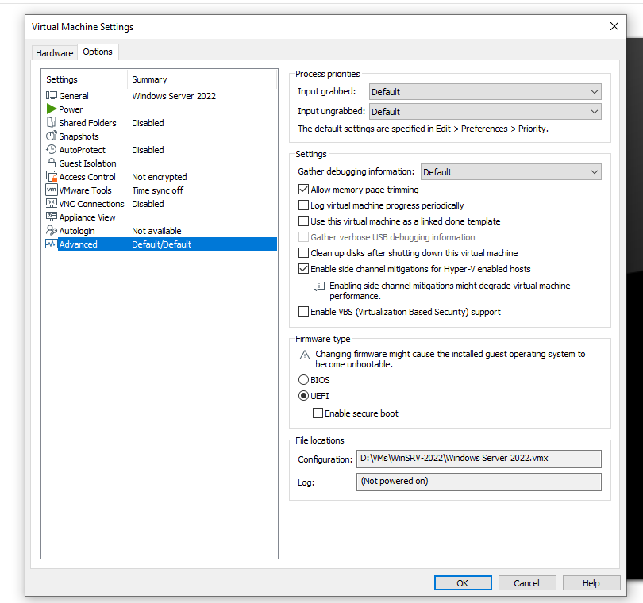

**What to do:** Click **Edit virtual machine settings** > **Options** tab > **Advanced**.

**What you see:** Under **Firmware type**, **UEFI** is selected (VMware's default for Server 2022), and *Enable secure boot* is not ticked.

### Step 10: Change Firmware type to BIOS

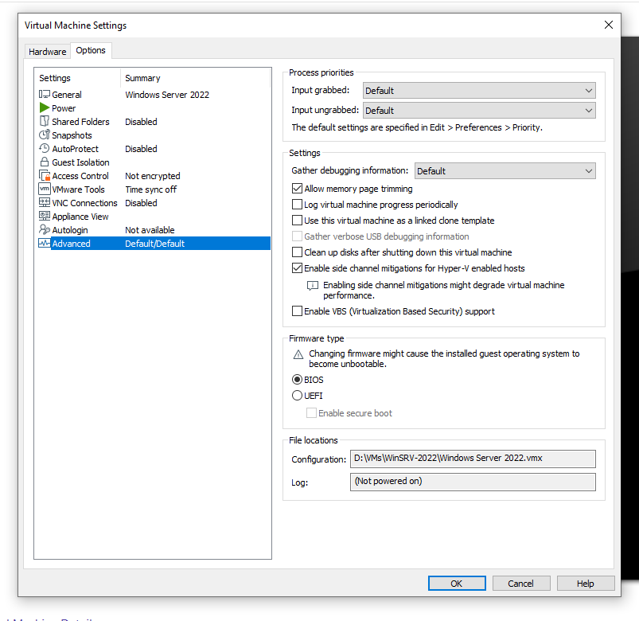

**What to do:** Select **BIOS**. Click **OK**.

**Why?** With UEFI, the Windows ISO shows *"Press any key to boot from CD or DVD..."* for only about 5 seconds. If you miss it, you land on the Boot Manager. **BIOS** boots straight into Setup.

**Important:** Read the warning: *"Changing firmware might cause the installed guest operating system to become unbootable."* Change firmware **only before** installing Windows, never after.

**Good to know:** UEFI is newer and more secure (Secure Boot, disks bigger than 2 TB). Real Server 2022 machines usually use UEFI. BIOS is simply easier for this lab. (Windows 11 *requires* UEFI, so there we will keep it.)

### Step 11: The VM is created

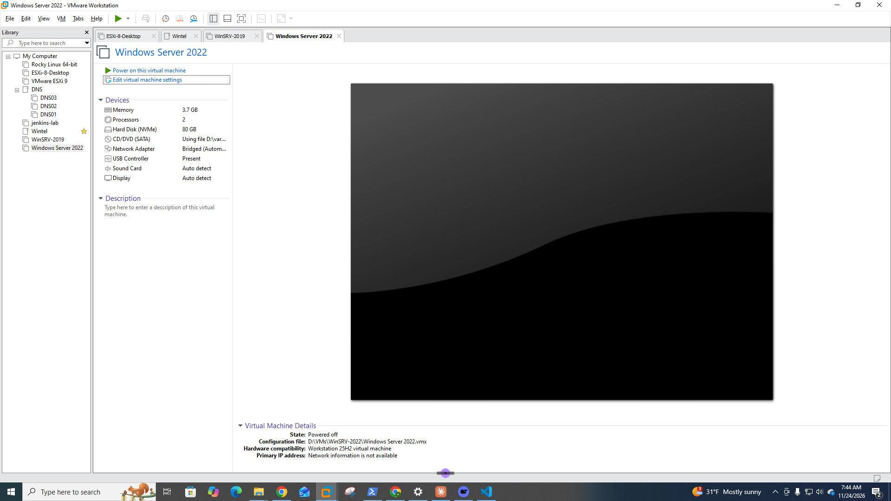

**What you see:** *Windows Server 2022* in the **Library**. Devices: Memory 3.7 GB, Processors 2, **Hard Disk (NVMe)** 80 GB, CD/DVD using the ISO, Network **Bridged**. *State: Powered off.* Configuration file: `D:\VMs\WinSRV-2022\Windows Server 2022.vmx`.

**What to do:** Click **Power on this virtual machine** (green play button), then **click inside the VM window** so your keyboard goes to the VM.

---

## Part D: Install Windows Server 2022

### Step 12: Language, time and keyboard

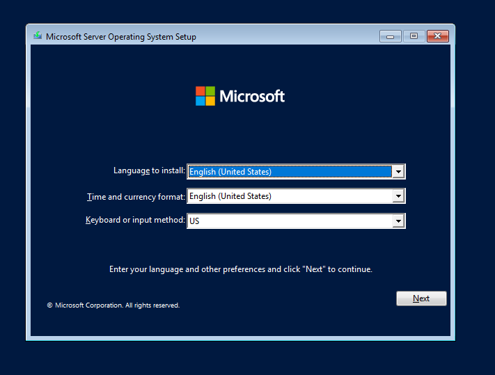

**What to do:** Check: *Language* **English (United States)**, *Time and currency format* **English (United States)**, *Keyboard* **US**. Click **Next**.

**Why?** A wrong keyboard layout can make symbols in your password come out differently from what you think you typed.

🆕 **Notice:** The window is now called **"Microsoft Server Operating System Setup"** (in 2019 it was "Windows Setup"). Same job, new name.

### Step 13: Install now

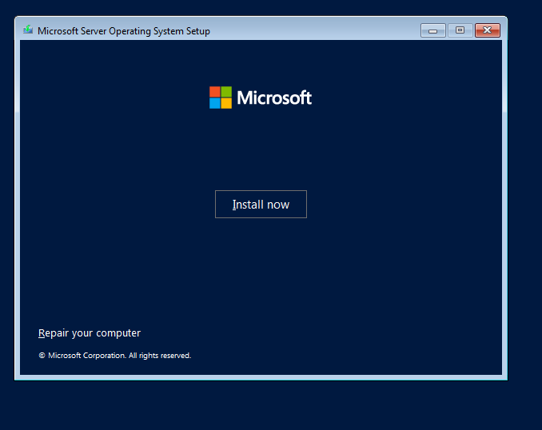

**What to do:** Click **Install now**. (*Repair your computer* is only for fixing a broken Windows.)

### Step 14: Choose the edition: Standard (Desktop Experience)

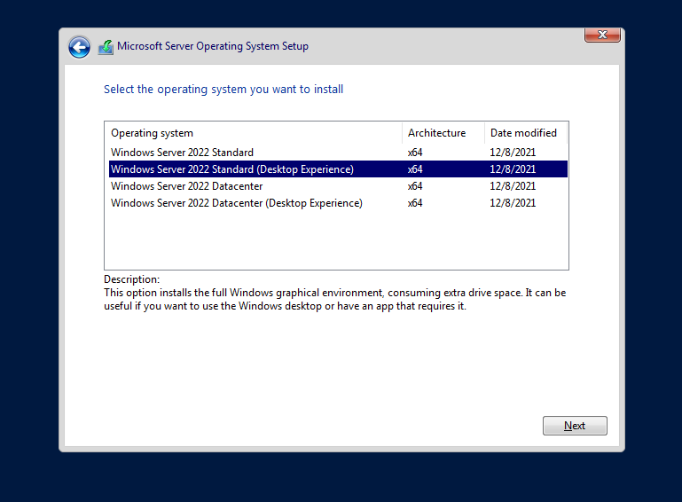

**What to do:** Select **Windows Server 2022 Standard (Desktop Experience)**. Click **Next**.

**Why?**

| Option | What you get |
|--------|--------------|
| **Standard** (no brackets) | **Server Core**: no desktop, just a command window. |
| **Standard (Desktop Experience)** | The full desktop with Server Manager and File Explorer. Best for learning. |

**Standard vs Datacenter:** Same core features. A **Standard** license allows **2** Windows Server VMs on one licensed host; **Datacenter** allows **unlimited** VMs and adds extra features (like Storage Spaces Direct and Shielded VMs). For a lab, either is fine.

🆕 **Notice:** The names do **not** say "Evaluation". That means this ISO is **not** the free trial ISO. See [Issue 4](TROUBLESHOOTING.md#issue-4-edition-names-do-not-say-evaluation).

### Step 15: Accept the license terms

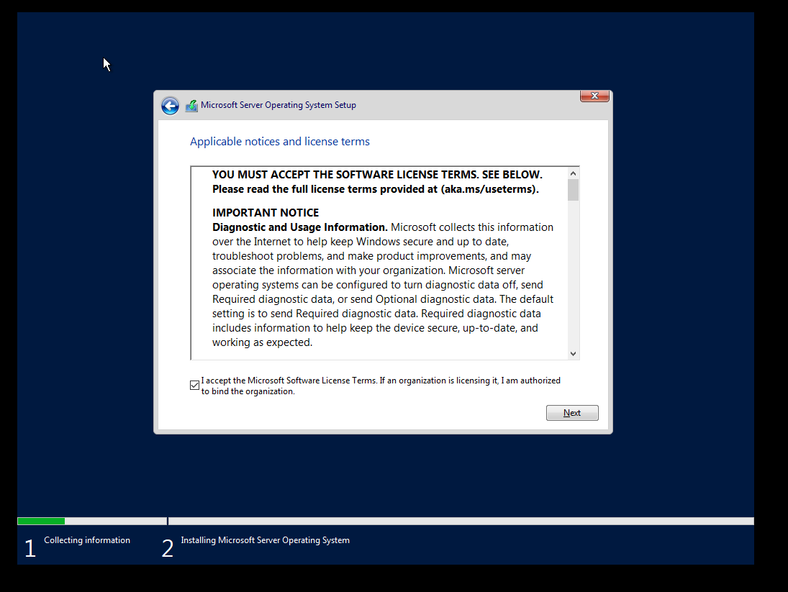

**What to do:** Tick **I accept the Microsoft Software License Terms...**. Click **Next**.

**Next screen:** choose **Custom: Install Microsoft Server Operating System only (advanced)**.

**Why Custom?** *Upgrade* is for updating an old Windows that is already installed. Our disk is empty, so we need a clean **Custom** install.

### Step 16: Choose the disk

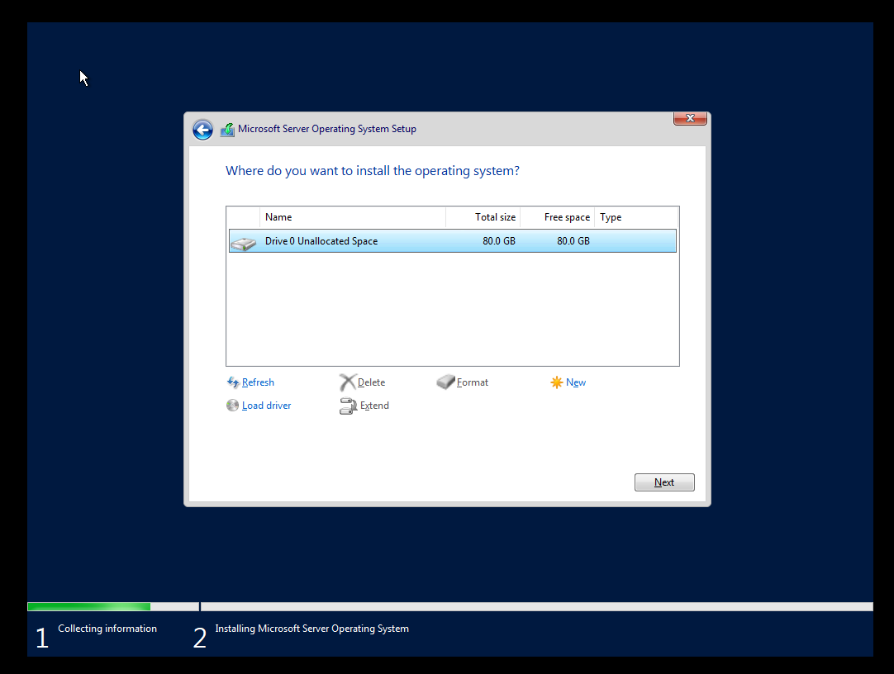

**What to do:** Select **Drive 0 Unallocated Space (80.0 GB)** and click **Next**.

**Why?** *Unallocated* means "empty, not yet formatted". Setup creates the partitions (sections of the disk) by itself, so you don't need *New* or *Format*.

🆕 **Note:** The disk is **NVMe**, and Server 2022 already has the NVMe driver built in, so the disk shows up with no extra driver.

### Step 17: Wait while Windows installs

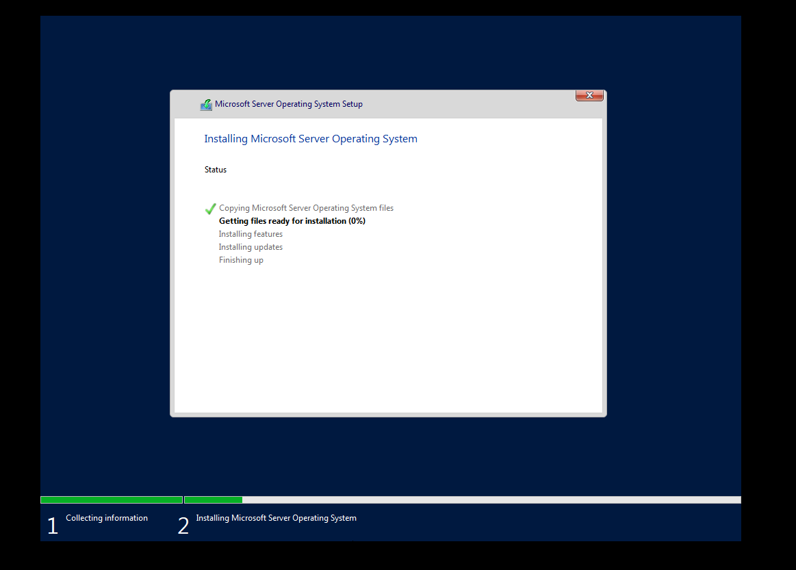

**What to do:** Nothing. Wait. Setup copies files, installs features and updates, then **restarts by itself**.

**Watch out:** If you see *"Press any key to boot from CD or DVD"* after a restart, **don't press a key**. That would start Setup again from the beginning.

### Step 18: Set the Administrator password

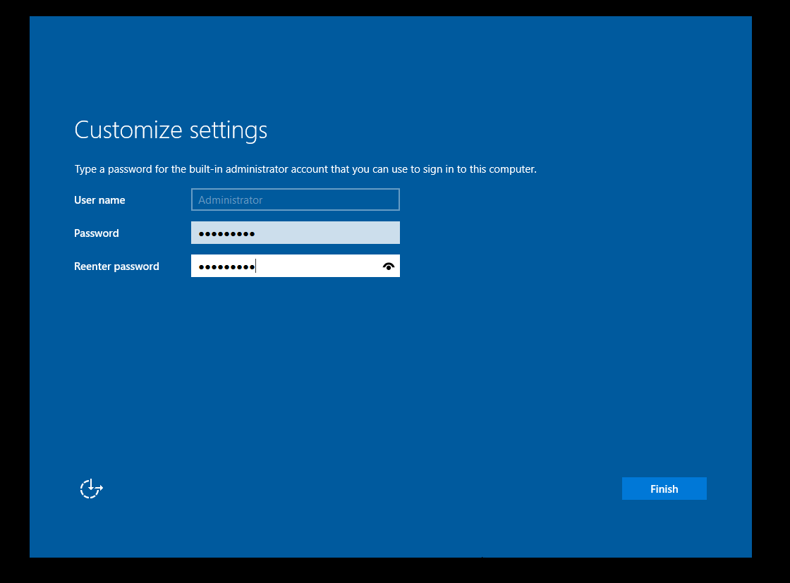

**What to do:** Type a **strong password** twice. Click **Finish**.

**Why?** Administrator has full control, so the password must be **complex**: at least 8 characters, using 3 of these 4: upper case, lower case, numbers, symbols. Use the eye icon to check what you typed. **Never commit it to GitHub.**

🆕 **Notice:** In my lab there was **no product key screen** before this one (in 2019 there was, and I clicked "Do this later"). If you *do* see one, click **I don't have a product key** or **Do this later**.

---

## Part E: First login and finishing touches

### Step 19: Log in

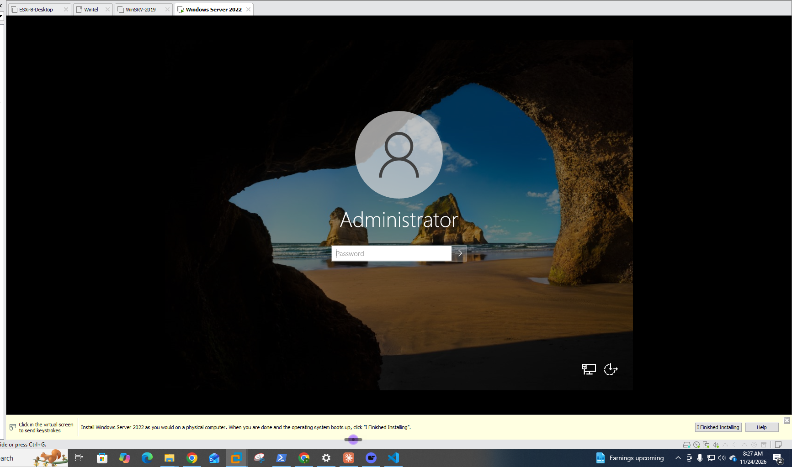

**What to do:**
1. Press **`Ctrl + Alt + Insert`** to get the password box (not `Ctrl + Alt + Del`: your host would catch that one).
2. Type your password and press **Enter**.
3. In VMware's **yellow bar** at the bottom, click **I Finished Installing**. It just tells VMware the install is done, so the bar goes away.

### Step 20: Server Manager opens

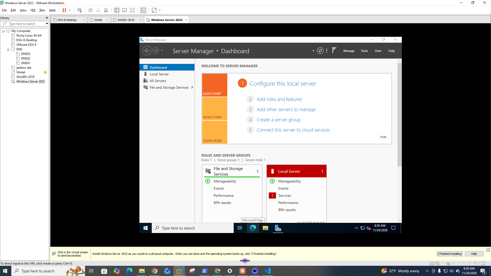

**What you see:** **Server Manager**, the main control panel of Windows Server, opens by itself. The VM screen is still **small**, and the mouse feels clumsy. VMware Tools will fix that.

🆕 **Notice:**
- A red **"Services 1"** under *Local Server*. On a fresh install this usually means a service set to start automatically is stopped. Not a mistake. See [Issue 6](TROUBLESHOOTING.md#issue-6-red-services-alert-in-server-manager).
- **Microsoft Edge** is in the taskbar. Server 2022 comes with Edge instead of Internet Explorer.
- The VM clock already showed the **same time as the host** (8:30 AM). In 2019 it was 2 hours behind.

### Step 21: Install VMware Tools (Complete)

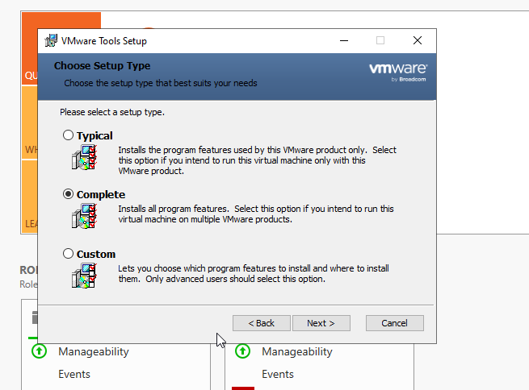

**What to do:**
1. In VMware's menu: **VM > Install VMware Tools...**
2. Inside the VM: **File Explorer > This PC**, double-click the **DVD drive (VMware Tools)**. If it doesn't start, run **setup64.exe**.
3. **Next** > **Complete** > **Next** > **Install** > **Finish** > **Yes** to restart.

**Why?** VMware Tools are drivers that make the VM pleasant: the screen resizes to fit the window, the mouse moves smoothly, copy and paste works, and the clock can sync with the host.

**Typical or Complete?** *Typical* installs only what Workstation needs. *Complete* installs everything, in case the VM later moves to another VMware product (like **ESXi**). Both are fine here.

### Step 22: Desktop after VMware Tools

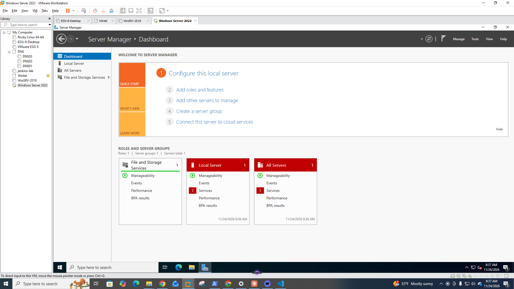

**What you see:** The server now **fills the whole VMware window**. VMware Tools is working.

**How to check VMware Tools worked:**
- The screen resizes when you resize the VMware window.
- The mouse moves in and out of the VM without `Ctrl + Alt`.
- **VM > Install VMware Tools** has changed to **Reinstall VMware Tools**.

**Notice:** *Services* now shows **3**. Some services start a little later after a reboot. Click **Services** to see which ones; see [Issue 6](TROUBLESHOOTING.md#issue-6-red-services-alert-in-server-manager).

### Step 23: Check the time zone

**What to do:** Right-click the clock in the VM taskbar > **Adjust date/time**. Make sure **Time zone** is **(UTC-06:00) Central Time (US & Canada)** (or your real zone) and *Adjust for daylight saving time automatically* is **On**.

**Why?** Even though the clock looked right, always check. In **Active Directory**, logins use **Kerberos**, which fails if clocks differ by **more than 5 minutes**. Choose *Central Time (US & Canada)*, **not** *Central America*, which has no daylight saving (a 2019 lesson).

**Done!** 🎉 You now have a working Windows Server 2022 VM.

---

## Handy keyboard shortcuts

| Keys | What it does |
|------|--------------|
| `Ctrl + G` (or click inside the VM) | Send your keyboard and mouse **into** the VM. |
| `Ctrl + Alt` | **Release** the mouse and keyboard back to the host. |
| `Ctrl + Alt + Insert` | Send **Ctrl + Alt + Del** to the VM (to log in or lock). |
| `Ctrl + Alt + Enter` | Full screen on / off. |

---

## What to do next

1. **Take a snapshot** called `Clean install` (**VM > Snapshot > Take Snapshot**). It's a "save point" you can go back to.
2. **Rename the server**, for example `SRV2022-01` (Server Manager > Local Server > Computer name).
3. **Give it a static IP address.**
4. **Run Windows Update.**
5. **Next lab idea:** join this server to a domain run by your Server 2019 machine, or make it a second domain controller.

Check your learning:
- Open [quiz.html](quiz.html) and aim for 20/25 or better.
- Practice answering [INTERVIEW-QA.md](INTERVIEW-QA.md) out loud.

---

*Lab environment: Windows 10 Pro host, VMware Workstation Pro 25H2, Windows Server 2022 Standard (Desktop Experience). Written as a class lab study guide. No passwords or product keys are included in this repository.*
