# Windows Server 2022 ko VMware Workstation Pro mein Install karna (Beginner Lab Guide)

**Zabaan (Language):** [English](README.md) | Roman Urdu

Yeh [Wintel Lab](../README.roman-urdu.md) series ka hissa hai. [Windows Server 2019](../WS2019/README.roman-urdu.md) ke baad doosra bundle.

Yeh guide step-by-step aur screenshot ke saath batati hai ke **Windows 10** computer par **VMware Workstation Pro 25H2** ke andar **Windows Server 2022** ki virtual machine kaise banani hai.

Yeh ek student ne students ke liye likhi hai. Har step ke saath ek chhota sa **"Kyun?"** hai, taake aap sirf button na dabayen balke samjhen bhi ke kya ho raha hai.

**2019 wali lab kar chuke hain?** Bohat khoob, yeh wali jaldi ho jaayegi. 2019 ke saare sabaq shuru se hi lagaye gaye hain, is liye is dafa **Boot Manager ka masla aaya hi nahin**. 🆕 nishaan dekhein: yeh batata hai ke 2022 mein kya **mukhtalif** hai.

> **Note:** Button aur menu ke naam English mein hi likhe gaye hain, kyun ke screen par aap ko English mein hi nazar aayenge.

## Is bundle mein kya hai

| File | Kis kaam ki hai |
|------|-----------------|
| [README.roman-urdu.md](README.roman-urdu.md) / [English](README.md) | Yeh guide. Shuru se aakhir tak follow karein. |
| [TROUBLESHOOTING.roman-urdu.md](TROUBLESHOOTING.roman-urdu.md) / [English](TROUBLESHOOTING.md) | Masle, ajeeb lagne wali cheezen, aur un ka hal. Atak jaayen to yeh parhein. |
| [INTERVIEW-QA.roman-urdu.md](INTERVIEW-QA.roman-urdu.md) / [English](INTERVIEW-QA.md) | Server 2022 aur is lab par 25 beginner interview sawal aur jawab. |
| [quiz.html](quiz.html) | 25 sawalon ka practice quiz (English mein). Download karke kisi bhi browser mein kholein. Internet ke baghair bhi chalta hai. |
| [images/](images/) | Is guide ke saare screenshots. |

## Fehrist (Contents)

1. [Aham alfaaz ki wazahat](#1-aham-alfaaz-ki-wazahat)
2. [Shuru karne se pehle (checklist)](#2-shuru-karne-se-pehle-checklist)
3. [Is lab mein istemal hone wali settings](#3-is-lab-mein-istemal-hone-wali-settings)
4. [Server 2019 se kya mukhtalif hai?](#4-server-2019-se-kya-mukhtalif-hai)
5. [Part A: Virtual machine banayen](#part-a-virtual-machine-banayen)
6. [Part B: Hardware customize karein](#part-b-hardware-customize-karein)
7. [Part C: Pehli dafa on karne se pehle firmware BIOS karein](#part-c-pehli-dafa-on-karne-se-pehle-firmware-bios-karein)
8. [Part D: Windows Server 2022 install karein](#part-d-windows-server-2022-install-karein)
9. [Part E: Pehla login aur aakhri kaam](#part-e-pehla-login-aur-aakhri-kaam)
10. [Kaam ke keyboard shortcuts](#kaam-ke-keyboard-shortcuts)
11. [Aage kya karein](#aage-kya-karein)

---

## 1. Aham alfaaz ki wazahat

Ek dafa parh lein. Neeche wala har lafz guide mein aage aayega. (2019 wali list jaisi, aakhir mein teen naye alfaaz.)

| Lafz | Aasaan matlab |
|------|---------------|
| **Host** | Aap ka asli, physical computer (yahan: Windows 10 PC). |
| **Virtual machine (VM)** | "Computer ke andar computer". Asal mein yeh disk par chand files hain, lekin alag PC ki tarah chalti hai. |
| **Guest OS** | VM ke *andar* install hone wala operating system (yahan: Windows Server 2022). |
| **Hypervisor** | Woh software jo VMs chalata hai. VMware Workstation Pro ek hypervisor hai. |
| **ISO file** | Ek file jo installation DVD ki hoobahoo copy hai. VM ise disc ki tarah "parhti" hai. |
| **vCPU / core** | Aap ke asli processor ka hissa jo aap VM ko dete hain. |
| **RAM / memory** | Waqti kaam ki memory. VM chalte waqt aap ki RAM udhaar leti hai. |
| **Virtual disk (.vmdk)** | Woh file(s) jo VM ki hard drive ka kaam karti hain. |
| **Firmware (BIOS / UEFI)** | Chhota sa program jo Windows se pehle computer start karta hai. BIOS purana tareeqa hai, UEFI naya. |
| **Bridged / NAT / Host-only** | VM ko network se jorne ke teen tareeqe. [Step 07](#step-07-iso-lagayen-aur-network-bridged-karein) mein samjhaya gaya hai. |
| **Edition** | Windows Server ka version jis ke features aur qeemat alag hain (Standard, Datacenter). |
| **Desktop Experience** | Windows Server *aam* Windows desktop ke saath. Is ke baghair **Server Core** milta hai: sirf command line. |
| **VMware Tools** | Drivers jo guest ke andar install hote hain taake VM smooth chale (behtar mouse, screen size, clock sync). |
| 🆕 **Product key** | License code jo Windows ko **activate** karta hai (yaani saabit karta hai ke aap ne paise diye). |
| 🆕 **Evaluation ISO** | Microsoft ki free 180 din wali trial ISO. Is ki editions ke naam mein "Evaluation" likha hota hai. |
| 🆕 **NVMe** | Tez, jadeed qism ki disk. VMware Server 2022 ko virtual NVMe disk deta hai. |

---

## 2. Shuru karne se pehle (checklist)

- [ ] **64-bit computer**, kam az kam **4 CPU cores** aur **16 GB RAM**, aur **virtualization Enabled** ho (dekhein [2019 guide, Step 00b](../WS2019/README.roman-urdu.md)).
- [ ] Kam az kam **80 GB khaali jagah** aisi drive par jo OneDrive ke andar *na* ho (yahan: `D:`).
- [ ] **VMware Workstation Pro** install ho (yeh guide 25H2 istemal karti hai).
- [ ] **Windows Server 2022 ki ISO file.** Free trial Microsoft Evaluation Center par hai ("Windows Server 2022 Evaluation Center" search karein). **ISO, 64-bit, English (United States)** chunein. Taqreeban 5 GB ki hai.
- [ ] Administrator account ke liye **mazboot password**. Kisi mehfooz jagah likh lein. **GitHub mein kabhi na daalein.**
- [ ] Taqreeban **1 ghanta** (meri lab mein install khud taqreeban 15 minute ka tha).

---

## 3. Is lab mein istemal hone wali settings

| Setting | Value | Step |
|---------|-------|------|
| Host | Windows 10 Pro, Intel i5-4430 (4 cores), 16 GB RAM | — |
| Hypervisor | VMware Workstation Pro 25H2 | — |
| Wizard type | Typical | 01 |
| OS install | "I will install the operating system later" | 02 |
| Guest OS | Microsoft Windows > Windows Server 2022 | 03 |
| VM ka naam | `Windows Server 2022` | 04 |
| VM location | `D:\VMs\WinSRV-2022` | 04 |
| Disk | 80 GB, **multiple files mein split** (NVMe type) | 05 |
| Memory | 3824 MB (taqreeban 3.7 GB). 4096 MB bhi theek hai. | 07-08 |
| Processors | 2 cores | 08 |
| CD/DVD | SATA, Server 2022 ISO ke saath | 07 |
| Network | **Bridged** (Automatic) | 08 |
| Firmware | **BIOS** (pehli dafa on karne se pehle UEFI se badla) | 09-10 |
| Edition | **Standard (Desktop Experience)** | 14 |
| Install type | Custom, unallocated space par | 16 |
| Product key | Meri lab mein key ki screen aayi hi nahin | — |
| VMware Tools | Install kiye, **Complete** setup | 21-22 |
| Time zone | (UTC-06:00) Central Time (US & Canada) | 23 |

---

## 4. Server 2019 se kya mukhtalif hai?

| Mauzu | Server 2019 lab | 🆕 Server 2022 lab |
|-------|-----------------|--------------------|
| Boot ka masla | UEFI **Boot Manager** par atak gaye, masla aane ke **baad** BIOS kiya | **Pehli dafa on karne se pehle BIOS** kiya, Setup foran shuru ho gaya |
| VM location | OneDrive wala default theek karna para | Shuru se hi `D:\VMs\WinSRV-2022` |
| Network | NAT se Bridged kiya | Wohi |
| Edition | Datacenter (Desktop Experience) | **Standard** (Desktop Experience) |
| Edition ke naam | "...Evaluation..." | Naam mein "Evaluation" nahin (non-evaluation ISO). Dekhein [Masla 4](TROUBLESHOOTING.roman-urdu.md#masla-4-edition-ke-naam-mein-evaluation-nahin-likha). |
| Setup window ka naam | "Windows Setup" | "Microsoft Server Operating System Setup" |
| Product key screen | Aayi, "Do this later" dabaya | **Nahin aayi**, seedha password par gaye |
| Pehle login par ghari | 2 ghante peeche (Pacific) | Pehle se host ke barabar thi, phir bhi check kiya |
| Server Manager | Normal | Laal **Services** alert ([Masla 6](TROUBLESHOOTING.roman-urdu.md#masla-6-server-manager-mein-laal-services-alert)) |
| Built-in browser | Internet Explorer | **Microsoft Edge** (taskbar mein nazar aata hai) |

---

## Part A: Virtual machine banayen

Wizard **File > New Virtual Machine** (ya `Ctrl + N`) se shuru karein.

### Step 01: Typical chunein

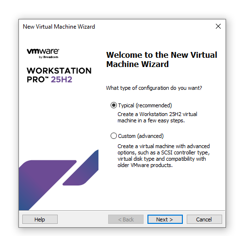

**Kya karna hai:** **Typical (recommended)** select karein aur **Next** dabayen.

**Kyun?** Typical sirf zaroori sawal poochta hai aur baqi sab ke liye munasib default chun leta hai. *Custom* advanced cheezon ke liye hai jo beginner ko nahin chahiyen.

### Step 02: Operating system baad mein install karein

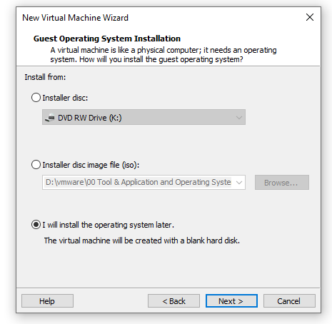

**Kya karna hai:** **I will install the operating system later** select karein aur **Next** dabayen.

**Kyun?** Agar yahan ISO de dein to VMware *Easy Install* chala kar Setup ke sawalon ke jawab khud de sakta hai. Lab mein aap ko **har Setup screen khud dekhni aur seekhni** hai. ISO hum Step 07 mein lagayenge.

### Step 03: Guest operating system chunein

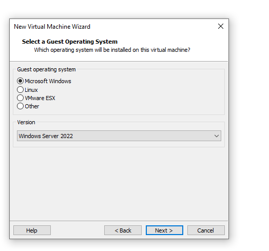

**Kya karna hai:** **Microsoft Windows** select karein, phir *Version* mein **Windows Server 2022** chunein. **Next** dabayen.

**Kyun?** Is se VMware ko pata chalta hai ke andar kya jaayega, taake woh us system ke liye sahi default (disk size, memory, disk type) chune.

### Step 04: VM ka naam rakhein aur D: par save karein

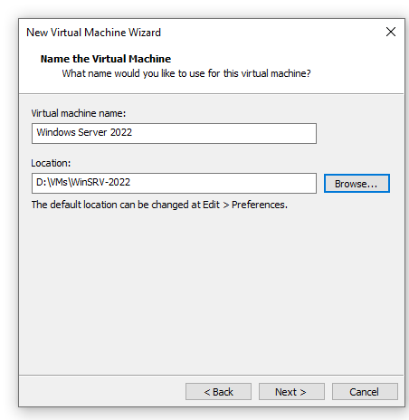

**Kya karna hai:** Naam: **`Windows Server 2022`**. Location: **`D:\VMs\WinSRV-2022`**. **Next** dabayen.

**Kyun?** Yeh **2019 ka sabaq** hai: VMware ki default location `C:` par **OneDrive** ke andar hoti hai. OneDrive har tabdeeli cloud par upload karne ki koshish karta hai, jo slow hai aur VM ko **kharab (corrupt)** kar sakta hai. `D:` par jagah bhi bohat zyada hai. Dekhein [Masla 1](TROUBLESHOOTING.roman-urdu.md#masla-1-default-vm-location-onedrive-ke-andar-hai).

### Step 05: Disk: 80 GB, multiple files mein split

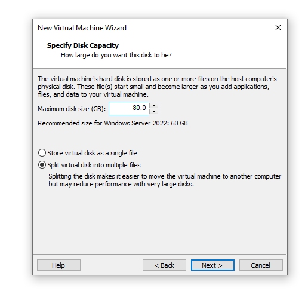

**Kya karna hai:** *Maximum disk size* **80 GB** rakhein (VMware 60 GB recommend karta hai). **Split virtual disk into multiple files** select karein. **Next** dabayen.

**Kyun?**
- **80 GB** updates aur baad mein lagne wale roles ke liye jagah chhorta hai. Disk chhoti shuru hoti hai aur data likhne ke saath barhti hai.
- **Split** = kai chhoti files, jo **copy, move aur backup** karne mein aasaan hain (yeh bhi 2019 ka sabaq).

### Step 06: Summary dekhein (abhi Finish na dabayen)

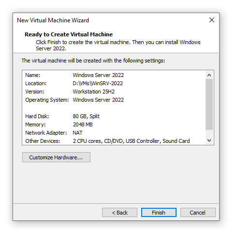

**Kya nazar aata hai:** Default **2048 MB memory**, **NAT** network, aur **2 CPU cores**.

**Kya karna hai:** **Customize Hardware...** dabayen.

**Kyun?** Desktop wale server ke liye 2 GB RAM slow hai. Hamein Bridged network aur ISO bhi lagana hai.

---

## Part B: Hardware customize karein

### Step 07: ISO lagayen aur network Bridged karein

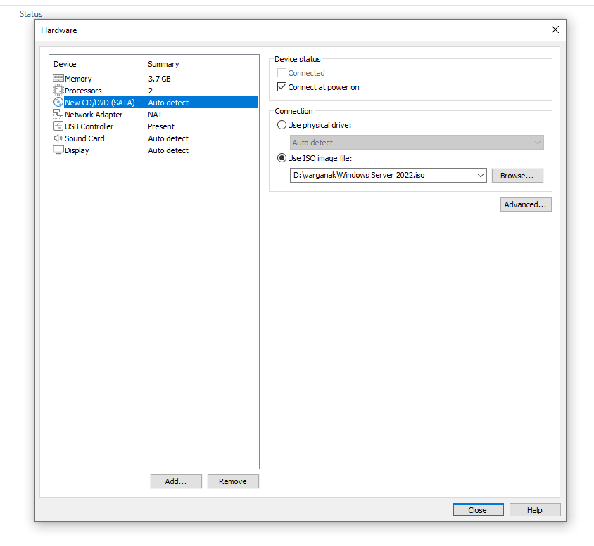

**Kya karna hai:**
1. **Memory:** taqreeban **4 GB** kar dein. (Meri lab mein yeh **3824 MB** par aa gayi, yaani 3.7 GB, jo theek hai.)
2. **Processors:** **2** rehne dein.
3. **New CD/DVD (SATA):** **Use ISO image file** select karein > **Browse...** se Windows Server 2022 ki ISO chunein. **Connect at power on** tick rehne dein.
4. **Network Adapter:** **Bridged** select karein.
5. **Close** dabayen.

**Kyun?**
- **ISO:** is se "installation disc" VM ki DVD drive mein lag jaati hai. *Connect at power on* ka matlab hai VM start hote hi disc andar hogi.
- **Bridged:** VM aap ke asli network par **ek aur asli PC** ki tarah judti hai aur apna IP address leti hai. Server tak doosre computers ki pohanch honi chahiye.

| Mode | Aasaan matlab |
|------|---------------|
| **Bridged** (yahan istemal) | VM aap ke network par ek aur asli PC jaisi, apne IP ke saath. |
| **NAT** (default) | VM host ke IP ke peeche chhupi hoti hai. Internet hai, lekin doosre aasani se nahin pohanch sakte. |
| **Host-only** | VM sirf aap ke host se baat kar sakti hai. Internet nahin. |

### Step 08: Aakhri summary, phir Finish

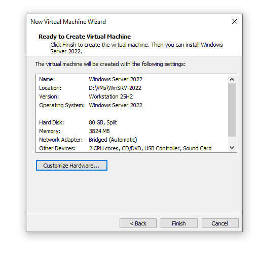

**Kya check karna hai:** *Location* **D:\VMs\WinSRV-2022**, *Hard Disk* **80 GB, Split**, *Memory* **3824 MB**, *Network Adapter* **Bridged (Automatic)**, *Other Devices* **2 CPU cores**.

**Kya karna hai:** **Finish** dabayen.

---

## Part C: Pehli dafa on karne se pehle firmware BIOS karein

**Ruk jaayen! Abhi power on na karein.** 2019 wali lab mein VM UEFI ke saath start hui aur **Boot Manager** par atak gayi. Is dafa hum yeh *pehli boot se pehle* theek karte hain.

### Step 09: VM Settings > Options > Advanced kholein (UEFI default hai)

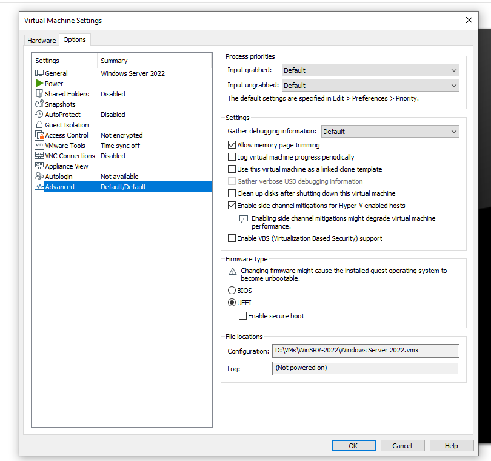

**Kya karna hai:** **Edit virtual machine settings** > **Options** tab > **Advanced** dabayen.

**Kya nazar aata hai:** **Firmware type** mein **UEFI** select hai (Server 2022 ke liye VMware ka default), aur *Enable secure boot* tick nahin hai.

### Step 10: Firmware type BIOS karein

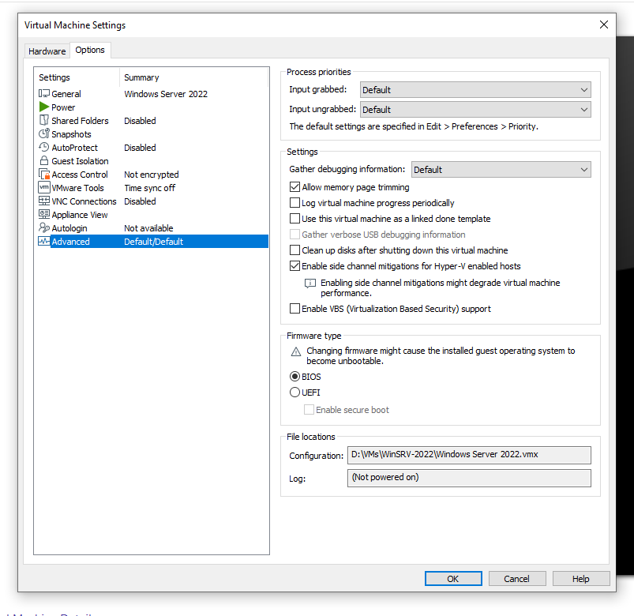

**Kya karna hai:** **BIOS** select karein. **OK** dabayen.

**Kyun?** UEFI ke saath Windows ISO *"Press any key to boot from CD or DVD..."* sirf taqreeban 5 second dikhati hai. Agar chook jaayen to Boot Manager aa jaata hai. **BIOS** seedha Setup mein le jaata hai.

**Aham:** Warning parhein: *"Changing firmware might cause the installed guest operating system to become unbootable."* Firmware **sirf Windows install karne se pehle** badlein, baad mein kabhi nahin.

**Jaanna achha hai:** UEFI naya aur zyada mehfooz hai (Secure Boot, 2 TB se bari disks). Asli Server 2022 machines aam tor par UEFI istemal karti hain. Is lab ke liye BIOS bas aasaan hai. (Windows 11 ke liye UEFI *zaroori* hai, wahan hum ise rakhenge.)

### Step 11: VM ban gayi

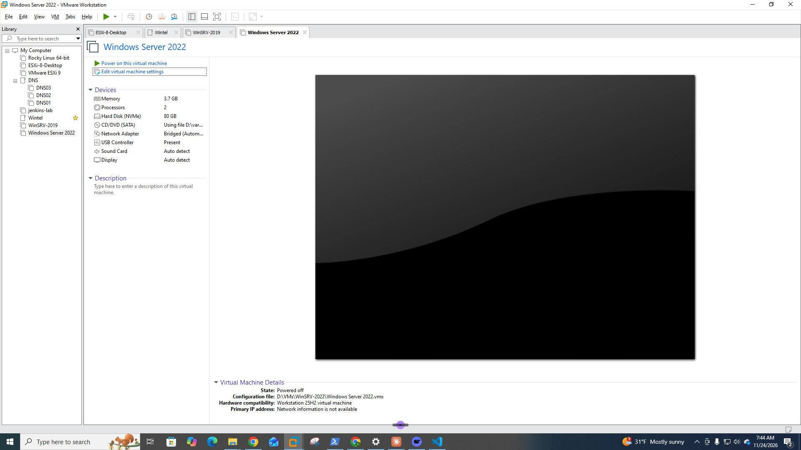

**Kya nazar aata hai:** **Library** mein *Windows Server 2022*. Devices: Memory 3.7 GB, Processors 2, **Hard Disk (NVMe)** 80 GB, CD/DVD ISO ke saath, Network **Bridged**. *State: Powered off.* Configuration file: `D:\VMs\WinSRV-2022\Windows Server 2022.vmx`.

**Kya karna hai:** **Power on this virtual machine** (hara play button) dabayen, phir **VM window ke andar click** karein taake keyboard VM ko jaaye.

---

## Part D: Windows Server 2022 install karein

### Step 12: Zabaan, waqt aur keyboard

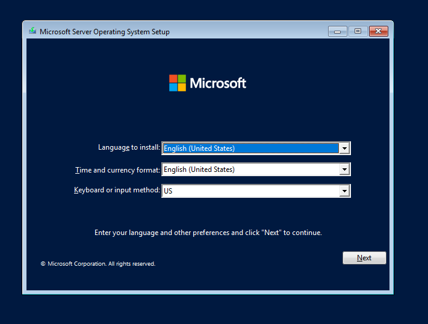

**Kya karna hai:** Check karein: *Language* **English (United States)**, *Time and currency format* **English (United States)**, *Keyboard* **US**. **Next** dabayen.

**Kyun?** Ghalat keyboard layout se password ke symbols woh nahin aate jo aap samajh rahe hain ke aap ne type kiye.

🆕 **Ghaur karein:** Window ka naam ab **"Microsoft Server Operating System Setup"** hai (2019 mein "Windows Setup" tha). Kaam wohi, naam naya.

### Step 13: Install now

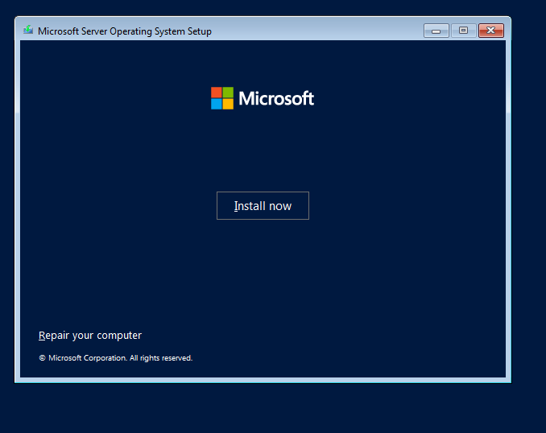

**Kya karna hai:** **Install now** dabayen. (*Repair your computer* sirf kharab Windows theek karne ke liye hai.)

### Step 14: Edition chunein: Standard (Desktop Experience)

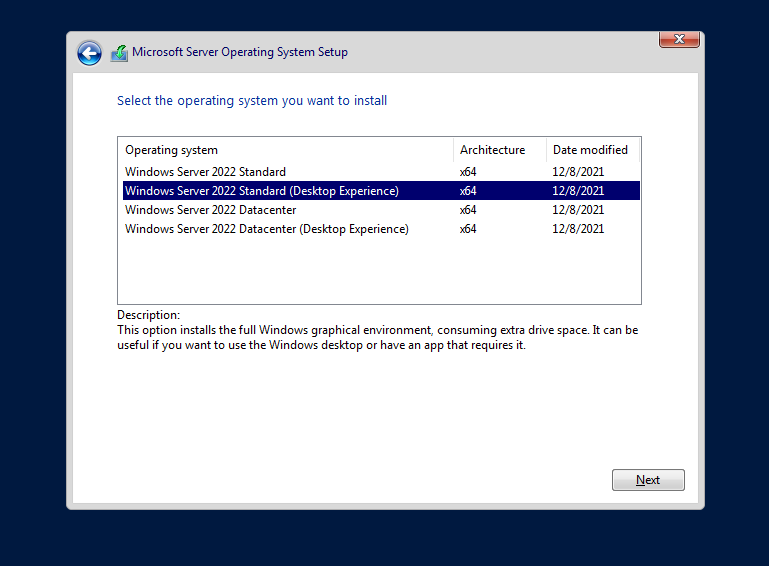

**Kya karna hai:** **Windows Server 2022 Standard (Desktop Experience)** select karein. **Next** dabayen.

**Kyun?**

| Option | Kya milta hai |
|--------|---------------|
| **Standard** (bracket ke baghair) | **Server Core**: desktop nahin, sirf command window. |
| **Standard (Desktop Experience)** | Poora desktop, Server Manager aur File Explorer ke saath. Seekhne ke liye behtareen. |

**Standard aur Datacenter mein farq:** Core features ek jaise. **Standard** license ek licensed host par **2** Windows Server VMs ki ijazat deta hai; **Datacenter** **be-had (unlimited)** VMs aur extra features (jaise Storage Spaces Direct aur Shielded VMs) deta hai. Lab ke liye dono theek hain.

🆕 **Ghaur karein:** Naamon mein "Evaluation" **nahin** likha. Matlab yeh free trial wali ISO **nahin** hai. Dekhein [Masla 4](TROUBLESHOOTING.roman-urdu.md#masla-4-edition-ke-naam-mein-evaluation-nahin-likha).

### Step 15: License terms qubool karein

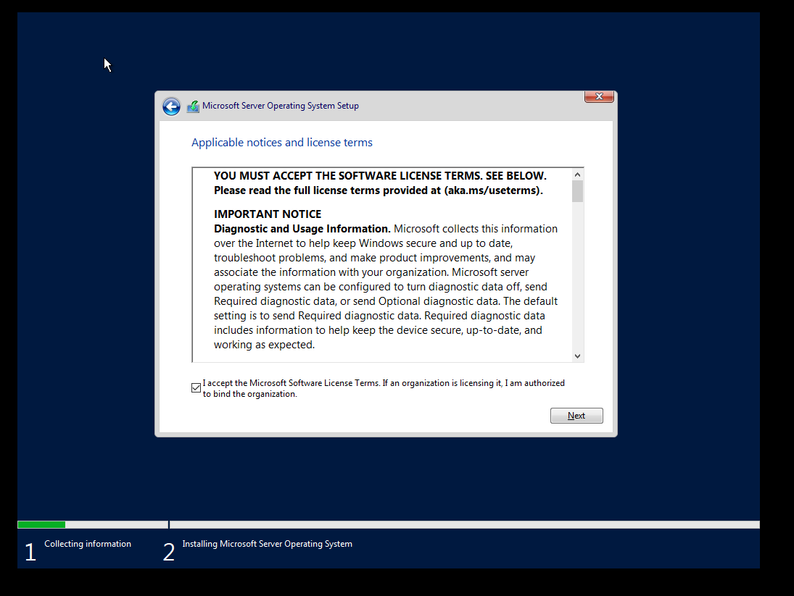

**Kya karna hai:** **I accept the Microsoft Software License Terms...** tick karein. **Next** dabayen.

**Agli screen:** **Custom: Install Microsoft Server Operating System only (advanced)** chunein.

**Custom kyun?** *Upgrade* pehle se install shuda purani Windows ko update karne ke liye hai. Hamari disk khaali hai, is liye saaf **Custom** install chahiye.

### Step 16: Disk chunein

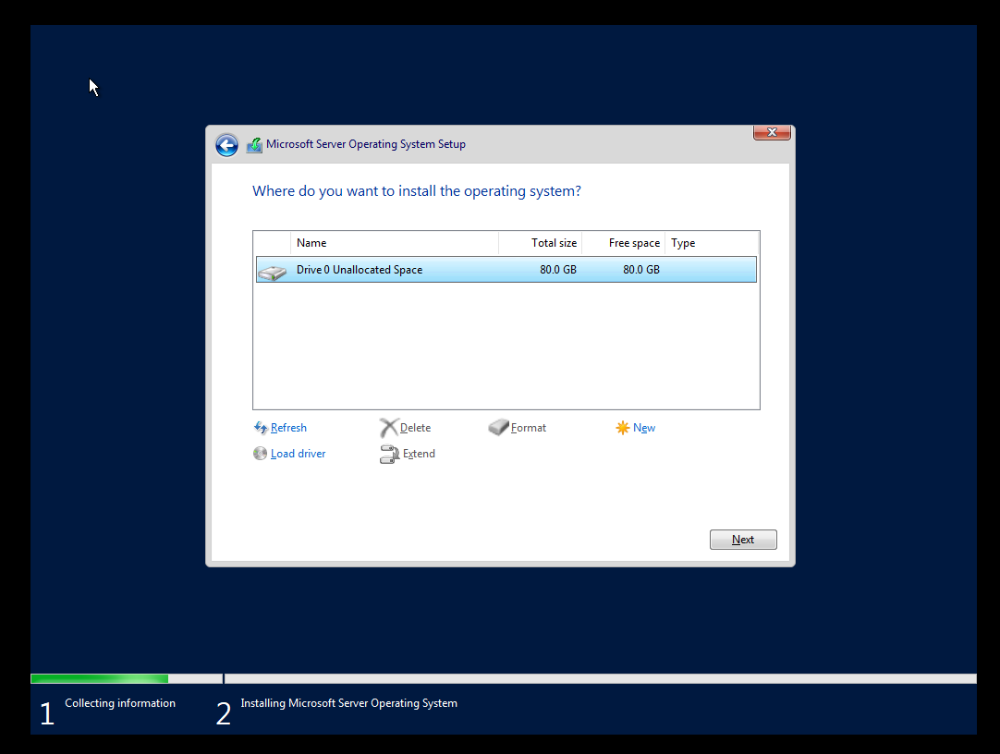

**Kya karna hai:** **Drive 0 Unallocated Space (80.0 GB)** select karein aur **Next** dabayen.

**Kyun?** *Unallocated* ka matlab hai "khaali, abhi format nahin hui". Setup partitions (disk ke hisse) khud bana leta hai, is liye *New* ya *Format* ki zaroorat nahin.

🆕 **Note:** Disk **NVMe** hai, aur Server 2022 mein NVMe driver pehle se maujood hai, is liye disk baghair extra driver ke nazar aa jaati hai.

### Step 17: Windows install hone ka intezar karein

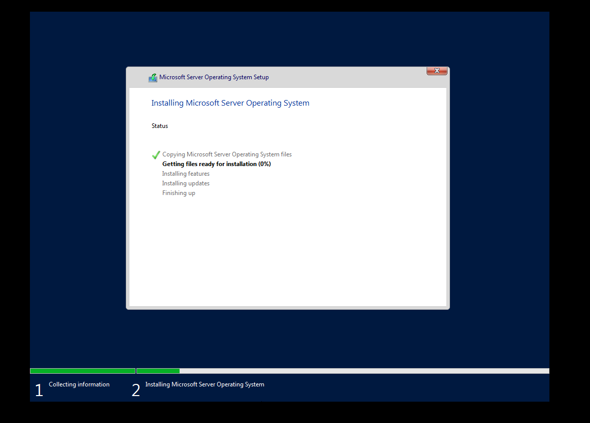

**Kya karna hai:** Kuch nahin. Intezar karein. Setup files copy karta hai, features aur updates install karta hai, phir **khud restart** hota hai.

**Khabardar:** Restart ke baad *"Press any key to boot from CD or DVD"* nazar aaye to **koi key na dabayen**. Warna Setup dobara shuru se chal parega.

### Step 18: Administrator ka password rakhein

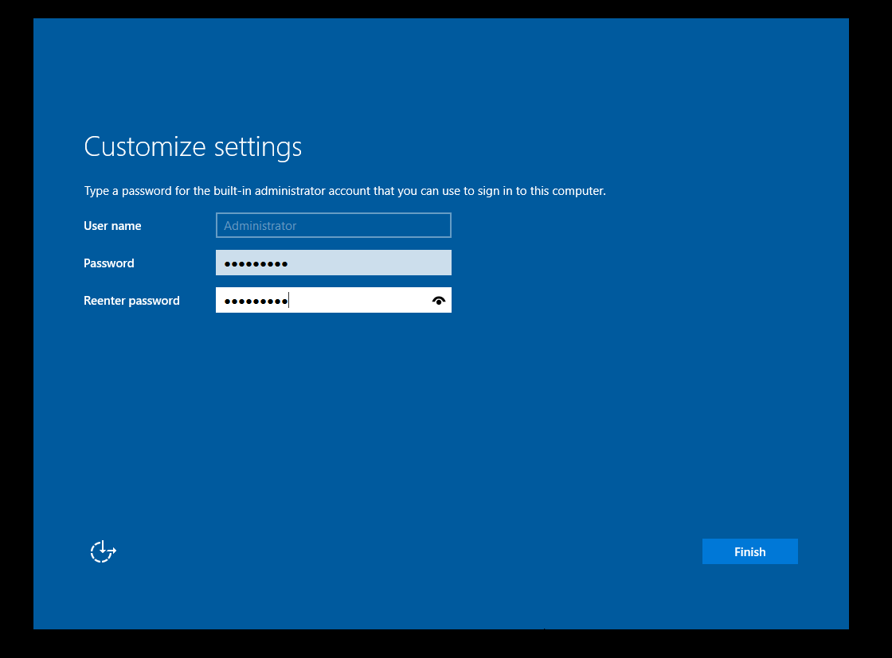

**Kya karna hai:** **Mazboot password** do dafa likhein. **Finish** dabayen.

**Kyun?** Administrator ke paas poora control hota hai, is liye password **complex** hona zaroori hai: kam az kam 8 characters, aur in 4 mein se 3: bare huroof, chhote huroof, numbers, symbols. Aankh wale icon se check kar lein ke kya likha. **GitHub mein kabhi na daalein.**

🆕 **Ghaur karein:** Meri lab mein is se pehle **product key ki screen nahin aayi** (2019 mein aayi thi aur maine "Do this later" dabaya tha). Agar aap ko nazar aaye to **I don't have a product key** ya **Do this later** dabayen.

---

## Part E: Pehla login aur aakhri kaam

### Step 19: Login karein

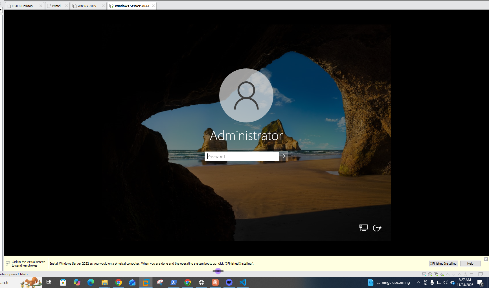

**Kya karna hai:**
1. Password box ke liye **`Ctrl + Alt + Insert`** dabayen (`Ctrl + Alt + Del` nahin: woh aap ka host pakar leta hai).
2. Password likhein aur **Enter** dabayen.
3. VMware ke neeche **peeli patti (yellow bar)** mein **I Finished Installing** dabayen. Yeh bas VMware ko batata hai ke install mukammal hai, aur patti hat jaati hai.

### Step 20: Server Manager khulta hai

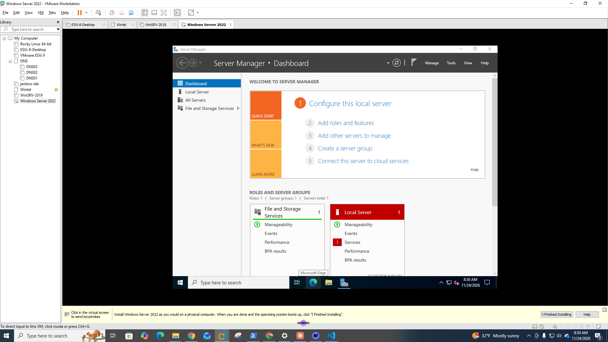

**Kya nazar aata hai:** **Server Manager**, Windows Server ka main control panel, khud khul jaata hai. VM ki screen abhi **chhoti** hai aur mouse ajeeb chalta hai. VMware Tools yeh theek karega.

🆕 **Ghaur karein:**
- *Local Server* ke neeche laal **"Services 1"**. Naye install par aam tor par iska matlab hai ke automatic start hone wali koi service ruki hui hai. Ghalti nahin. Dekhein [Masla 6](TROUBLESHOOTING.roman-urdu.md#masla-6-server-manager-mein-laal-services-alert).
- Taskbar mein **Microsoft Edge** hai. Server 2022 mein Internet Explorer ki jagah Edge aata hai.
- VM ki ghari pehle se **host ke barabar** thi (8:30 AM). 2019 mein 2 ghante peeche thi.

### Step 21: VMware Tools install karein (Complete)

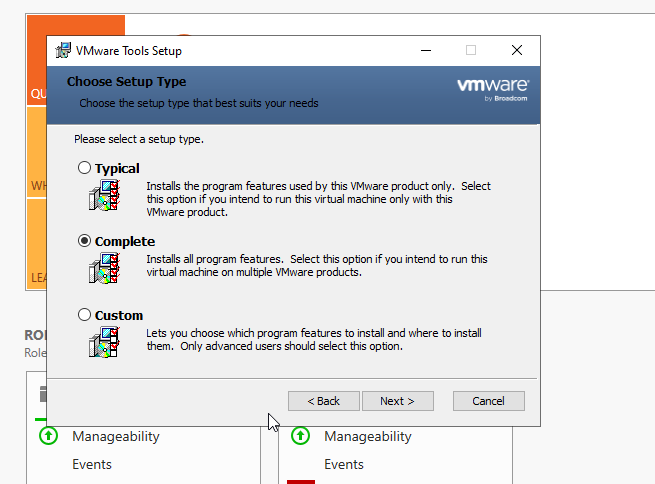

**Kya karna hai:**
1. VMware ke menu mein: **VM > Install VMware Tools...**
2. VM ke andar: **File Explorer > This PC**, **DVD drive (VMware Tools)** par double-click karein. Agar shuru na ho to **setup64.exe** chalayen.
3. **Next** > **Complete** > **Next** > **Install** > **Finish** > restart ke liye **Yes**.

**Kyun?** VMware Tools woh drivers hain jo VM ko aaraam deh banate hain: screen window ke hisaab se resize hoti hai, mouse smooth chalta hai, copy paste chalta hai, aur ghari host se sync ho sakti hai.

**Typical ya Complete?** *Typical* sirf woh install karta hai jo Workstation ko chahiye. *Complete* sab kuch install karta hai, agar VM baad mein kisi aur VMware product (jaise **ESXi**) par jaaye. Yahan dono theek hain.

### Step 22: VMware Tools ke baad desktop

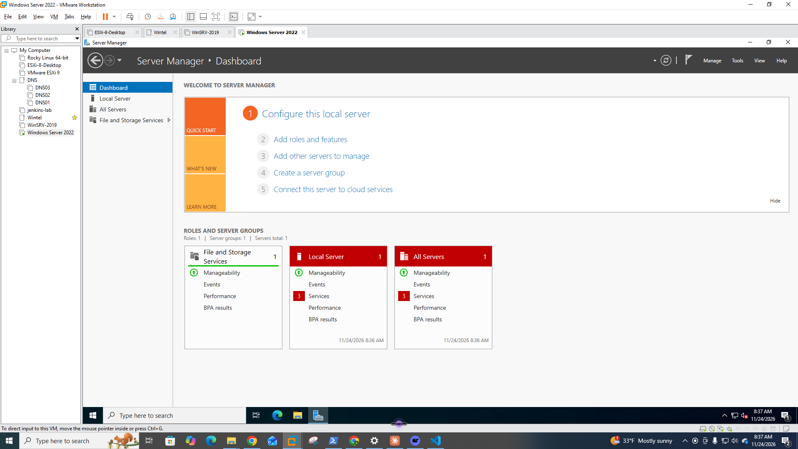

**Kya nazar aata hai:** Server ab **poori VMware window bhar deta hai**. VMware Tools kaam kar raha hai.

**Kaise check karein ke VMware Tools chal raha hai:**
- VMware window ka size badlein to screen bhi badalti hai.
- Mouse baghair `Ctrl + Alt` ke VM se andar baahar jaata hai.
- **VM > Install VMware Tools** ab **Reinstall VMware Tools** ban gaya hai.

**Ghaur karein:** *Services* ab **3** dikhata hai. Kuch services reboot ke thori der baad start hoti hain. **Services** par click karke dekhein kaun si hain; dekhein [Masla 6](TROUBLESHOOTING.roman-urdu.md#masla-6-server-manager-mein-laal-services-alert).

### Step 23: Time zone check karein

**Kya karna hai:** VM ke taskbar mein ghari par right-click > **Adjust date/time**. Yaqeeni banayen ke **Time zone** **(UTC-06:00) Central Time (US & Canada)** (ya aap ka asli zone) hai aur *Adjust for daylight saving time automatically* **On** hai.

**Kyun?** Ghari theek lag rahi ho tab bhi check karein. **Active Directory** mein login **Kerberos** se hota hai, jo clocks mein **5 minute se zyada** farq par fail ho jaata hai. *Central Time (US & Canada)* chunein, *Central America* **nahin**, jis mein daylight saving nahin hoti (2019 ka sabaq).

**Mukammal!** 🎉 Ab aap ke paas chalti hui Windows Server 2022 VM hai.

---

## Kaam ke keyboard shortcuts

| Keys | Kya karti hain |
|------|----------------|
| `Ctrl + G` (ya VM ke andar click) | Keyboard aur mouse VM ke **andar** bhejein. |
| `Ctrl + Alt` | Mouse aur keyboard wapas host ko **chhor dein**. |
| `Ctrl + Alt + Insert` | VM ko **Ctrl + Alt + Del** bhejein (login ya lock ke liye). |
| `Ctrl + Alt + Enter` | Full screen on / off. |

---

## Aage kya karein

1. `Clean install` naam ka **snapshot lein** (**VM > Snapshot > Take Snapshot**). Yeh ek "save point" hai jahan aap wapas ja sakte hain.
2. **Server ka naam badlein**, maslan `SRV2022-01` (Server Manager > Local Server > Computer name).
3. **Static IP address** dein.
4. **Windows Update** chalayen.
5. **Agli lab ka idea:** is server ko apne Server 2019 wale domain mein join karein, ya isey doosra domain controller banayen.

Apni seekh check karein:
- [quiz.html](quiz.html) kholein aur 20/25 ya us se zyada ka target rakhein.
- [INTERVIEW-QA.roman-urdu.md](INTERVIEW-QA.roman-urdu.md) ke jawab buland awaaz mein practice karein.

---

*Lab environment: Windows 10 Pro host, VMware Workstation Pro 25H2, Windows Server 2022 Standard (Desktop Experience). Class lab study guide ke tor par likhi gayi. Is repository mein koi password ya product key nahin hai.*
