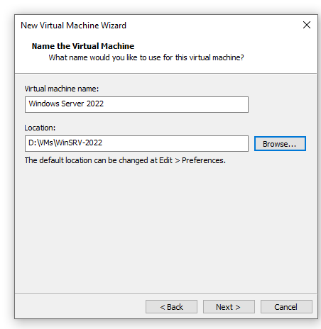
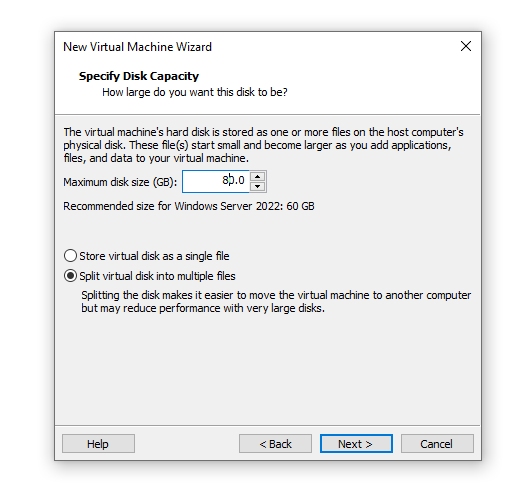
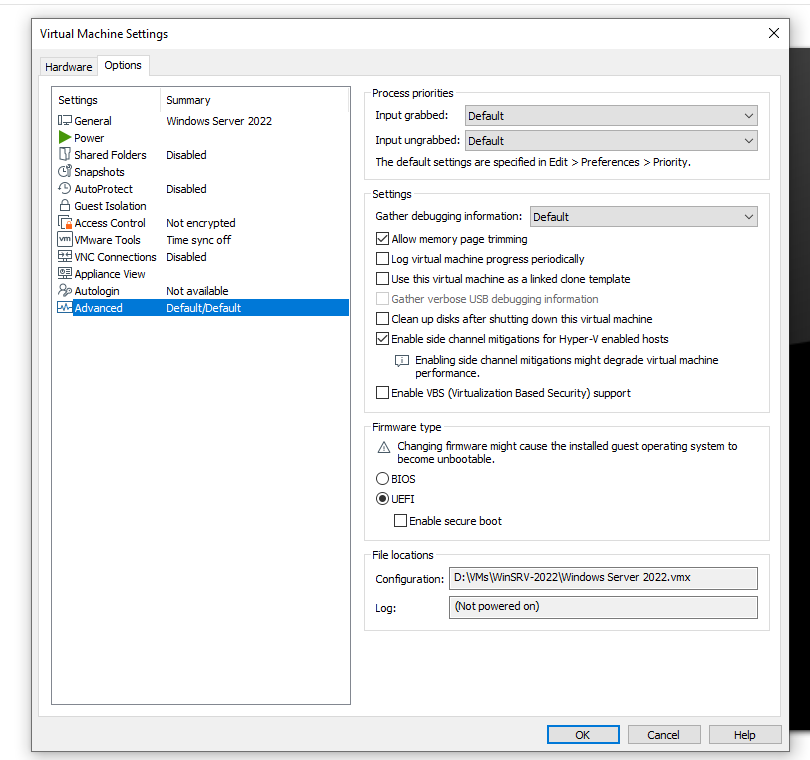
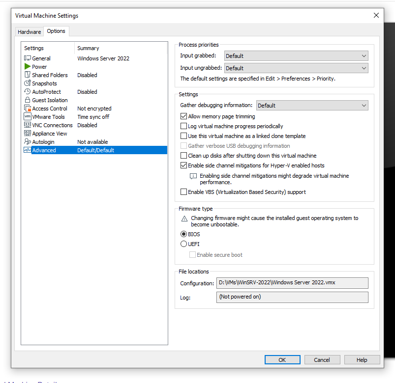
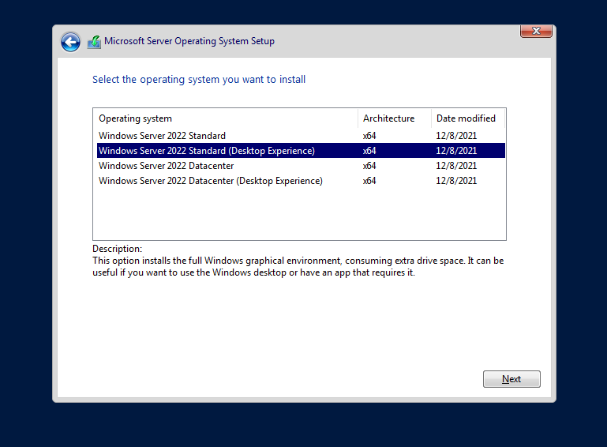
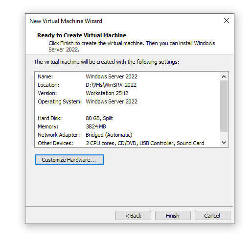
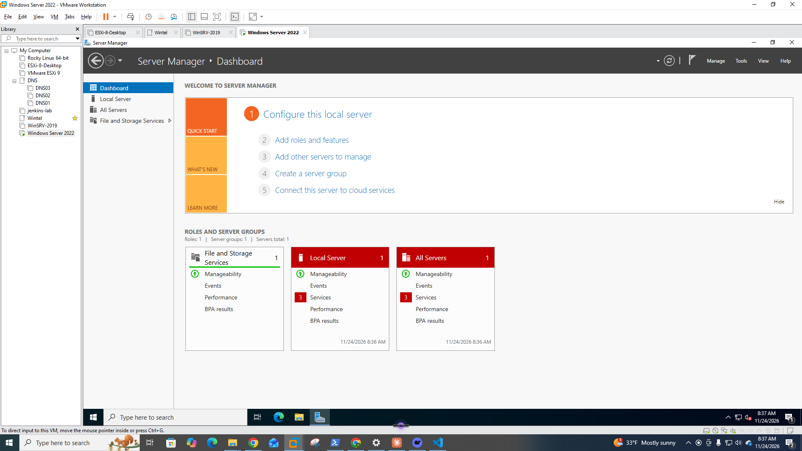
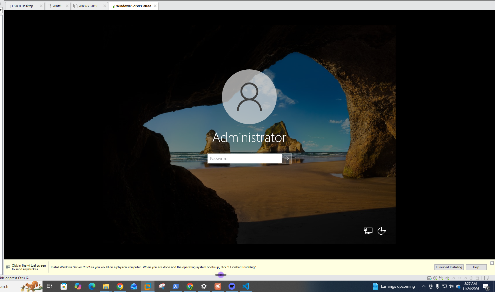
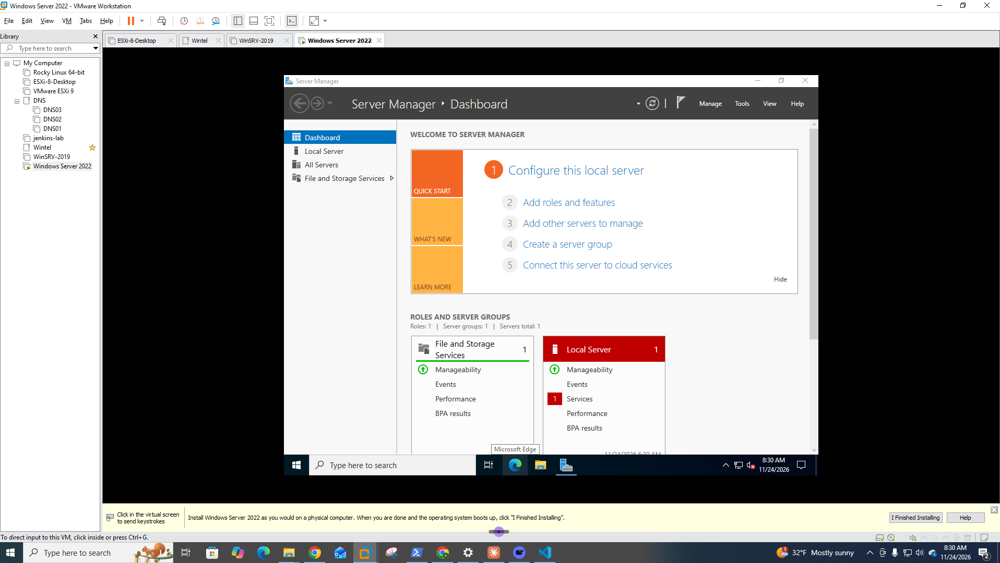

# Troubleshooting: Windows Server 2022 in VMware Workstation Pro

**Language:** English | [Roman Urdu](TROUBLESHOOTING.roman-urdu.md)  ·  Back to the [guide](README.md)

Problems, and things that looked strange, from my Server 2022 lab. Each one follows the same format as the [2019 troubleshooting guide](../WS2019/TROUBLESHOOTING.md):

- **Symptom**: what you see.
- **Cause**: why it happens.
- **Fix**: what to do, step by step.
- **Lesson**: the idea to remember for next time.

Issues 1 to 3 were **avoided** this time, because I applied the 2019 lessons before they could happen. Issues 4 to 8 are **new** in 2022. Issues 9 and 10 are common problems for other students.

## Quick index

| # | Problem | Guide step | Status in my lab |
|---|---------|-----------|------------------|
| 1 | [Default VM location is inside OneDrive](#issue-1-default-vm-location-is-inside-onedrive) | 04 | Avoided |
| 2 | [Virtual disk stored as a single file](#issue-2-virtual-disk-stored-as-a-single-file) | 05 | Avoided |
| 3 | [UEFI Boot Manager instead of Setup](#issue-3-uefi-boot-manager-instead-of-setup) | 09-10 | Avoided |
| 4 | [Edition names do not say "Evaluation"](#issue-4-edition-names-do-not-say-evaluation) | 14 | New |
| 5 | [Memory shows 3824 MB, not 4096 MB](#issue-5-memory-shows-3824-mb-not-4096-mb) | 07-08 | New |
| 6 | [Red "Services" alert in Server Manager](#issue-6-red-services-alert-in-server-manager) | 20, 22 | New |
| 7 | [Yellow "I Finished Installing" bar in VMware](#issue-7-yellow-i-finished-installing-bar-in-vmware) | 19 | New |
| 8 | [VM window is small after first login](#issue-8-vm-window-is-small-after-first-login) | 20-22 | New |
| 9 | [Ctrl + Alt + Del opens the host's menu](#issue-9-ctrl--alt--del-opens-the-hosts-menu) | 19 | For others |
| 10 | [Setup starts again after a restart](#issue-10-setup-starts-again-after-a-restart) | 17 | For others |

---

## Issue 1: Default VM location is inside OneDrive

**Symptom**
VMware suggests saving the VM in `C:\Users\<you>\OneDrive\Documents\Virtual Machines\...`.

**Cause**
VMware's default folder is inside *Documents*, which OneDrive syncs.

**Fix**
Type the location **`D:\VMs\WinSRV-2022`** in Step 04. To make it permanent: **Edit > Preferences > Workspace > Default location for virtual machines** = `D:\VMs`.

**Lesson**
Keep VMs out of OneDrive (or any sync folder). Syncing huge, always-changing VM files is slow and can **corrupt** the VM.

---

## Issue 2: Virtual disk stored as a single file

**Symptom**
*Store virtual disk as a single file* can be selected by default.

**Fix**
Select **Split virtual disk into multiple files** in Step 05.

**Lesson**
Many smaller files are easier to copy, move and back up (for example to a FAT32 USB stick, which can't hold a file bigger than 4 GB).

---

## Issue 3: UEFI Boot Manager instead of Setup

**Symptom (in 2019)**
On first power-on, a blue **Boot Manager** screen appeared instead of Windows Setup. Choosing the CD-ROM only showed a blinking cursor.

**Cause**
VMware uses **UEFI** firmware by default (screenshot above). With UEFI, the ISO waits only about 5 seconds for *"Press any key to boot from CD or DVD..."*. If you miss it, the VM falls back to the Boot Manager.

**Fix (done before the first boot this time)**
1. **Edit virtual machine settings** > **Options** > **Advanced**.
2. Under **Firmware type**, choose **BIOS**. Click **OK**.

   

3. Power on. Setup starts straight away.

**Lesson**
- Change firmware **only before** installing the OS. Changing it later can make Windows unbootable (BIOS uses MBR disks, UEFI uses GPT).
- Prevention is easier than repair: this time there was no problem at all.

---

## Issue 4: Edition names do not say "Evaluation"

**Symptom**
The edition list shows *Windows Server 2022 Standard* and *Datacenter*, **without** the word "Evaluation". In 2019 the names said "Evaluation".

**Cause**
The ISO used was **not** the Evaluation Center trial ISO. It is a regular (retail or volume) ISO, which expects a **product key** for activation.

**What it means**
- Windows still installs and works normally for a class lab.
- Without a key, Windows stays **not activated**. You'll see an "Activate Windows" watermark, and some personalization settings are locked. Server roles still work.
- In my lab **no product key screen appeared** during Setup. If you see one, click **I don't have a product key** or **Do this later**.

**Fix (only if you need it)**
- For a full 180-day trial, download the **Evaluation** ISO from the Microsoft Evaluation Center and use that instead.
- If your school gives you a key: **Settings > Update & Security > Activation > Change product key**.

**Lesson**
Check the edition names: "Evaluation" means the free 180-day trial. No "Evaluation" means a regular ISO that needs a key to activate. **Never put a product key in GitHub.**

---

## Issue 5: Memory shows 3824 MB, not 4096 MB

**Symptom**
The summary shows **Memory: 3824 MB** (about 3.7 GB) instead of a round 4096 MB.

**Cause**
The memory slider in VMware landed on 3824 MB instead of 4096.

**Fix (optional)**
With the VM powered off: **VM > Settings > Hardware > Memory**, type **4096** and click **OK**.

**Lesson**
Not a real problem. 3.7 GB runs Server 2022 with Desktop Experience fine. You can type an exact number in the box instead of dragging the slider.

---

## Issue 6: Red "Services" alert in Server Manager

**Symptom**
In Server Manager, under *Local Server* and *All Servers*, **Services** has a red number: **1** after first login, **3** after installing VMware Tools.

**Cause**
Server Manager counts services that are set to **Automatic** start but are **not running** right now. On a fresh install this is common and usually harmless:
- Some services start **a bit later** after boot (*Automatic (Delayed Start)*) or only when something needs them (*trigger start*).
- Some update services (like the Microsoft Edge update service) run, finish their job, and stop again.
- After VMware Tools and a restart, Server Manager may count again before everything has started.

**Fix**
1. Click **Services** (the red number) to see the list of stopped services.
2. Wait a few minutes, then click the **refresh** icon at the top of Server Manager. The number often goes down.
3. If a service you need is stopped, right-click it > **Start Services**.

**Lesson**
A red alert in Server Manager is a "please look at this", not always an error. **Read what it says before you change anything.**

---

## Issue 7: Yellow "I Finished Installing" bar in VMware

**Symptom**
A yellow bar at the bottom of VMware says *"Install Windows Server 2022 as you would on a physical computer. When you are done... click 'I Finished Installing'."*

**Cause**
We chose *"I will install the operating system later"*, so VMware shows a reminder until you tell it the install is done.

**Fix**
Click **I Finished Installing** (or the small **x** on the bar).

**Lesson**
It is only a reminder. It does not change the VM.

---

## Issue 8: VM window is small after first login

**Symptom**
After the first login, the server's screen sits in a small box in the middle of the VMware window, and the mouse feels slow.

**Cause**
**VMware Tools** is not installed yet, so Windows uses a basic display driver.

**Fix**
Install VMware Tools (Step 21) and restart. The screen then fills the window.

**Lesson**
Install VMware Tools first, right after the first login, on every VMware VM.

---

## Issue 9: Ctrl + Alt + Del opens the host's menu

**Symptom**
Pressing `Ctrl + Alt + Del` at the VM's lock screen opens **your host's** (Windows 10) menu.

**Cause**
The host always catches `Ctrl + Alt + Del` first.

**Fix**
Press **`Ctrl + Alt + Insert`**, or use **VM > Send Ctrl+Alt+Del**.

---

## Issue 10: Setup starts again after a restart

**Symptom**
After Setup restarts the VM, the "Install now" screen appears again.

**Cause**
A key was pressed at *"Press any key to boot from CD or DVD..."*, so the VM booted from the ISO again instead of the new disk.

**Fix**
Restart the VM and **don't press any key**. It will boot from the disk and continue. If it keeps happening, after Setup finishes go to **VM > Settings > CD/DVD** and untick **Connect at power on**.

---

## Still stuck?

1. Read the error message slowly and search the exact text online.
2. Check VMware's log: the `vmware.log` file in `D:\VMs\WinSRV-2022`.
3. Ask a classmate or your instructor, and share a screenshot of the error (never your password or product key).
