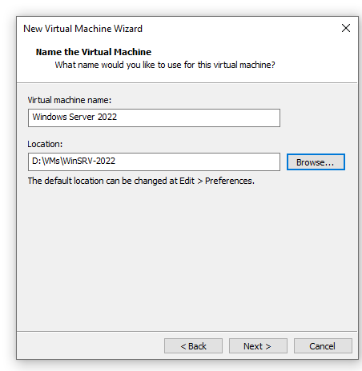
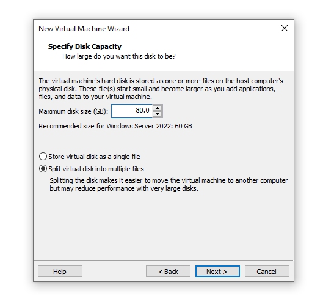
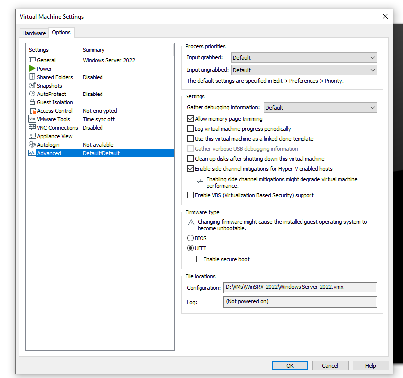
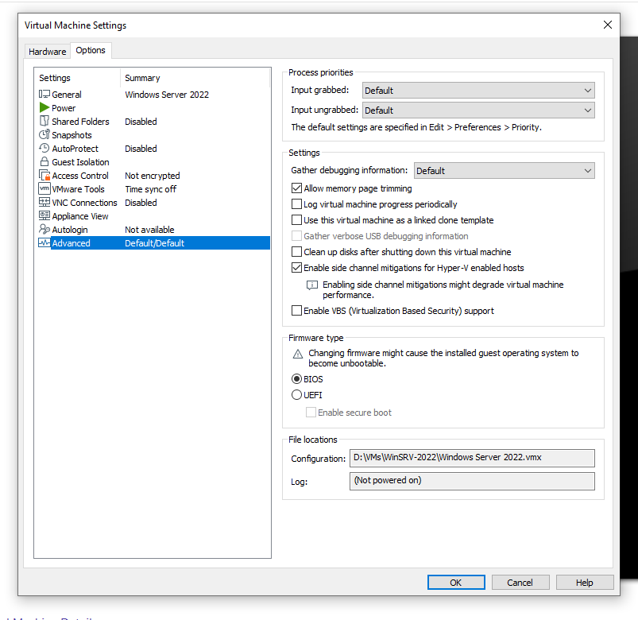
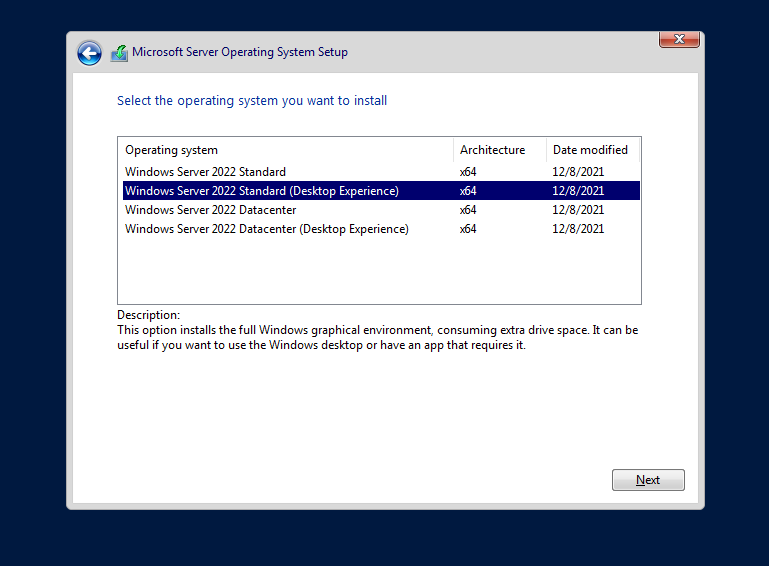
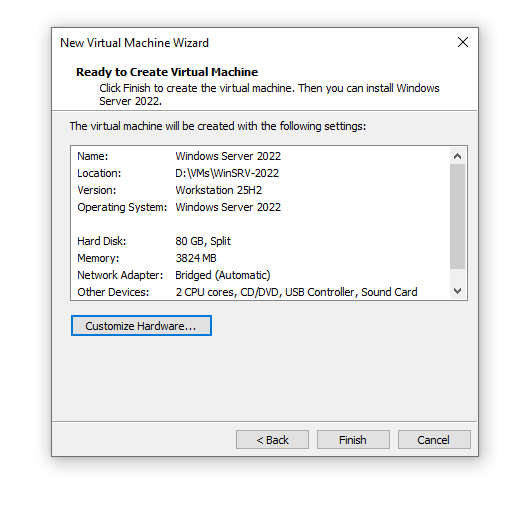
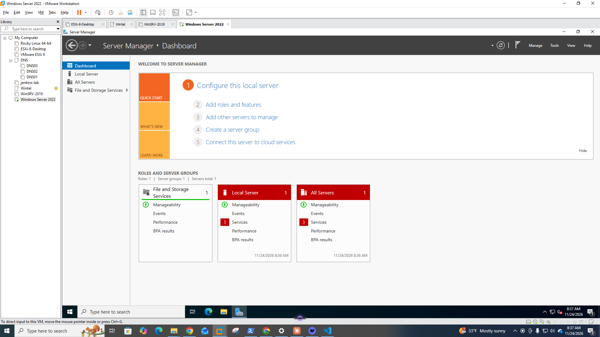
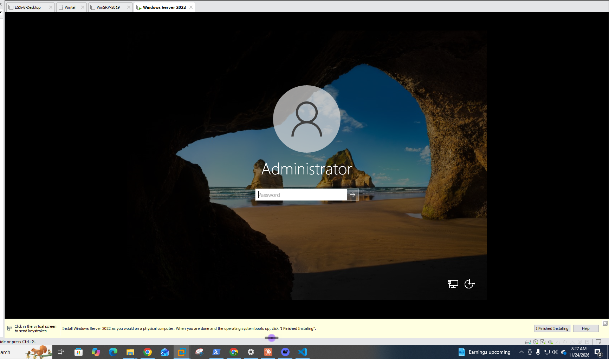
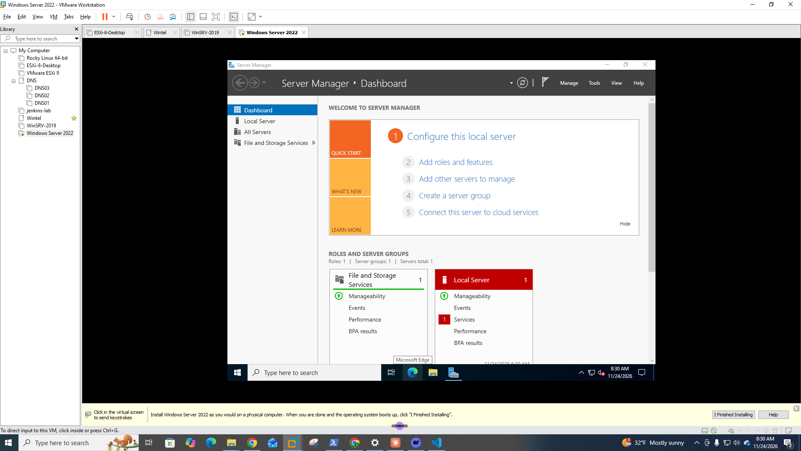

# Troubleshooting: VMware Workstation Pro mein Windows Server 2022

**Zabaan (Language):** [English](TROUBLESHOOTING.md) | Roman Urdu  ·  Wapas [guide](README.roman-urdu.md) par

Meri Server 2022 lab ke masle, aur woh cheezen jo ajeeb lagin. Har ek [2019 troubleshooting guide](../WS2019/TROUBLESHOOTING.roman-urdu.md) wale format mein hai:

- **Alaamat**: aap ko kya nazar aata hai.
- **Wajah**: aisa kyun hota hai.
- **Hal**: kya karna hai, step by step.
- **Sabaq**: agli dafa ke liye yaad rakhne wali baat.

Masla 1 se 3 is dafa **aaye hi nahin**, kyun ke maine 2019 ke sabaq pehle se laga diye the. Masla 4 se 8 2022 mein **naye** hain. Masla 9 aur 10 doosre students ke aam masle hain.

## Fehrist (Quick index)

| # | Masla | Guide step | Meri lab mein |
|---|-------|-----------|---------------|
| 1 | [Default VM location OneDrive ke andar hai](#masla-1-default-vm-location-onedrive-ke-andar-hai) | 04 | Bach gaye |
| 2 | [Virtual disk ek hi file mein](#masla-2-virtual-disk-ek-hi-file-mein) | 05 | Bach gaye |
| 3 | [Setup ki jagah UEFI Boot Manager](#masla-3-setup-ki-jagah-uefi-boot-manager) | 09-10 | Bach gaye |
| 4 | [Edition ke naam mein "Evaluation" nahin likha](#masla-4-edition-ke-naam-mein-evaluation-nahin-likha) | 14 | Naya |
| 5 | [Memory 4096 MB ki jagah 3824 MB](#masla-5-memory-4096-mb-ki-jagah-3824-mb) | 07-08 | Naya |
| 6 | [Server Manager mein laal "Services" alert](#masla-6-server-manager-mein-laal-services-alert) | 20, 22 | Naya |
| 7 | [VMware mein peeli "I Finished Installing" patti](#masla-7-vmware-mein-peeli-i-finished-installing-patti) | 19 | Naya |
| 8 | [Pehle login ke baad VM window chhoti](#masla-8-pehle-login-ke-baad-vm-window-chhoti) | 20-22 | Naya |
| 9 | [Ctrl + Alt + Del host ka menu khol deta hai](#masla-9-ctrl--alt--del-host-ka-menu-khol-deta-hai) | 19 | Doosron ke liye |
| 10 | [Restart ke baad Setup dobara shuru](#masla-10-restart-ke-baad-setup-dobara-shuru) | 17 | Doosron ke liye |

---

## Masla 1: Default VM location OneDrive ke andar hai

**Alaamat**
VMware VM ko `C:\Users\<aap>\OneDrive\Documents\Virtual Machines\...` mein save karne ka mashwara deta hai.

**Wajah**
VMware ka default folder *Documents* ke andar hai, jise OneDrive sync karta hai.

**Hal**
Step 04 mein location **`D:\VMs\WinSRV-2022`** likhein. Hamesha ke liye: **Edit > Preferences > Workspace > Default location for virtual machines** = `D:\VMs`.

**Sabaq**
VMs ko OneDrive (ya kisi bhi sync folder) se door rakhein. Bari aur har waqt badalne wali VM files sync karna slow hai aur VM ko **kharab** kar sakta hai.

---

## Masla 2: Virtual disk ek hi file mein

**Alaamat**
*Store virtual disk as a single file* default mein select ho sakta hai.

**Hal**
Step 05 mein **Split virtual disk into multiple files** select karein.

**Sabaq**
Kai chhoti files copy, move aur backup karna aasaan hai (maslan FAT32 USB par, jo 4 GB se bari file nahin rakh sakti).

---

## Masla 3: Setup ki jagah UEFI Boot Manager

**Alaamat (2019 mein)**
Pehli dafa on karne par Windows Setup ki jagah neeli **Boot Manager** screen aayi. CD-ROM chunne par sirf blinking cursor nazar aaya.

**Wajah**
VMware default mein **UEFI** firmware istemal karta hai (upar screenshot). UEFI ke saath ISO *"Press any key to boot from CD or DVD..."* ke liye sirf taqreeban 5 second rukti hai. Chook jaayen to VM Boot Manager par chali jaati hai.

**Hal (is dafa pehli boot se pehle kiya)**
1. **Edit virtual machine settings** > **Options** > **Advanced**.
2. **Firmware type** mein **BIOS** chunein. **OK** dabayen.

   

3. Power on karein. Setup foran shuru ho jaata hai.

**Sabaq**
- Firmware **sirf OS install karne se pehle** badlein. Baad mein badalne se Windows boot nahin hoti (BIOS MBR disk istemal karta hai, UEFI GPT).
- Bachao ilaaj se behtar hai: is dafa koi masla hi nahin aaya.

---

## Masla 4: Edition ke naam mein "Evaluation" nahin likha

**Alaamat**
Edition list mein *Windows Server 2022 Standard* aur *Datacenter* hain, lekin lafz "Evaluation" **nahin**. 2019 mein naamon mein "Evaluation" tha.

**Wajah**
Jo ISO istemal hui woh Evaluation Center wali trial ISO **nahin** thi. Yeh aam (retail ya volume) ISO hai, jo activate hone ke liye **product key** maangti hai.

**Is ka matlab**
- Windows phir bhi install hoti hai aur class lab ke liye normal chalti hai.
- Key ke baghair Windows **activate nahin** hoti. "Activate Windows" ka watermark nazar aata hai, aur kuch personalization settings band hoti hain. Server roles phir bhi chalte hain.
- Meri lab mein Setup ke dauran **product key ki screen nahin aayi**. Agar aap ko aaye to **I don't have a product key** ya **Do this later** dabayen.

**Hal (sirf agar zaroorat ho)**
- Poore 180 din ki trial ke liye Microsoft Evaluation Center se **Evaluation** ISO download karke woh istemal karein.
- Agar school ne key di hai: **Settings > Update & Security > Activation > Change product key**.

**Sabaq**
Edition ke naam check karein: "Evaluation" = free 180 din ki trial. "Evaluation" nahin = aam ISO jise activate karne ke liye key chahiye. **Product key kabhi GitHub mein na daalein.**

---

## Masla 5: Memory 4096 MB ki jagah 3824 MB

**Alaamat**
Summary mein **Memory: 3824 MB** (taqreeban 3.7 GB) hai, poore 4096 MB nahin.

**Wajah**
VMware ka memory slider 4096 ki jagah 3824 MB par ruk gaya.

**Hal (marzi par)**
VM band ho to: **VM > Settings > Hardware > Memory**, **4096** likhein aur **OK** dabayen.

**Sabaq**
Asal masla nahin. 3.7 GB mein Server 2022 Desktop Experience ke saath theek chalta hai. Slider ghaseetne ki jagah box mein seedha number likh sakte hain.

---

## Masla 6: Server Manager mein laal "Services" alert

**Alaamat**
Server Manager mein *Local Server* aur *All Servers* ke neeche **Services** par laal number hai: pehle login par **1**, VMware Tools ke baad **3**.

**Wajah**
Server Manager un services ko ginta hai jo **Automatic** start par set hain lekin is waqt **chal nahin rahin**. Naye install par yeh aam hai aur aksar be-zarar:
- Kuch services boot ke **thori der baad** start hoti hain (*Automatic (Delayed Start)*), ya sirf tab jab koi cheez unhen bulaye (*trigger start*).
- Kuch update services (jaise Microsoft Edge ki update service) apna kaam karke ruk jaati hain.
- VMware Tools aur restart ke baad, Server Manager sab services start hone se pehle hi gin leta hai.

**Hal**
1. **Services** (laal number) par click karke ruki hui services ki list dekhein.
2. Chand minute intezar karein, phir Server Manager ke upar **refresh** icon dabayen. Number aksar kam ho jaata hai.
3. Agar zaroori service ruki hai to right-click > **Start Services**.

**Sabaq**
Server Manager ka laal alert "zara dekh lein" ka ishara hai, hamesha ghalti nahin. **Kuch badalne se pehle parhein ke kya likha hai.**

---

## Masla 7: VMware mein peeli "I Finished Installing" patti

**Alaamat**
VMware ke neeche peeli patti likhti hai: *"Install Windows Server 2022 as you would on a physical computer. When you are done... click 'I Finished Installing'."*

**Wajah**
Hum ne *"I will install the operating system later"* chuna tha, is liye VMware yaad dihaani karta rehta hai jab tak aap na batayen ke install mukammal hai.

**Hal**
**I Finished Installing** dabayen (ya patti par chhota **x**).

**Sabaq**
Yeh sirf yaad dihaani hai. VM mein kuch nahin badalta.

---

## Masla 8: Pehle login ke baad VM window chhoti

**Alaamat**
Pehle login ke baad server ki screen VMware window ke beech mein chhote se dabbe mein hoti hai, aur mouse slow lagta hai.

**Wajah**
**VMware Tools** abhi install nahin hue, is liye Windows basic display driver istemal karti hai.

**Hal**
VMware Tools install karein (Step 21) aur restart karein. Screen poori window bhar degi.

**Sabaq**
Har VMware VM par pehle login ke foran baad VMware Tools install karein.

---

## Masla 9: Ctrl + Alt + Del host ka menu khol deta hai

**Alaamat**
VM ki lock screen par `Ctrl + Alt + Del` dabane se **aap ke host** (Windows 10) ka menu khulta hai.

**Wajah**
Host hamesha `Ctrl + Alt + Del` pehle pakar leta hai.

**Hal**
**`Ctrl + Alt + Insert`** dabayen, ya **VM > Send Ctrl+Alt+Del** istemal karein.

---

## Masla 10: Restart ke baad Setup dobara shuru

**Alaamat**
Setup ke VM restart karne ke baad "Install now" screen dobara aa jaati hai.

**Wajah**
*"Press any key to boot from CD or DVD..."* par koi key dab gayi, is liye VM nayi disk ki jagah phir se ISO se boot hui.

**Hal**
VM restart karein aur **koi key na dabayen**. Woh disk se boot hokar aage chalegi. Agar baar baar ho to Setup mukammal hone ke baad **VM > Settings > CD/DVD** mein **Connect at power on** ka tick hata dein.

---

## Phir bhi atke hue hain?

1. Error message aahista parhein aur exact text online search karein.
2. VMware ka log dekhein: `D:\VMs\WinSRV-2022` mein `vmware.log` file.
3. Kisi classmate ya instructor se poochein, aur error ka screenshot dikhayen (password ya product key kabhi nahin).
